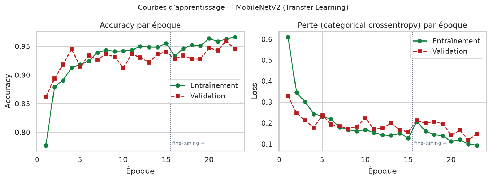
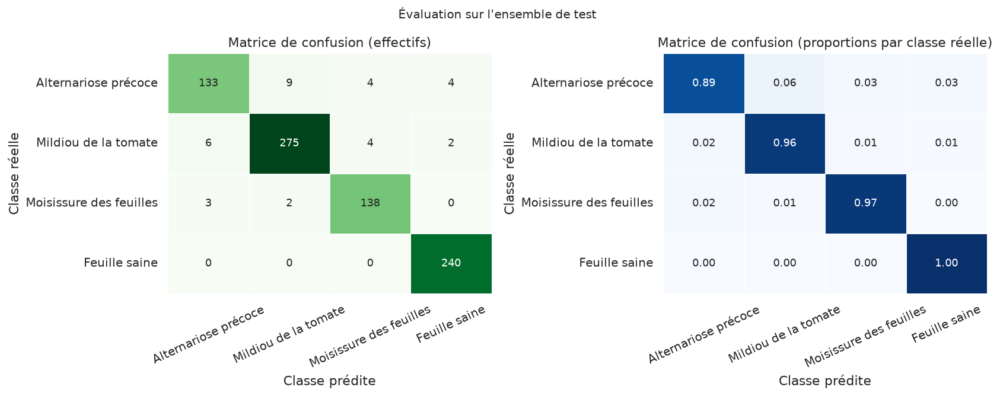
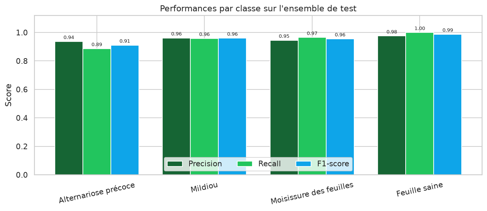
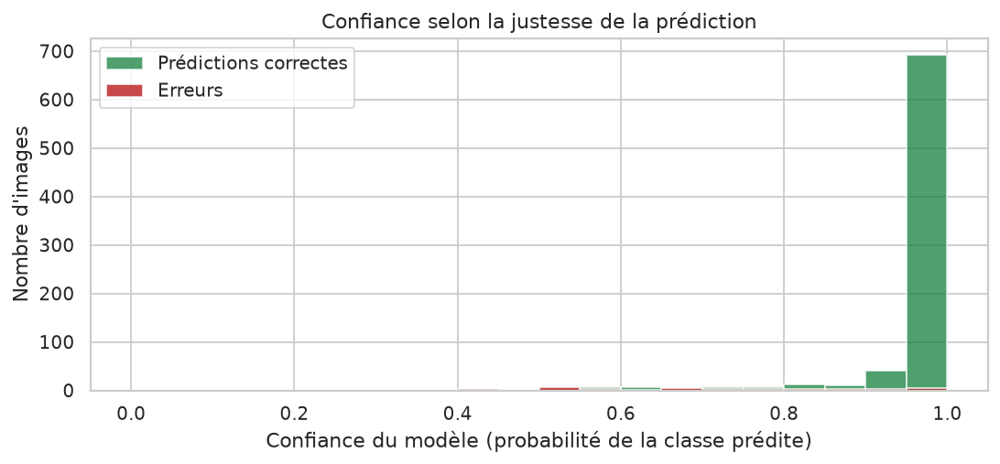
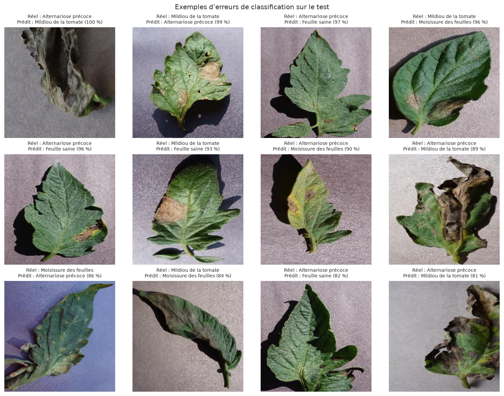

# Fiche expérimentale — Détection des maladies de la feuille de tomate

**Modèle** : MobileNetV2 + Transfer Learning  
**Expérience réalisée le** : 2026-11-06  
**Environnement** : Python 3.12.3, TensorFlow 2.21.0, CPU (sans GPU)  
**Fiche générée le** : 13/11/2026

## 1. Paramètres d'entraînement

| Paramètre | Valeur |
| --- | --- |
| Taille d'image | 224 × 224 × 3 |
| Batch size | 32 |
| Optimiseur | Adam |
| Perte | categorical_crossentropy |
| Époques phase 1 (effectuées / max) | 15 / 15 |
| Learning rate phase 1 | 0.001 |
| Époques phase 2 (fine-tuning) | 8 |
| Learning rate phase 2 | 1e-05 |
| Couches dégelées | 19 |
| Graine aléatoire | 42 |
| Early Stopping | patience 5 sur val_loss |
| Model Checkpoint | meilleur val_accuracy (best_model.keras) |
| Paramètres totaux | 2 422 468 |
| Paramètres entraînables (phase 1) | 164 484 |

Data Augmentation : rotation ±5 %, zoom ±10 %, retournement horizontal, luminosité ±15 %, translation ±5 %.

## 2. Effectifs par classe

| Classe | Dataset brut | Entraînement | Validation | Test |
| --- | --- | --- | --- | --- |
| Alternariose précoce (Tomato___Early_blight) | 1000 | 700 | 150 | 150 |
| Mildiou (Tomato___Late_blight) | 1909 | 1334 | 288 | 287 |
| Moisissure des feuilles (Tomato___Leaf_Mold) | 952 | 666 | 143 | 143 |
| Feuille saine (Tomato___healthy) | 1591 | 1111 | 240 | 240 |
| **Total** | **5452** | **3811** | **821** | **820** |

Découpage stratifié, graine 42, 14 doublons exacts regroupés, 0 image(s) illisible(s).

## 3. Courbes d'apprentissage

Meilleure accuracy de validation : **95,98 %** (époque 22, sur 23 époques).

| Phase | Époques | Meilleure val_accuracy | Durée |
| --- | --- | --- | --- |
| Phase 1 — base gelée | 15 | 94,52 % | 23.43 min |
| Phase 2 — fine-tuning | 8 | 95,98 % | 14.29 min |

## 4. Métriques sur l'ensemble de test

| Métrique | Valeur |
| --- | --- |
| Accuracy | **95,85 %** |
| Precision (macro) | 95,47 % |
| Recall (macro) | 95,25 % |
| F1-score (macro) | **95,34 %** |
| F1-score (pondéré) | 95,82 % |
| Images de test | 820 |
| Images mal classées | 34 (4,15 %) |

## 5. Matrice de confusion

| Réel \ Prédit | Alternariose précoce | Mildiou | Moisissure des feuilles | Feuille saine |
| --- | --- | --- | --- | --- |
| Alternariose précoce | 133 | 9 | 4 | 4 |
| Mildiou | 6 | 275 | 4 | 2 |
| Moisissure des feuilles | 3 | 2 | 138 | 0 |
| Feuille saine | 0 | 0 | 0 | 240 |

## 6. Résultats par classe

| Classe | Precision | Recall | F1-score | Support | Bien classées | Confiance moyenne |
| --- | --- | --- | --- | --- | --- | --- |
| Alternariose précoce | 93,66 % | 88,67 % | 91,10 % | 150 | 133 | 91,44 % |
| Mildiou | 96,15 % | 95,82 % | 95,99 % | 287 | 275 | 95,81 % |
| Moisissure des feuilles | 94,52 % | 96,50 % | 95,50 % | 143 | 138 | 97,31 % |
| Feuille saine | 97,56 % | 100,00 % | 98,77 % | 240 | 240 | 99,62 % |

## 7. Confiance et analyse des erreurs

| Indicateur | Valeur |
| --- | --- |
| Confiance moyenne (prédictions correctes) | 97,52 % |
| Confiance moyenne (erreurs) | 70,23 % |
| Confiance médiane | 99,95 % |
| Erreurs | 34 / 820 (4,15 %) |

| Confusion observée | Nombre de cas |
| --- | --- |
| Alternariose précoce → Mildiou | 9 |
| Mildiou → Alternariose précoce | 6 |
| Alternariose précoce → Feuille saine | 4 |
| Mildiou → Moisissure des feuilles | 4 |
| Alternariose précoce → Moisissure des feuilles | 4 |

## 8. Observations et difficultés rencontrées

- **Convergence très rapide de la phase 1** : dès la première époque, la validation atteint 86,2 %, ce qui confirme la qualité des caractéristiques ImageNet.
- **Le fine-tuning apporte un gain modeste mais réel** (+1,46 point de validation) ; son learning rate très faible (1e-5) est indispensable pour ne pas détruire les poids pré-entraînés.
- **La validation est irrégulière** (±2 points entre époques voisines) en raison de la taille limitée du jeu de validation (821 images) et de l'augmentation aléatoire.
- **L'alternariose précoce est la classe la plus difficile** : ses lésions brunes la rapprochent du mildiou, ce qui explique la majorité des confusions.
- **Le modèle est sur-confiant** : la confiance médiane dépasse 99 %, ce qui justifie l'affichage de la distribution complète des probabilités dans l'application.
- **Budget d'entraînement contraint** : 23 époques au total sur un processeur à deux cœurs (≈ 38 minutes), contre 30 + 15 époques prévues par la configuration.
- **Dataset de laboratoire** : les images ont un fond uniforme ; les performances mesurées ne préjugent pas du comportement sur des photos de terrain.
- **Doublons** : 14 images identiques ont été détectées et regroupées pour éviter toute fuite entre entraînement et test.

## 9. Conclusion de l'expérience

Le modèle MobileNetV2 adapté par Transfer Learning atteint **95,85 % d'accuracy** et un **F1-score macro de 95,34 %** sur 820 images de test indépendantes, avec un temps d'inférence d'environ 70 ms par image sur CPU. Ces résultats confirment la faisabilité d'un outil local d'aide à la reconnaissance visuelle, dans les limites du périmètre étudié.

## 10. Fichiers de référence

| Ressource | Fichier |
| --- | --- |
| Configuration complète | `models/training_config.json` |
| Historique des époques | `results/metrics/training_history.json` |
| Rapport de classification | `results/metrics/classification_report.txt` |
| Métriques détaillées | `results/metrics/evaluation.json` |
| Prédictions du test | `results/predictions/predictions_test.csv` |
| Erreurs détaillées | `results/predictions/erreurs.csv` |
