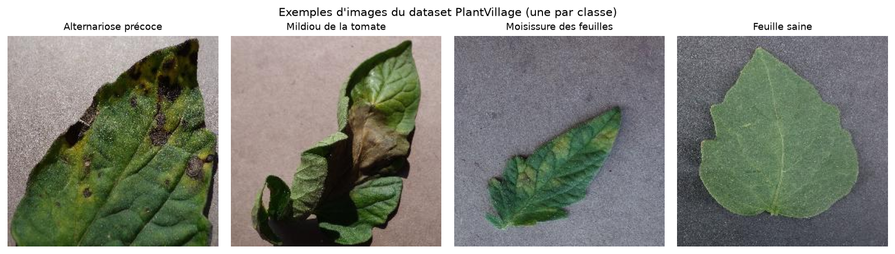
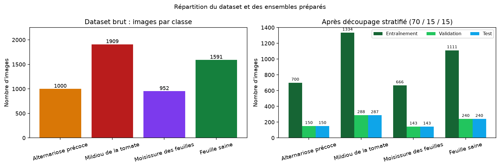
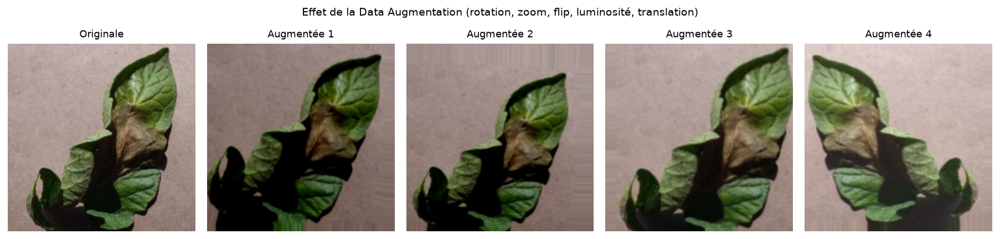
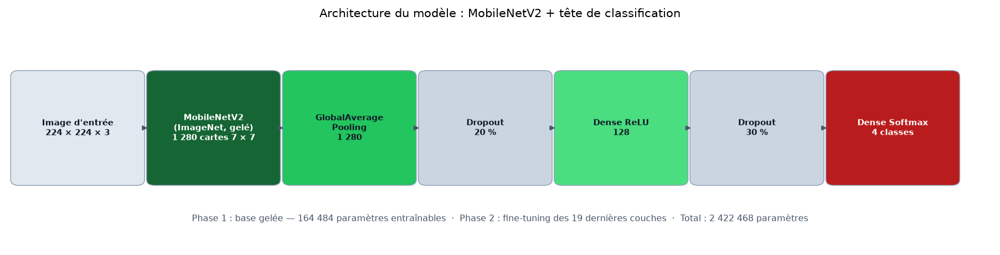

## 7. Présentation et exploration du dataset

### 7.1 Origine des données

Le dataset utilisé est **PlantVillage**, un dépôt public d'images de feuilles de plantes
saines et malades. Il a été introduit par Hughes et Salathé (2015) et constitue la
référence de nombreux travaux en vision par ordinateur appliquée à l'agriculture.

- **Source** : dépôt GitHub officiel `spMohanty/PlantVillage-Dataset`, dossier
  `raw/color` (images couleur d'origine, 256 × 256 pixels) ;
- **Article associé** : Mohanty, Hughes et Salathé (2016), *Using Deep Learning for
  Image-Based Plant Disease Detection*, Frontiers in Plant Science, 7:1419 ;
- **Périmètre retenu** : 4 classes de tomate, soit **5 452 images**.

Le dépôt officiel ne comporte pas de fichier de licence explicite. Les images sont
diffusées à des fins de recherche ; elles ont donc été utilisées dans un cadre
strictement académique et **ne sont pas redistribuées** dans le dépôt du projet. Le
script `training/download_dataset.py` permet à quiconque de les récupérer depuis la
source d'origine.

### 7.2 Classes et effectifs

| Code de classe | Nom français | Agent pathogène | Images |
| --- | --- | --- | --- |
| `Tomato___Early_blight` | Alternariose précoce | *Alternaria solani* (champignon) | 1 000 |
| `Tomato___Late_blight` | Mildiou de la tomate | *Phytophthora infestans* (oomycète) | 1 909 |
| `Tomato___Leaf_Mold` | Moisissure des feuilles | *Passalora fulva* (champignon) | 952 |
| `Tomato___healthy` | Feuille saine | — | 1 591 |
| **Total** | | | **5 452** |

*Tableau 3 — Classes retenues et effectifs du dataset.*

Le dataset est **déséquilibré** : la classe la plus représentée (mildiou, 1 909 images)
contient deux fois plus d'images que la classe la moins représentée (moisissure,
952 images). Ce déséquilibre doit être pris en compte, sous peine d'obtenir un modèle
qui prédit plus volontiers les classes majoritaires.

*Figure 1 — Exemples d'images du dataset (une par classe).*

### 7.3 Contrôle qualité

Avant toute utilisation, chaque fichier a été vérifié :

- ouverture et décodage complet par Pillow : **0 image illisible** sur 5 452 ;
- vérification des dimensions : toutes les images sont en 256 × 256 pixels, en RGB ;
- calcul d'une empreinte **MD5** pour chaque fichier : **14 doublons exacts** ont été
  détectés (même image présente plusieurs fois dans le dataset).

Les doublons détectés ne sont pas supprimés, car ils correspondent à des images
légitimement présentes dans leur classe. En revanche, ils sont **regroupés** lors du
découpage afin qu'une même image ne puisse jamais se retrouver simultanément dans
l'ensemble d'entraînement et dans l'ensemble de test.

### 7.4 Découpage des données

Le découpage est réalisé par classe (stratifié), avec la graine aléatoire **42** pour
garantir la reproductibilité, selon les proportions 70 % / 15 % / 15 % :

| Ensemble | Rôle | Images |
| --- | --- | --- |
| Entraînement | Apprentissage des poids | 3 811 |
| Validation | Suivi, Early Stopping, sélection du modèle | 821 |
| Test | Évaluation finale, jamais utilisé pendant l'entraînement | 820 |

*Tableau 4 — Rôle et taille des trois ensembles.*

La répartition détaillée par classe est la suivante :

| Classe | Entraînement | Validation | Test |
| --- | --- | --- | --- |
| Alternariose précoce | 700 | 150 | 150 |
| Mildiou de la tomate | 1 334 | 288 | 287 |
| Moisissure des feuilles | 666 | 143 | 143 |
| Feuille saine | 1 111 | 240 | 240 |
| **Total** | **3 811** | **821** | **820** |

*Tableau 5 — Découpage stratifié détaillé par classe.*

*Figure 2 — Répartition des images par classe, avant et après découpage.*

### 7.5 Garanties contre la fuite de données

La fuite de données (*data leakage*) est l'une des erreurs les plus fréquentes en
apprentissage automatique : si des images très similaires se trouvent à la fois dans
l'entraînement et dans le test, les performances mesurées sont artificiellement
optimistes. Trois mesures ont été prises :

1. **découpage au niveau des fichiers, avant tout calcul de statistiques** ;
2. **regroupement des doublons exacts** dans un même ensemble ;
3. **absence totale d'utilisation du test** pendant l'entraînement et la sélection du
   modèle (le test n'est chargé que par `training/evaluate.py`).

### 7.6 Limites du dataset

- **Images de laboratoire** : les feuilles sont photographiées sur un fond uniforme,
  souvent gris, avec un éclairage contrôlé. Les performances mesurées ne peuvent pas être
  transposées directement à des photos prises au champ.
- **Une seule culture** : le modèle ne connaît que la tomate.
- **Pas de niveau de gravité** : seules les classes sont étiquetées, pas le stade de la
  maladie.
- **Regroupement par feuille** : le dépôt fournit des métadonnées de regroupement par
  feuille (*leaf grouping*) que nous n'avons pas exploitées ; des images d'une même
  feuille sous des angles légèrement différents peuvent donc se retrouver dans deux
  ensembles. C'est une limite reconnue, qui plaide pour une évaluation future plus
  stricte.
- **Quatre classes sur trente-huit** : les autres maladies de la tomate (septoriose,
  brûlure bactérienne, virus de l'enroulement jaune, tache cible, etc.) sont hors
  périmètre et seront de toute façon classées dans l'une des quatre catégories.

## 8. Prétraitement et Data Augmentation

### 8.1 Pipeline de prétraitement

Le prétraitement est **strictement identique** pendant l'entraînement et pendant la
prédiction. Il est centralisé dans `utils/preprocessing.py`, utilisé à la fois par les
scripts d'entraînement et par l'application Flask.

| Étape | Opération | Justification |
| --- | --- | --- |
| 1 | Ouverture et conversion en RGB | Uniformise les images (PNG avec transparence, niveaux de gris, etc.) |
| 2 | Application de l'orientation EXIF | Corrige les photos de smartphone |
| 3 | Redimensionnement en 224 × 224 | Taille d'entrée attendue par MobileNetV2 |
| 4 | Conversion en tableau `float32` | Format numérique attendu par Keras |
| 5 | Normalisation `x / 127.5 - 1` | Ramène les valeurs dans [-1, 1], convention MobileNetV2 |

*Tableau 6 — Pipeline de prétraitement des images.*

La normalisation utilisée reproduit exactement
`tensorflow.keras.applications.mobilenet_v2.preprocess_input`. Un test automatisé
(`tests/test_preprocessing.py`) vérifie cette équivalence numériquement, ce qui garantit
l'absence de décalage de distribution entre l'entraînement et l'inférence : c'est un
point où de nombreux projets échouent silencieusement.

### 8.2 Data Augmentation

La Data Augmentation génère des variantes des images d'entraînement afin d'augmenter la
diversité apparente du dataset et de réduire le sur-apprentissage. Les transformations
retenues sont volontairement modérées, car les images PlantVillage sont déjà cadrées et
centrées :

| Transformation | Paramètre | Effet recherché |
| --- | --- | --- |
| Rotation | ±5 % (≈ ±18°) | Robustesse à l'orientation de la feuille |
| Zoom | ±10 % | Robustesse à la distance de prise de vue |
| Retournement horizontal | aléatoire | Invariance gauche/droite |
| Luminosité | ±15 % | Robustesse aux conditions d'éclairage |
| Translation | ±5 % | Robustesse au cadrage |

*Tableau 7 — Transformations de Data Augmentation.*

Ces couches sont appliquées **uniquement** au jeu d'entraînement et sont inactives à
l'inférence. Elles ne font pas partie du modèle sauvegardé : le prétraitement de
prédiction reste donc simplement « redimensionnement + normalisation ».

*Figure 3 — Exemples de variantes générées par la Data Augmentation sur une même image.*

### 8.3 Gestion du déséquilibre des classes

Deux mécanismes complémentaires ont été mis en place :

1. **poids de classes** lors de la phase 1 : chaque classe reçoit un poids inversement
   proportionnel à son effectif (mildiou ≈ 0,72 ; alternariose ≈ 1,36 ; moisissure
   ≈ 1,43 ; feuille saine ≈ 0,86) ;
2. **métriques par classe** dans l'évaluation, afin de ne pas masquer une classe
   défavorisée par une bonne accuracy globale.

## 9. Architecture du modèle proposé

### 9.1 Vue d'ensemble

Le modèle est construit en Keras selon l'enchaînement suivant :

1. entrée de forme 224 × 224 × 3 ;
2. base **MobileNetV2** pré-entraînée sur ImageNet, sans couche de classification
   (`include_top=False`) ;
3. **GlobalAveragePooling2D** : agrège les 7 × 7 × 1 280 cartes en un vecteur de 1 280 ;
4. **Dropout (0,2)** ;
5. **Dense(128, activation ReLU)** : couche de caractéristiques spécifiques au problème ;
6. **Dropout (0,3)** ;
7. **Dense(4, activation Softmax)** : distribution de probabilités sur les quatre classes.

*Figure 4 — Architecture du modèle : base MobileNetV2 et tête de classification.*

### 9.2 Détail des couches et des paramètres

| Bloc | Type | Sortie | Paramètres |
| --- | --- | --- | --- |
| Entrée | InputLayer | 224 × 224 × 3 | 0 |
| Base | MobileNetV2 (ImageNet) | 7 × 7 × 1 280 | 2 257 984 |
| Agrégation | GlobalAveragePooling2D | 1 280 | 0 |
| Régularisation | Dropout (0,2) | 1 280 | 0 |
| Classification | Dense (ReLU) | 128 | 163 968 |
| Régularisation | Dropout (0,3) | 128 | 0 |
| Sortie | Dense (Softmax) | 4 | 516 |
| **Total** | | | **2 422 468** |

*Tableau 8 — Détail des couches et du nombre de paramètres.*

Les 2 257 984 paramètres de la base sont **gelés** en phase 1 : seuls 164 484 paramètres
sont alors entraînables, soit moins de 7 % du total. Cette réduction drastique explique
la rapidité de convergence observée.

### 9.3 Choix de la fonction de perte et de l'optimiseur

- **Perte** : `categorical_crossentropy`, adaptée à un encodage one-hot des étiquettes
  (les images sont chargées avec `label_mode="categorical"`).
- **Optimiseur** : Adam, avec un learning rate de 1e-3 en phase 1 puis 1e-5 en phase 2.
- **Métrique suivie** : accuracy, complétée par la perte de validation pour l'Early
  Stopping et la réduction du learning rate.

Le choix d'Adam se justifie par sa robustesse et sa convergence rapide sans réglage fin
du pas, ce qui est adapté à un projet où le nombre d'expériences possibles est limité par
le temps de calcul.

## 10. Configuration et processus d'entraînement

### 10.1 Hyperparamètres

| Paramètre | Valeur |
| --- | --- |
| Taille d'image | 224 × 224 × 3 |
| Batch size | 32 |
| Époques maximales (phase 1) | 15 (configuration : 30) |
| Époques maximales (phase 2) | 8 (configuration : 15) |
| Learning rate phase 1 | 1e-3 |
| Learning rate phase 2 | 1e-5 |
| Couches dégelées | 19 (30 dernières couches, BatchNormalization exclues) |
| Perte | Categorical crossentropy |
| Optimiseur | Adam |
| Graine aléatoire | 42 |
| Early Stopping | patience 5 sur `val_loss`, restauration des meilleurs poids |
| Model Checkpoint | sauvegarde si `val_accuracy` s'améliore |
| ReduceLROnPlateau | facteur 0,5, patience 2, learning rate minimal 1e-6 |

*Tableau 9 — Hyperparamètres d'entraînement.*

> **Remarque sur le budget d'époques.** Le nombre maximal d'époques prévu par la
> configuration est de 30 (phase 1) et 15 (phase 2). L'expérience présentée ici a été
> exécutée avec un budget réduit (15 + 8 époques) car elle a été réalisée sur un
> processeur à deux cœurs, sans GPU : chaque époque dure environ 90 secondes. Ce budget
> reste suffisant pour observer la convergence, comme le montrent les courbes.

### 10.2 Environnement d'exécution

| Élément | Valeur |
| --- | --- |
| Processeur | 2 cœurs (x86-64, AVX2) |
| Mémoire | 16 Go |
| GPU | aucun |
| Système | Linux (Ubuntu 24.04) |
| Python | 3.12 |
| TensorFlow | 2.21 (version CPU) |
| Durée phase 1 | 23,4 minutes (15 époques) |
| Durée phase 2 | 14,3 minutes (8 époques) |
| Durée totale | ≈ 38 minutes |

*Tableau 10 — Environnement d'exécution de l'expérience.*

### 10.3 Déroulement de la phase 1

La base MobileNetV2 est gelée et seules les couches de classification apprennent. Dès la
première époque, l'accuracy de validation atteint **86,2 %**, ce qui illustre la qualité
des caractéristiques ImageNet. La progression est rapide : 89,40 % à l'époque 2, 91,84 %
à l'époque 3, puis un maximum de **94,52 % dès l'époque 4**. La validation oscille ensuite
entre 91 % et 94,5 % jusqu'à la fin de la phase.
Le learning rate est réduit automatiquement à 5e-4 puis 2,5e-4 et 1,25e-4, sans gain
supplémentaire sur la validation : le modèle commence à plafonner.

### 10.4 Déroulement de la phase 2 (fine-tuning)

Les 19 dernières couches de la base sont dégelées et ré-entraînées avec un learning rate
de 1e-5. Après une légère dégradation initiale (92,8 % à l'époque 16), la validation
remonte progressivement. Les époques 21 et 22 apportent les meilleurs résultats :

- époque 18 : 92,81 % ;
- époque 20 : 94,76 % ;
- époque 21 : 94,52 % ;
- **époque 22 : 95,98 %** (meilleur modèle retenu) ;
- époque 23 : 94,52 % (légère baisse, non conservée).

Le fine-tuning apporte donc un gain réel de **+1,46 point** d'accuracy de validation par
rapport au meilleur modèle de la phase 1 (94,52 % → 95,98 %). Le meilleur modèle est
sauvegardé automatiquement dans `models/best_model.keras`, avec la contrainte de ne
jamais remplacer un modèle de phase 1 par un modèle de phase 2 moins bon
(`initial_value_threshold`).

### 10.5 Suivi et reproductibilité

Tous les paramètres, comptages, durées et versions de bibliothèques sont enregistrés dans
`models/training_config.json`. L'historique complet des époques est conservé dans
`results/metrics/training_history.json` et `results/metrics/training_log.csv`. La graine
42 est fixée pour Python, NumPy et TensorFlow. Le découpage des données est lui aussi
déterministe. Ces précautions permettent de rejouer l'expérience dans des conditions
comparables.
