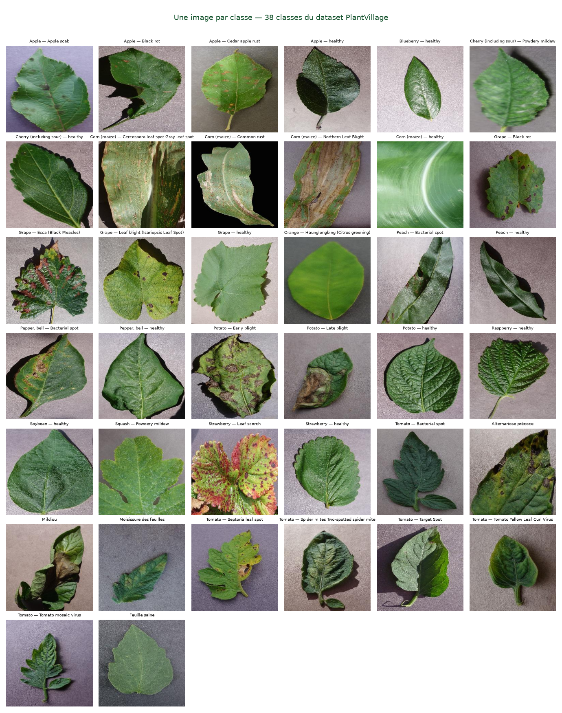
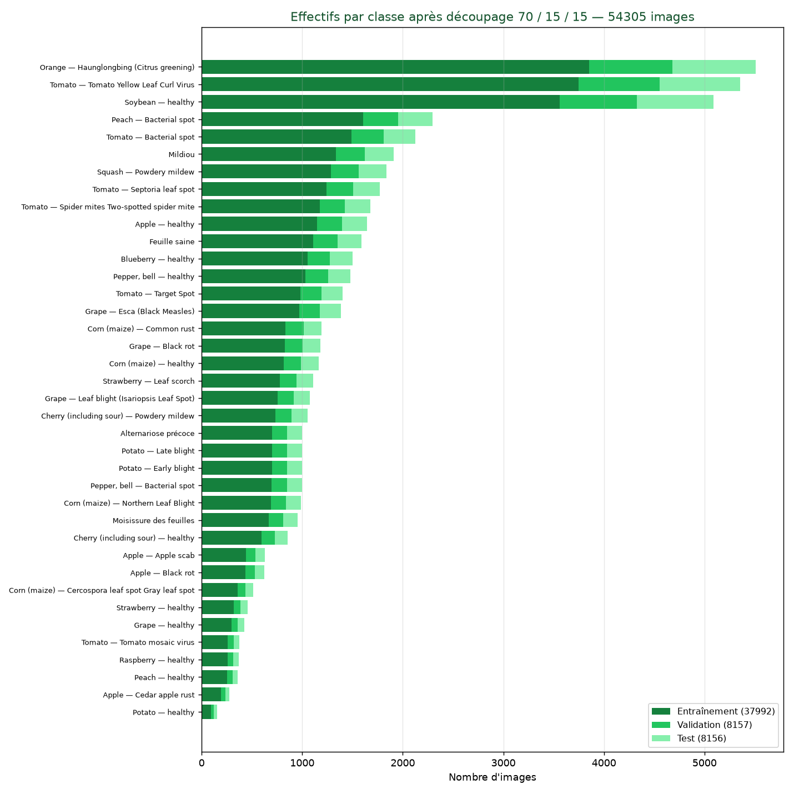
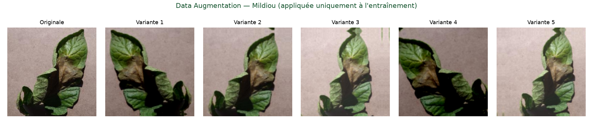
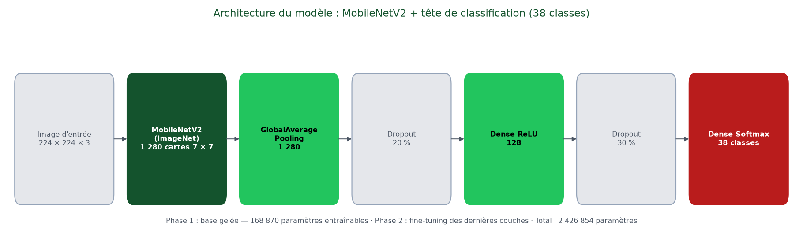

[[PAGEBREAK]]

## 3. Données et préparation

### 3.1. Présentation et exploration du dataset


#### 3.1.1. Origine des données

Le dataset utilisé est **PlantVillage**, un dépôt public d'images de feuilles de plantes
saines et malades. Il a été introduit par Hughes et Salathé (2015) et constitue la
référence de nombreux travaux en vision par ordinateur appliquée à l'agriculture.

- **Source** : dépôt GitHub officiel `spMohanty/PlantVillage-Dataset`, dossier
  `raw/color` (images couleur d'origine, 256 × 256 pixels) ;
- **Article associé** : Mohanty, Hughes et Salathé (2016), *Using Deep Learning for
  Image-Based Plant Disease Detection*, Frontiers in Plant Science, 7:1419 ;
- **Périmètre retenu** : **l'intégralité des 38 classes** couleur, soit
  **54 305 images** réparties sur **14 cultures**.

Le dépôt officiel ne comporte pas de fichier de licence explicite. Les images sont
diffusées à des fins de recherche ; elles ont donc été utilisées dans un cadre
strictement académique et **ne sont pas redistribuées** dans le dépôt du projet. Le
script `training/download_dataset.py` permet à quiconque de les récupérer depuis la
source d'origine par un clone partiel (sparse checkout) limité au dossier couleur.

Le choix des 38 classes, et non d'un sous-ensemble, répond à un objectif précis :
mesurer le comportement du modèle à l'échelle réelle du dataset, où les classes sont
à la fois nombreuses (38 sorties softmax) et très inégalement représentées. Un
sous-ensemble de quatre classes de tomate, beaucoup plus facile, avait servi de
prototype ; il a été abandonné au profit de la version complète.

#### 3.1.2. Classes et effectifs

Les 38 classes couvrent le pommier, la myrtille, la cerise, le maïs, la vigne,
l'orange, la pêche, le poivron, la pomme de terre, la framboise, le soja, la courge,
la fraise et la tomate. Le tableau suivant donne les effectifs réellement comptés
après contrôle qualité.

| Classe | Brut | Entraînement | Validation | Test |
| --- | --- | --- | --- | --- |
| Apple — Apple scab | 630 | 442 | 94 | 94 |
| Apple — Black rot | 621 | 435 | 93 | 93 |
| Apple — Cedar apple rust | 275 | 193 | 41 | 41 |
| Apple — healthy | 1 645 | 1 149 | 248 | 248 |
| Blueberry — healthy | 1 502 | 1 052 | 225 | 225 |
| Cherry (including sour) — Powdery mildew | 1 052 | 736 | 158 | 158 |
| Cherry (including sour) — healthy | 854 | 598 | 128 | 128 |
| Corn (maize) — Cercospora leaf spot Gray leaf spot | 513 | 359 | 77 | 77 |
| Corn (maize) — Common rust | 1 192 | 834 | 179 | 179 |
| Corn (maize) — Northern Leaf Blight | 985 | 689 | 148 | 148 |
| Corn (maize) — healthy | 1 162 | 814 | 174 | 174 |
| Grape — Black rot | 1 180 | 826 | 177 | 177 |
| Grape — Esca (Black Measles) | 1 383 | 969 | 207 | 207 |
| Grape — Leaf blight (Isariopsis Leaf Spot) | 1 076 | 754 | 161 | 161 |
| Grape — healthy | 423 | 297 | 63 | 63 |
| Orange — Haunglongbing (Citrus greening) | 5 507 | 3 855 | 826 | 826 |
| Peach — Bacterial spot | 2 297 | 1 607 | 345 | 345 |
| Peach — healthy | 360 | 252 | 54 | 54 |
| Pepper, bell — Bacterial spot | 997 | 697 | 150 | 150 |
| Pepper, bell — healthy | 1 478 | 1 034 | 222 | 222 |
| Potato — Early blight | 1 000 | 700 | 150 | 150 |
| Potato — Late blight | 1 000 | 700 | 150 | 150 |
| Potato — healthy | 152 | 92 | 30 | 30 |
| Raspberry — healthy | 371 | 259 | 56 | 56 |
| Soybean — healthy | 5 090 | 3 562 | 764 | 764 |
| Squash — Powdery mildew | 1 835 | 1 285 | 275 | 275 |
| Strawberry — Leaf scorch | 1 109 | 777 | 166 | 166 |
| Strawberry — healthy | 456 | 320 | 68 | 68 |
| Tomato — Bacterial spot | 2 127 | 1 489 | 319 | 319 |
| Tomato — Early blight (alternariose précoce) | 1 000 | 700 | 150 | 150 |
| Tomato — Late blight (mildiou) | 1 909 | 1 334 | 288 | 287 |
| Tomato — Leaf Mold (moisissure des feuilles) | 952 | 666 | 143 | 143 |
| Tomato — Septoria leaf spot | 1 771 | 1 239 | 266 | 266 |
| Tomato — Spider mites Two-spotted spider mite | 1 676 | 1 174 | 251 | 251 |
| Tomato — Target Spot | 1 404 | 982 | 211 | 211 |
| Tomato — Tomato Yellow Leaf Curl Virus | 5 357 | 3 749 | 804 | 804 |
| Tomato — Tomato mosaic virus | 373 | 261 | 56 | 56 |
| Tomato — healthy (feuille saine) | 1 591 | 1 111 | 240 | 240 |
| **Total** | **54 305** | **37 992** | **8 157** | **8 156** |

*Tableau 3 — Classes retenues et effectifs réels, avant et après découpage.*

Le dataset est **très déséquilibré** : la classe la plus fournie (orange, 5 507 images)
contient **36 fois** plus d'images que la moins fournie (pomme de terre saine, 152
images). Six classes dépassent 2 000 images alors que quatre en comptent moins de 500.
Ce déséquilibre est traité explicitement (section 8.3), sans quoi le modèle
sacrifierait mécaniquement les classes rares.



*Figure 1 — Une image représentative par classe, sur les 38 classes du dataset.*

#### 3.1.3. Contrôle qualité

Avant toute utilisation, chaque fichier a été vérifié par `training/prepare_data.py` :

- ouverture et décodage complet par Pillow : **0 image illisible** sur 54 305 ;
- vérification des dimensions : toutes les images sont en 256 × 256 pixels, en RGB ;
- calcul d'une empreinte **MD5** sur **l'ensemble du dataset, toutes classes
  confondues**, avant tout découpage (le dictionnaire d'empreintes n'est jamais
  réinitialisé au changement de classe) : **21 groupes de doublons exacts** (21 images
  dupliquées), **0 doublon inter-classes** et **196 groupes de quasi-doublons**
  (empreinte dHash, 263 images dont 56 inter-classes).

La politique est explicite : les copies identiques d'une même classe sont **regroupées**
et tombent dans le même ensemble — sinon une image pourrait figurer à la fois dans
l'entraînement et dans le test et gonfler les performances. Une image identique
étiquetée dans deux classes serait un **conflit d'annotation** : écartée et signalée,
sans choisir de classe arbitrairement. Les quasi-doublons sont seulement **signalés**,
car deux feuilles malades différentes se ressemblent légitimement. Le rapport détaillé
est écrit dans `results/metrics/qualite_donnees.json`, et relancer le découpage redonne
exactement 37 992 / 8 157 / 8 156 images.

#### 3.1.4. Découpage des données

Le découpage est réalisé par classe (stratifié), avec la graine aléatoire **42** pour
garantir la reproductibilité, selon les proportions 70 % / 15 % / 15 % :

| Ensemble | Rôle | Images |
| --- | --- | --- |
| Entraînement | Apprentissage des poids | 37 992 |
| Validation | Suivi, Early Stopping, sélection du modèle | 8 157 |
| Test | Évaluation finale, jamais utilisé pendant l'entraînement | 8 156 |

*Tableau 4 — Rôle et taille des trois ensembles.*



*Figure 2 — Effectifs par classe, empilés par ensemble (entraînement, validation, test).*

Avec 8 156 images de test, l'intervalle de confiance à 95 % sur l'accuracy est de
l'ordre de ±0,4 point : le chiffre final est donc une estimation raisonnablement
précise, ce qui n'était pas le cas du prototype à quatre classes (820 images de test).

#### 3.1.5. Garanties contre la fuite de données

La fuite de données (*data leakage*) est l'une des erreurs les plus fréquentes en
apprentissage automatique : si des images très similaires se trouvent à la fois dans
l'entraînement et dans le test, les performances mesurées sont artificiellement
optimistes. Trois mesures ont été prises :

1. **découpage au niveau des fichiers, avant tout calcul de statistiques** ;
2. **regroupement des doublons exacts** dans un même ensemble ;
3. **absence totale d'utilisation du test** pendant l'entraînement et la sélection du
   modèle (le test n'est chargé que par `training/evaluate.py`).

De plus, la normalisation appliquée est une transformation **déterministe** (aucune
statistique n'est estimée sur les données), et la Data Augmentation est générée à la
volée, uniquement sur le jeu d'entraînement : aucun paramètre appris sur les données
n'est ajusté avant le découpage.

#### 3.1.6. Limites du dataset

- **Images de laboratoire** : les feuilles sont photographiées sur un fond uniforme,
  souvent gris, avec un éclairage contrôlé. Les performances mesurées ne peuvent pas être
  transposées directement à des photos prises au champ.
- **Déséquilibre extrême** : de 152 à 5 507 images selon la classe, soit un rapport de
  36 ; les classes rares (pomme de terre saine, pêche saine, cerise saine) restent les
  plus fragiles à estimer.
- **Pas de niveau de gravité** : seules les classes sont étiquetées, pas le stade de la
  maladie.
- **Regroupement par feuille** : le dépôt fournit des métadonnées de regroupement par
  feuille (*leaf grouping*) que nous n'avons pas exploitées ; des images d'une même
  feuille sous des angles légèrement différents peuvent donc se retrouver dans deux
  ensembles. C'est une limite reconnue, qui plaide pour une évaluation future plus
  stricte.
- **Une seule image par classe et par plante** : le modèle apprend des signatures
  visuelles globales, pas une notion de contexte (parcelle, stade, co-occurrence de
  maladies).

### 3.2. Prétraitement et Data Augmentation


#### 3.2.1. Pipeline de prétraitement

Le prétraitement est **strictement identique** pendant l'entraînement et pendant la
prédiction. Il est centralisé dans `utils/preprocessing.py`, utilisé à la fois par les
scripts d'entraînement et par l'application Flask.

| Étape | Opération | Justification |
| --- | --- | --- |
| 1 | Ouverture et conversion en RGB | Uniformise les images (PNG avec transparence, niveaux de gris, etc.) |
| 2 | Application de l'orientation EXIF | Corrige les photos de smartphone |
| 3 | Redimensionnement en 224 × 224 | Taille d'entrée attendue par MobileNetV2 |
| 4 | Conversion en tableau `float32` | Format numérique attendu par Keras |
| 5 | Normalisation `x / 127.5 - 1` | Ramène les valeurs dans [-1, 1], convention MobileNetV2 |

*Tableau 5 — Pipeline de prétraitement des images.*

La normalisation utilisée reproduit exactement
`tensorflow.keras.applications.mobilenet_v2.preprocess_input`. Un test automatisé
(`tests/test_preprocessing.py`) vérifie cette équivalence numériquement, ce qui garantit
l'absence de décalage de distribution entre l'entraînement et l'inférence : c'est un
point où de nombreux projets échouent silencieusement.

#### 3.2.2. Data Augmentation

La Data Augmentation génère des variantes des images d'entraînement afin d'augmenter la
diversité apparente du dataset et de réduire le sur-apprentissage. Les transformations
retenues sont volontairement modérées, car les images PlantVillage sont déjà cadrées et
centrées :

| Transformation | Paramètre | Effet recherché |
| --- | --- | --- |
| Rotation | ±5 % (≈ ±18°) | Robustesse à l'orientation de la feuille |
| Zoom | ±10 % | Robustesse à la distance de prise de vue |
| Retournement horizontal | aléatoire | Invariance gauche/droite |
| Luminosité | ±15 % | Robustesse aux conditions d'éclairage |
| Translation | ±5 % | Robustesse au cadrage |

*Tableau 6 — Transformations de Data Augmentation.*

Ces couches sont appliquées **uniquement** au jeu d'entraînement et sont inactives à
l'inférence. Elles ne font pas partie du modèle sauvegardé : le prétraitement de
prédiction reste donc simplement « redimensionnement + normalisation ».



*Figure 3 — Une image d'origine et cinq variantes générées par la Data Augmentation.*

#### 3.2.3. Gestion du déséquilibre des classes

Deux mécanismes complémentaires ont été mis en place :

1. **poids de classes** lors de la phase 1 : chaque classe reçoit un poids inversement
   proportionnel à son effectif. Les poids effectifs vont de **0,26** (orange, 3 855
   images d'entraînement) à **10,87** (pomme de terre saine, 92 images), soit un facteur
   42 entre la classe la plus favorisée et la plus pénalisée ;
2. **métriques par classe** dans l'évaluation, afin de ne pas masquer une classe
   défavorisée par une bonne accuracy globale.

Sans ces poids, un modèle qui prédirait toujours la classe majoritaire obtiendrait déjà
47 % d'accuracy sur le test (orange + soja + virus YLCV représentent près de la moitié
des images) : l'accuracy globale, seule, serait trompeuse.

## 4. Méthodologie et entraînement

### 4.1. Architecture du modèle proposé


#### 4.1.1. Vue d'ensemble

Le modèle est construit en Keras selon l'enchaînement suivant :

1. entrée de forme 224 × 224 × 3 ;
2. base **MobileNetV2** pré-entraînée sur ImageNet, sans couche de classification
   (`include_top=False`) ;
3. **GlobalAveragePooling2D** : agrège les 7 × 7 × 1 280 cartes en un vecteur de 1 280 ;
4. **Dropout (0,2)** ;
5. **Dense(128, activation ReLU)** : couche de caractéristiques spécifiques au problème ;
6. **Dropout (0,3)** ;
7. **Dense(38, activation Softmax)** : distribution de probabilités sur les 38 classes.



*Figure 4 — Architecture du modèle : base MobileNetV2 et tête de classification à 38 sorties.*

#### 4.1.2. Détail des couches et des paramètres

| Bloc | Type | Sortie | Paramètres |
| --- | --- | --- | --- |
| Entrée | InputLayer | 224 × 224 × 3 | 0 |
| Base | MobileNetV2 (ImageNet) | 7 × 7 × 1 280 | 2 257 984 |
| Agrégation | GlobalAveragePooling2D | 1 280 | 0 |
| Régularisation | Dropout (0,2) | 1 280 | 0 |
| Classification | Dense (ReLU) | 128 | 163 968 |
| Régularisation | Dropout (0,3) | 128 | 0 |
| Sortie | Dense (Softmax) | 38 | 4 902 |
| **Total** | | | **2 426 854** |

*Tableau 7 — Détail des couches et du nombre de paramètres.*

Les 2 257 984 paramètres de la base sont **gelés** en phase 1 : seuls **168 870**
paramètres sont alors entraînables, soit moins de 7 % du total. Le passage de 4 à 38
classes ne coûte que **4 386 paramètres supplémentaires** (38 × 129 au lieu de 4 × 129) :
l'essentiel de la capacité du modèle se trouve dans la base convolutive partagée.

#### 4.1.3. Choix de la fonction de perte et de l'optimiseur

- **Perte** : `categorical_crossentropy`, adaptée à un encodage one-hot des étiquettes
  (les images sont chargées avec `label_mode="categorical"`).
- **Optimiseur** : Adam, avec un learning rate de 1e-3 en phase 1 puis 1e-5 en phase 2.
- **Métrique suivie** : accuracy, complétée par la perte de validation pour l'Early
  Stopping et la réduction du learning rate.

Le choix d'Adam se justifie par sa robustesse et sa convergence rapide sans réglage fin
du pas, ce qui est adapté à un projet où le nombre d'expériences possibles est limité par
le temps de calcul.

### 4.2. Configuration et processus d'entraînement


#### 4.2.1. Hyperparamètres

| Paramètre | Valeur |
| --- | --- |
| Taille d'image | 224 × 224 × 3 |
| Batch size | 32 |
| Époques (phase 1) | 30 (toutes effectuées) |
| Époques (phase 2) | 15 (toutes effectuées) |
| Learning rate phase 1 | 1e-3 |
| Learning rate phase 2 | 1e-5 |
| Couches dégelées | 19 (les 30 dernières couches, BatchNormalization exclues) |
| Perte | Categorical crossentropy |
| Optimiseur | Adam |
| Graine aléatoire | 42 |
| Early Stopping | patience 5 sur `val_loss`, restauration des meilleurs poids |
| Model Checkpoint | sauvegarde si `val_accuracy` s'améliore |
| ReduceLROnPlateau | facteur 0,5, patience 2, learning rate minimal 1e-6 |

*Tableau 8 — Hyperparamètres d'entraînement.*

Le nombre d'images par époque (37 992) impose 1 188 lots de 32 : une époque dure donc
plusieurs minutes, et le budget complet 30 + 15 époques représente une douzaine d'heures
de calcul. L'Early Stopping n'a pas été déclenché, ce qui signifie que la validation
progressait encore à la dernière époque : le budget maximal a été entièrement consommé.

#### 4.2.2. Environnement d'exécution

| Élément | Valeur |
| --- | --- |
| Processeur | 12 cœurs logiques (x86-64, AVX2), 4 threads alloués à TensorFlow |
| GPU | aucun |
| Système | Windows 11 |
| Python | 3.12.10 |
| TensorFlow | 2.21 (version CPU) |
| Durée phase 1 | 498 minutes (30 époques, ≈ 16,6 min/époque) |
| Durée phase 2 | 267 minutes (15 époques, ≈ 17,8 min/époque) |
| Durée totale | ≈ 765 minutes, soit environ 12 h 45 |

*Tableau 9 — Environnement d'exécution de l'expérience.*

Le nombre de threads a été volontairement limité à 4 sur 12 cœurs logiques afin de
laisser la machine utilisable pendant l'entraînement. C'est un choix assumé : il
multiplie la durée par environ deux par rapport à une utilisation pleine de tous les
cœurs.

#### 4.2.3. Déroulement de la phase 1

La base MobileNetV2 est gelée et seules les couches de classification apprennent. Dès la
première époque, l'accuracy de validation atteint **86,6 %**, ce qui illustre la qualité
des caractéristiques ImageNet. La progression est ensuite régulière :

| Époque | Accuracy entraînement | Accuracy validation | Perte validation |
| --- | --- | --- | --- |
| 1 | 72,42 % | 86,59 % | 0,426 |
| 2 | 84,43 % | 90,46 % | 0,291 |
| 5 | 87,72 % | 91,86 % | 0,253 |
| 10 | 90,90 % | 92,64 % | 0,215 |
| 15 | 92,04 % | 93,94 % | 0,177 |
| 20 | 92,78 % | 94,72 % | 0,161 |
| 25 | 92,78 % | 94,64 % | 0,160 |
| 30 | 92,86 % | 94,70 % | 0,159 |

*Tableau 10 — Phase 1 : suivi de l'apprentissage (extrait du journal réel).*

Le learning rate est réduit automatiquement de 1e-3 à 5e-4, 2,5e-4, 1,25e-4 puis
6,25e-5, et la validation se stabilise autour de **94,7 %**. Le meilleur modèle de la
phase 1 est atteint à l'époque 27, avec **94,75 %** de validation.

#### 4.2.4. Déroulement de la phase 2 (fine-tuning)

Les 19 dernières couches de la base sont dégelées et ré-entraînées avec un learning rate
de 1e-5. L'accuracy d'entraînement repart à la hausse et la validation suit, sans
dégradation initiale marquée :

| Époque | Accuracy entraînement | Accuracy validation | Perte validation |
| --- | --- | --- | --- |
| 31 | 92,74 % | 93,98 % | 0,188 |
| 35 | 94,96 % | 95,16 % | 0,150 |
| 40 | 96,53 % | 96,44 % | 0,105 |
| 43 | 96,89 % | 96,60 % | 0,098 |
| 44 | 96,97 % | 96,98 % | 0,092 |
| **45** | **96,98 %** | **97,01 %** | **0,090** |

*Tableau 11 — Phase 2 : suivi du fine-tuning (extrait du journal réel).*

Le fine-tuning apporte donc un gain réel de **+2,26 points** d'accuracy de validation
par rapport au meilleur modèle de la phase 1 (94,75 % → 97,01 %). Le meilleur modèle est
sauvegardé automatiquement dans `models/best_model.keras`, avec la contrainte de ne
jamais remplacer un modèle de phase 1 par un modèle de phase 2 moins bon
(`initial_value_threshold`).

Le fait que le gain soit plus marqué qu'avec 4 classes (+1,46 point) est cohérent : avec
38 classes, les frontières de décision sont plus fines et les filtres profonds de la base
bénéficient davantage d'un ajustement aux textures de feuilles.

#### 4.2.5. Suivi et reproductibilité

Tous les paramètres, comptages, durées et versions de bibliothèques sont enregistrés dans
`models/training_config.json`. L'historique complet des époques est conservé dans
`results/metrics/training_history.json` et `results/metrics/training_log.csv`. La graine
42 est fixée pour Python, NumPy et TensorFlow. Le découpage des données est lui aussi
déterministe. Ces précautions permettent de rejouer l'expérience dans des conditions
comparables.

La chaîne d'exécution complète est la suivante :

```bash
python training/download_dataset.py   # récupération des 38 classes (~955 Mo)
python training/prepare_data.py       # contrôle qualité + split stratifié
python training/explore_data.py       # figures d'exploration du rapport
python training/train.py              # phases 1 et 2 (~12 h)
python training/evaluate.py           # métriques et figures sur le test
```
