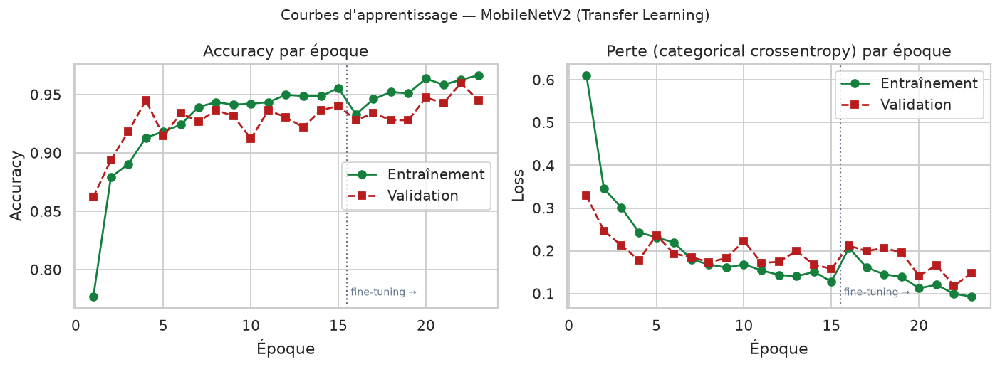
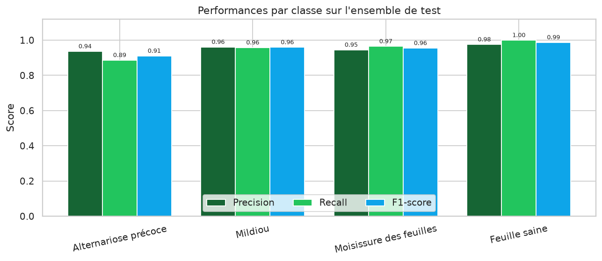
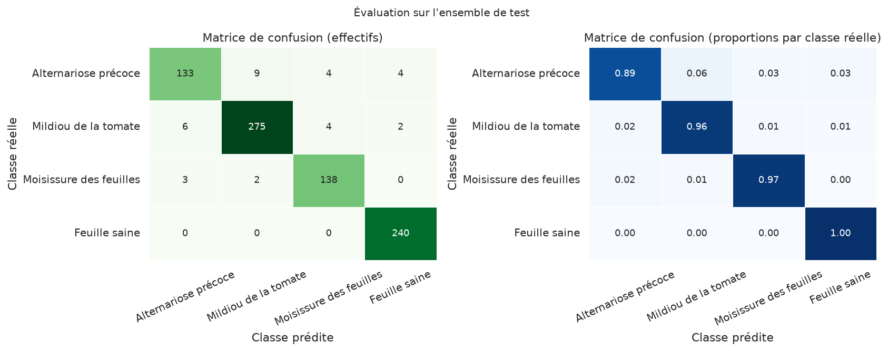
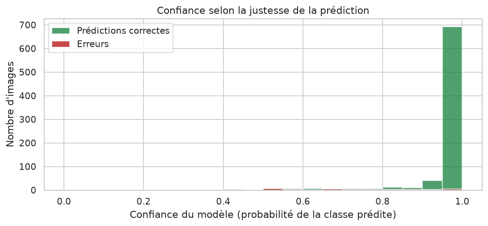
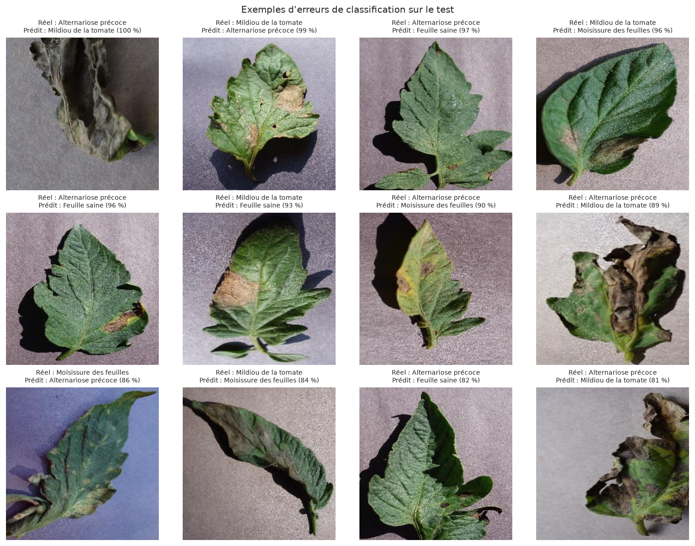

## 11. Développement de l'application Web

### 11.1 Objectif et principe

L'application Web constitue la couche de restitution du projet : elle rend le modèle
utilisable par une personne qui ne connaît rien à l'apprentissage automatique. Son
périmètre a été volontairement limité à **une seule fonction** : recevoir une image de
feuille et afficher la prédiction du modèle.

Deux routes suffisent :

| Route | Méthode | Rôle |
| --- | --- | --- |
| `/` | GET | affiche le formulaire de téléversement |
| `/analyser` | POST | valide l'image, lance la prédiction, réaffiche la page avec le résultat |

Le modèle Keras est chargé **une seule fois** au démarrage (singleton protégé par un
verrou) : chaque analyse évite ainsi plusieurs secondes de chargement. L'application ne
maintient ni session, ni compte, ni base de données.

### 11.2 Architecture

Le code reste organisé par responsabilité, comme le reste du projet :

| Module | Responsabilité |
| --- | --- |
| `config.py` | chemins, hyperparamètres, libellés français des classes |
| `app.py` | les deux routes, la validation, le rendu de la page |
| `utils/preprocessing.py` | pipeline d'image partagé entraînement / inférence |
| `utils/predictor.py` | chargement unique du modèle et prédiction |
| `utils/helpers.py` | validation du fichier téléversé, libellés, formatage |

*Tableau 11 — Modules de l'application et responsabilités.*

Cette séparation est ce qui garantit la cohérence scientifique du système : le
prétraitement appliqué à la prédiction est **le même code** que celui utilisé pendant
l'entraînement, ce qui élimine la principale source d'écart entre validation et usage réel.

### 11.3 Parcours utilisateur

1. l'utilisateur ouvre <http://127.0.0.1:5000> ; la page affiche un formulaire et rappelle
   les quatre classes reconnues ;
2. il choisit un fichier JPG ou PNG de 8 Mo maximum ;
3. le serveur vérifie l'extension, le type MIME, décode réellement l'image avec Pillow et
   contrôle ses dimensions ;
4. l'image est convertie en RGB, redimensionnée à 224 × 224 puis normalisée dans
   l'intervalle [-1, 1] avant d'être passée au modèle ;
5. la page réaffiche le résultat : classe prédite, confiance en pourcentage, durée de
   l'inférence, les quatre probabilités triées, et un message adapté — « feuille saine »
   ou « maladie détectée, faites confirmer par un agronome ».

Aucune image n'est écrite sur le disque : le fichier est traité en mémoire, puis oublié.
Il n'y a donc ni historique, ni fichier téléversé à nettoyer, ni donnée personnelle
conservée.

### 11.4 Choix de simplicité

Trois simplifications ont été assumées par rapport à une application « complète » :

- **pas de base de données ni d'historique** : le besoin exprimé est une inférence, pas un
  suivi d'activité ; supprimer la persistance supprime aussi le stockage d'images ;
- **pas d'API JSON ni de JavaScript** : un formulaire HTML classique et un rendu côté
  serveur suffisent, la page fonctionne même si les scripts sont désactivés ;
- **pas de framework CSS** : une feuille de style d'environ 130 lignes remplace Bootstrap
  et Chart.js, ce qui allège le dépôt de plusieurs mégaoctets et supprime toute dépendance
  externe.

Il en résulte une application de **130 lignes environ**, deux gabarits HTML et une feuille
de style : le comportement complet se lit d'un coup d'œil, ce qui facilite la relecture,
les tests et la démonstration. Pour un usage par lot, le script `training/predict.py`
reste disponible en ligne de commande.

### 11.5 Sécurité et robustesse

Les contrôles appliqués au fichier téléversé sont les suivants :

- **extension** en liste blanche (`.jpg`, `.jpeg`, `.png`) ;
- **type MIME** déclaré par le navigateur ;
- **décodage réel** par Pillow : un fichier renommé ou corrompu est rejeté, l'extension
  seule ne suffit pas ;
- **taille maximale** de 8 Mo, appliquée par Flask (`MAX_CONTENT_LENGTH`) ;
- **dimensions** comprises entre 32 et 4 000 pixels ;
- **traitement en mémoire** : aucun nom fourni par l'utilisateur ne participe à la
  construction d'un chemin, ce qui exclut toute traversée de répertoire ;
- **aucun chemin interne** renvoyé au navigateur ; les erreurs techniques sont
  journalisées côté serveur et remplacées par un message générique ;
- **codes HTTP explicites** : 400 (fichier refusé), 404 (page inconnue), 413 (image trop
  volumineuse), 500 (échec de prédiction) et 503 lorsque le modèle est absent.

Si le fichier `models/best_model.keras` est manquant, l'application démarre quand même et
affiche un message clair au lieu de planter.

### 11.6 Tests

Trente-trois tests automatisés (pytest) couvrent le prétraitement, les utilitaires et
l'application. Le parcours réel est testé de bout en bout : envoi d'une image, prédiction
par le vrai modèle, affichage de la classe, de la confiance et des quatre probabilités.
Les cas de rejet sont également vérifiés : absence de fichier, extension interdite, faux
type MIME, contenu qui n'est pas une image, image trop petite ou trop grande, page
inconnue (404).

## 12. Résultats expérimentaux

### 12.1 Protocole

L'évaluation est réalisée par `training/evaluate.py` sur les **820 images de l'ensemble
de test**, jamais utilisées pendant l'entraînement ni pendant la sélection du modèle. Le
script charge `models/best_model.keras`, applique exactement le prétraitement décrit en
section 8, calcule les prédictions par lots, puis dérive l'ensemble des métriques avec
scikit-learn. Les figures et les fichiers CSV sont générés automatiquement.

### 12.2 Courbes d'apprentissage

*Figure 5 — Courbes d'apprentissage : accuracy et perte, entraînement et validation,
avec la séparation entre phase 1 et fine-tuning (ligne pointillée).*

L'accuracy d'entraînement progresse régulièrement de 77,7 % à 96,7 %. L'accuracy de
validation atteint rapidement 94,5 %, puis le fine-tuning permet de franchir la barre des
95 % à l'époque 22 (**95,98 %**). La perte de validation descend de 0,33 à 0,12. L'écart
final entre entraînement (96,7 %) et validation (95,98 %) reste modéré, ce qui indique
un sur-apprentissage limité.

### 12.3 Métriques globales sur le test

| Métrique | Valeur |
| --- | --- |
| Accuracy | **95,85 %** |
| Precision (macro) | 95,47 % |
| Recall (macro) | 95,25 % |
| F1-score (macro) | **95,34 %** |
| Precision (pondérée) | 95,83 % |
| Recall (pondéré) | 95,85 % |
| F1-score (pondéré) | 95,82 % |
| Images de test | 820 |
| Images mal classées | 34 (4,15 %) |

*Tableau 12 — Métriques globales du modèle sur l'ensemble de test.*

L'accuracy de 95,85 % signifie que 786 images sur 820 ont été correctement classées. La
faible différence entre les moyennes macro (95,34 %) et pondérée (95,82 %) indique que
les performances sont relativement homogènes entre classes : le modèle n'a pas sacrifié
les classes minoritaires au profit des classes majoritaires.

### 12.4 Performances par classe

| Classe | Precision | Recall | F1-score | Support | Bien classées |
| --- | --- | --- | --- | --- | --- |
| Alternariose précoce | 93,66 % | 88,67 % | 91,10 % | 150 | 133 |
| Mildiou de la tomate | 96,15 % | 95,82 % | 95,99 % | 287 | 275 |
| Moisissure des feuilles | 94,52 % | 96,50 % | 95,50 % | 143 | 138 |
| Feuille saine | 97,56 % | 100,00 % | 98,77 % | 240 | 240 |
| **Macro** | **95,47 %** | **95,25 %** | **95,34 %** | 820 | 786 |

*Tableau 13 — Métriques détaillées par classe.*

*Figure 6 — Precision, recall et F1-score pour chacune des quatre classes.*

Trois observations se dégagent :

1. **La classe « feuille saine » est parfaitement détectée** (rappel de 100 %). Aucune
   feuille saine n'a été classée comme malade, ce qui est le comportement souhaité pour un
   outil d'alerte : pas de fausse alerte sur un feuillage sain.
2. **L'alternariose précoce est la classe la plus difficile** (F1 = 91,10 %, rappel de
   88,67 %) : 17 feuilles sur 150 lui échappent, dont 9 classées comme mildiou. Ces deux
   maladies produisent des taches brunes et leur ressemblance visuelle est bien connue en
   agronomie.
3. **Le mildiou et la moisissure** obtiennent des scores élevés (F1 ≈ 96 %), cohérents
   avec leurs signatures visuelles plus marquées (lésions humides, duvet olive).

### 12.5 Matrice de confusion

| Réel \\ Prédit | Alternariose | Mildiou | Moisissure | Saine |
| --- | --- | --- | --- | --- |
| **Alternariose** | **133** | 9 | 4 | 4 |
| **Mildiou** | 6 | **275** | 4 | 2 |
| **Moisissure** | 3 | 2 | **138** | 0 |
| **Saine** | 0 | 0 | 0 | **240** |

*Tableau 14 — Matrice de confusion (effectifs) sur les 820 images de test.*

*Figure 7 — Matrice de confusion en effectifs (à gauche) et en proportions par classe
réelle (à droite).*

La lecture par ligne est la plus instructive : 88,7 % des alternarioses sont correctement
identifiées, 95,8 % des mildious, 96,5 % des moisissures et 100 % des feuilles saines. La
diagonale est nettement dominante, ce qui traduit un modèle globalement fiable. Les
erreurs se concentrent sur la frontière alternariose / mildiou, avec 15 confusions croisées
(9 + 6), soit près de la moitié des 34 erreurs totales.

### 12.6 Analyse des erreurs

| Indicateur | Valeur |
| --- | --- |
| Erreurs totales | 34 / 820 (4,15 %) |
| Confiance moyenne sur les prédictions correctes | 97,52 % |
| Confiance moyenne sur les erreurs | 70,23 % |
| Confiance médiane globale | 99,95 % |
| Confusion la plus fréquente | Alternariose → Mildiou (9 cas) |

*Tableau 15 — Statistiques de confiance et principales confusions.*

La confiance moyenne des erreurs (70,2 %) est très inférieure à celle des prédictions
correctes (97,5 %) : le modèle « sait » en partie qu'il hésite. C'est un signal utile pour
l'utilisateur et un argument en faveur de l'affichage de la distribution complète des
probabilités plutôt que d'une classe unique.

*Figure 8 — Distribution de la confiance selon que la prédiction est correcte ou non.*

*Figure 9 — Exemples d'images mal classées : classe réelle, classe prédite et confiance.*

La planche d'erreurs montre que les images mal classées sont souvent des cas ambigus :
lésions peu contrastées, feuille partiellement floue, ou symptômes mélangés. Certaines
images annotées « alternariose précoce » présentent des taches sombres étendues qui
évoquent visuellement le mildiou. Ces erreurs ne relèvent donc pas uniquement d'une
faiblesse du modèle, mais aussi de la frontière floue entre deux pathologies.

### 12.7 Temps d'inférence

| Contexte | Durée observée |
| --- | --- |
| Première requête (chargement + échauffement) | ≈ 880 ms |
| Requêtes suivantes (modèle en mémoire) | 68 – 80 ms |
| Batch d'évaluation (16 images) | ≈ 1,2 s, soit ≈ 75 ms par image |

*Tableau 16 — Temps d'inférence mesurés sur le processeur de test.*

Le chargement unique du modèle au démarrage permet de répondre en moins de 100 ms par
image, ce qui rend l'expérience fluide dans le navigateur. La première requête est plus
lente en raison de l'initialisation des graphes TensorFlow.

## 13. Évaluation et interprétation des métriques

### 13.1 Lecture critique de l'accuracy

Une accuracy de 95,85 % sur un jeu de test indépendant est un résultat solide pour un
projet réalisé sans GPU et avec un budget d'époques réduit. Il faut néanmoins rappeler
qu'un tel chiffre n'a de sens que replacé dans son contexte :

- le test provient de la **même distribution** que l'entraînement (même dataset, même
  protocole de prise de vue), ce qui facilite la tâche ;
- la classe majoritaire représente 35 % du test ; un classifieur naïf atteindrait déjà
  environ 35 % d'accuracy, et un modèle prédisant toujours « mildiou » obtiendrait 35 % ;
- les 820 images de test sont peu nombreuses à l'échelle des variations possibles d'une
  feuille de tomate malade.

L'accuracy est donc un indicateur de faisabilité, pas une garantie de performance sur le
terrain.

### 13.2 Cohérence entre les métriques

Les quatre métriques macro sont comprises entre 95,25 % et 95,47 %, avec un F1 de
95,34 %. Cette homogénéité signifie que le modèle n'est pas seulement bon sur les classes
majoritaires : il conserve un bon rappel sur la moisissure (143 images seulement) et sur
l'alternariose (150 images). Les poids de classes et la Data Augmentation ont
probablement contribué à cet équilibre.

La precision (95,47 %) est légèrement supérieure au recall (95,25 %) : le modèle commet
un peu plus de faux négatifs que de faux positifs. Dans un contexte de détection de
maladie, ce compromis est discutable : manquer une feuille malade (faux négatif) peut
être plus coûteux que signaler à tort une feuille saine. Un ajustement du seuil de
décision, ou une pondération plus forte des classes malades, pourrait être envisagé.

### 13.3 Interprétation des confusions

Les confusions observées sont **biologiquement cohérentes** :

- **alternariose → mildiou (9 cas)** : les deux maladies produisent des taches brunes
  irrégulières ; à un stade avancé, l'alternariose perd ses anneaux concentriques et
  ressemble au mildiou ;
- **mildiou → alternariose (6 cas)** : symétrique du cas précédent, souvent sur des
  lésions jeunes ou des images peu contrastées ;
- **alternariose → feuille saine (4 cas)** : taches rares ou très petites, insuffisantes
  pour déclencher la classe malade ;
- **mildiou → moisissure (4 cas)** et **alternariose → moisissure (4 cas)** : images
  présentant des plages jaunies communes aux deux pathologies.

Aucune confusion n'implique la classe « feuille saine » en sortie : le modèle ne prend
jamais une feuille malade pour une feuille saine de manière significative (2 cas de
mildiou classés sains au maximum). C'est un point rassurant pour un usage d'alerte.

### 13.4 Calibration et sur-confiance

La confiance médiane (99,95 %) est très élevée, et 100 % des feuilles saines du test sont
prédites avec une confiance proche de 1. Les réseaux de neurones modernes sont connus pour
être **mal calibrés** : leurs probabilités softmax sont souvent trop tranchées. Un score
de 100 % ne signifie donc pas une certitude absolue, mais une forte activation du modèle.

L'écart de confiance entre prédictions correctes (97,5 %) et erreurs (70,2 %) montre que
la confiance reste informative. Une perspective d'amélioration serait d'appliquer une
**température scaling** ou une calibration de Platt sur l'ensemble de validation, afin de
produire des probabilités plus réalistes.

### 13.5 Positionnement par rapport à la littérature

Mohanty et al. (2016) rapportent des accuracies supérieures à 99 % sur PlantVillage avec
des architectures comme AlexNet et GoogLeNet, sur l'ensemble des 38 classes et avec un
protocole d'entraînement bien plus long. Nos 95,85 % sur 4 classes ne sont pas directement
comparables : le périmètre est plus restreint, le budget d'entraînement beaucoup plus
faible (23 époques, CPU) et le découpage différent. Le résultat confirme néanmoins la
tendance de fond de la littérature : sur PlantVillage, les CNN pré-entraînés atteignent
une précision élevée avec un effort d'entraînement modéré.

## 14. Discussion des résultats

### 14.1 Apport du Transfer Learning

La progression observée valide l'intérêt du Transfer Learning :

| Étape | Accuracy de validation |
| --- | --- |
| Époque 1 (base gelée) | 86,24 % |
| Meilleure phase 1 (époque 4) | 94,52 % |
| Meilleure phase 2 (époque 22) | **95,98 %** |

*Tableau 17 — Progression de la validation au fil de l'expérience.*

Atteindre 86 % dès la première époque, avec seulement 164 484 paramètres entraînables,
aurait été impossible avec un réseau initialisé aléatoirement. Le gain du fine-tuning
(+1,46 point) est plus modeste mais réel : il montre que les filtres profonds de
MobileNetV2, initialement spécialisés sur ImageNet, bénéficient d'un ajustement aux
textures de feuilles.

### 14.2 Variabilité et sensibilité aux hyperparamètres

La courbe de validation est irrégulière (oscillations de ±2 points entre époques
voisines). Trois facteurs expliquent cette variabilité :

1. la taille limitée du jeu de validation (821 images, soit environ 26 lots de 32) ;
2. l'application aléatoire de la Data Augmentation, qui modifie la difficulté des lots ;
3. le déséquilibre des classes, partiellement compensé par les poids de classes.

Un usage plus stable serait obtenu avec une validation croisée à k plis, plus coûteuse en
temps de calcul mais beaucoup plus robuste pour estimer la performance réelle.

### 14.3 Coût de calcul et pertinence de MobileNetV2

Le modèle complet ne pèse que 2,4 millions de paramètres et environ 24 Mo sur disque. Une
époque d'entraînement dure 90 secondes sur deux cœurs, et une prédiction 70 ms. Ces
chiffres confirment que MobileNetV2 est un choix adapté à un déploiement local, sur un
ordinateur portable ou un mini-serveur, sans GPU ni service cloud. Un modèle plus profond
(ResNet-50, EfficientNet-B3) aurait probablement apporté quelques points supplémentaires
mais au prix d'un temps d'entraînement multiplié par 5 à 10 dans notre environnement.

### 14.4 Qualité des données versus complexité du modèle

Le principal facteur limitant n'est pas la capacité du modèle mais la **nature des
données**. Les images PlantVillage sont prises en laboratoire, sur fond uniforme, avec une
feuille unique et un éclairage contrôlé. Sur des photographies de terrain (feuillage
dense, arrière-plan complexe, ombres, reflets, flou de bougé), les performances chuteraient
très probablement. Améliorer le dataset (images de terrain, plusieurs feuilles par image,
conditions variées) serait plus rentable que complexifier l'architecture.

### 14.5 Enseignements méthodologiques

Ce projet illustre plusieurs principes importants :

- **l'identité du prétraitement** entre entraînement et inférence est critique : elle est
  ici garantie par un module unique et vérifiée par un test ;
- **la prévention des fuites** (doublons, split) conditionne la validité des métriques ;
- **le suivi de la validation** (Early Stopping, checkpoint) évite de conserver un modèle
  dégradé : sans `initial_value_threshold`, le modèle final aurait été moins bon que
  celui de la phase 1 ;
- **l'analyse des erreurs** apporte plus d'information que l'accuracy globale : elle
  révèle les frontières ambiguës entre maladies.

## 15. Limites et perspectives d'amélioration

### 15.1 Limites du système actuel

**Limites liées aux données**

- quatre classes seulement, alors que PlantVillage en compte 38 et que la tomate connaît
  une dizaine de maladies foliaires courantes ;
- images de laboratoire, non représentatives des conditions de terrain ;
- déséquilibre entre classes (952 à 1 909 images) ;
- absence de regroupement par feuille (*leaf grouping*), qui peut laisser passer des
  quasi-doublons entre ensembles ;
- jeu de test de 820 images, insuffisant pour une estimation à ±0,5 point près.

**Limites liées au modèle**

- une seule architecture et un seul protocole testés, faute de temps de calcul ;
- pas de validation croisée ;
- probabilités mal calibrées (sur-confiance) ;
- pas d'explicabilité intégrée : l'utilisateur ne voit pas quelles zones de la feuille ont
  motivé la décision ;
- pas de détection d'image hors domaine (une photo de fleur serait classée dans une des
  quatre catégories).

**Limites liées à l'application**

- pas de déploiement en production : serveur de développement Flask, sans HTTPS ;
- une seule image analysée à la fois, sans traitement par lot dans l'interface ;
- pas d'historique ni de suivi des analyses : choix de simplicité, aucune donnée
  n'est conservée ;
- interface en français uniquement.

### 15.2 Perspectives techniques

1. **Explicabilité (Grad-CAM)** : produire une carte de chaleur des zones discriminantes,
   superposée à l'image, afin de renforcer la confiance de l'utilisateur et de détecter
   les décisions fondées sur des artefacts.
2. **Détection d'inconnu** : ajouter un seuil de rejet ou une classe « autre » entraînée
   sur des images hors domaine, pour éviter de classer n'importe quelle image.
3. **Calibration des probabilités** : température scaling sur l'ensemble de validation.
4. **Validation croisée** à 5 plis pour une estimation plus fiable des performances.
5. **Comparaison d'architectures** : MobileNetV3, EfficientNet-B0, ResNet-50, avec le même
   protocole, pour objectiver le compromis précision / coût.
6. **Quantification et export** : conversion du modèle en TensorFlow Lite (INT8) ou ONNX
   pour un déploiement mobile.
7. **Augmentation plus agressive et adaptée** : mélange d'images (*MixUp*, *CutMix*),
   simulation d'ombres et de fonds variés, pour préparer le passage au terrain.
8. **Suivi d'expériences** : intégration de MLflow ou de TensorBoard pour comparer
   systématiquement les runs.

### 15.3 Perspectives applicatives

- prise de photo directe depuis le smartphone (API `getUserMedia`) ;
- export PDF d'une fiche de résultat ;
- mode hors-ligne complet avec un modèle quantifié exécuté dans le navigateur
  (TensorFlow.js) ;
- extension à d'autres cultures (pomme de terre, vigne, pommier) ;
- interface multilingue.

## 16. Éthique et impacts du système

Un système de vision artificielle appliqué à l'agriculture ne soulève pas seulement des
questions techniques. Parce qu'il produit une recommandation qu'un utilisateur pourrait
suivre pour traiter une culture, il engage une responsabilité : celle de dire clairement
ce qu'il fait, ce qu'il ne fait pas, et avec quelles données il a été construit. Cette
section explicite le cadre d'usage, les risques identifiés et les mesures prises ou
recommandées pour les atténuer.

### 16.1 Usage prévu et limites de responsabilité

L'usage prévu est **pédagogique et expérimental** : illustrer une chaîne complète de Deep
Learning, de la donnée brute à l'application. Le système n'est ni un dispositif médical ni
un outil de diagnostic agricole certifié. Trois précautions sont appliquées :

- un avertissement explicite figure dans le README et dans l'interface (page « À propos ») ;
- l'application affiche **les quatre probabilités**, et non une classe unique, afin que
  l'utilisateur voie l'incertitude du modèle ;
- aucune prescription de traitement (dose, produit, fréquence) n'est proposée : les fiches
  maladies décrivent des symptômes et des principes de prévention, pas une ordonnance.

Toute décision de traitement doit rester celle d'un agronome ou d'un technicien, sur la
base d'une observation de terrain. Le modèle ne qualifie ni la gravité ni le stade de
l'infection, deux informations déterminantes pour décider d'une intervention.

### 16.2 Données : licence, représentativité et biais

**Licence et redistribution.** Le dépôt PlantVillage ne comporte pas de fichier de licence
explicite. Les images sont donc utilisées dans un cadre strictement académique, ne sont
**pas redistribuées** et ne sont pas versionnées dans le dépôt Git (`.gitignore`), ce qui
respecte la source et évite toute réutilisation non contrôlée.

**Biais de représentativité.** Le jeu de données est constitué de feuilles isolées,
photographiées en laboratoire sur fond uniforme, dans des conditions contrôlées et pour un
nombre limité de variétés. Il sous-représente les situations réelles : symptômes précoces
ou atypiques, attaques multiples, feuilles sales ou flétries, arrière-plans végétaux,
éclairages rasants, photos de smartphone compressées. Le modèle n'a jamais vu ces
conditions : **aucune mesure de performance hors domaine n'est disponible**, et rien ne
permet d'affirmer que les 95,85 % obtenus se transposeraient au champ. Ce biais est le
plus important du projet et il est explicité dans les limites (§15.1).

**Biais hérité du pré-entraînement.** Les poids ImageNet proviennent d'images web, avec
leurs propres déséquilibres géographiques et culturels. Le transfer learning accélère
l'apprentissage mais transmet une partie de ces biais, impossible à quantifier ici.

**Déséquilibre entre classes.** Les effectifs vont de 952 à 1 909 images. Les poids de
classes compensent partiellement ce déséquilibre à l'entraînement, mais la classe la plus
petite (moisissure, 143 images de test) reste celle dont l'estimation est la plus fragile,
avec un intervalle de confiance plus large.

**Données personnelles dans le dataset.** Les images ne contiennent pas de données
personnelles identifiantes à notre connaissance, mais leurs métadonnées EXIF n'ont pas fait
l'objet d'un audit exhaustif ; ce point est signalé par prudence.

### 16.3 Vie privée des utilisateurs de l'application

Le principe appliqué est la **minimisation absolue** : l'image téléversée n'est **jamais
écrite sur le disque**. Elle est décodée en mémoire, convertie en tenseur, passée au
modèle, puis oubliée à la fin de la requête. L'application ne conserve donc ni image, ni
nom de fichier, ni résultat : aucune analyse n'est consultable après coup, aucune donnée
personnelle n'est stockée.

Mesures techniques concrètes :

- **traitement en mémoire** : le flux du fichier est lu directement par Pillow, sans
  écriture dans un répertoire temporaire ;
- **aucun chemin construit** à partir du nom fourni par le client : ce nom sert uniquement
  à vérifier l'extension, ce qui exclut toute traversée de répertoire ;
- **aucun envoi à un tiers** : l'inférence est exécutée par le serveur local, sans API
  externe ni service cloud ;
- **aucun cookie de suivi, aucun compte, aucune adresse IP enregistrée** : l'application
  ne tient pas de session et n'a pas de base de données.

Limites assumées : le serveur de développement Flask sert la page **en HTTP**, sans
chiffrement ; une image transite donc en clair sur le réseau si l'application est exposée
autre part qu'en local, et les journaux du serveur conservent l'heure et le code de
réponse des requêtes. Pour un déploiement réel, il faudrait ajouter HTTPS, une politique
de rétention des journaux et une information explicite des utilisateurs. Ces points sont
documentés comme limites et non masqués.

### 16.4 Risque d'un mauvais diagnostic

Sur 820 images, 34 erreurs (4,15 %) subsistent. Leur concentration est le point sensible :
15 confusions croisées entre **alternariose précoce** et **mildiou**, deux maladies dont
les lésions se ressemblent mais dont la gestion diffère. Une erreur dans ce couple peut
conduire à un traitement inadapté, donc à une perte de récolte ou à un usage inutile de
fongicides.

Deux risques symétriques doivent être nommés :

- **faux négatif** (maladie prédite saine) : risque de propagation silencieuse, le plus
  grave agronomiquement ; la classe saine est toutefois celle qui obtient le meilleur
  rappel (100 % sur le test), ce qui limite ce risque dans le domaine étudié ;
- **faux positif** (sain prédit malade) : traitement inutile, coût économique et intrants
  supplémentaires.

La confiance moyenne des erreurs (70,23 %) est nettement inférieure à celle des prédictions
correctes (97,52 %), mais elle reste élevée pour certaines erreurs : l'affichage de la
confiance **ne suffit pas** à lui seul à alerter l'utilisateur. C'est pourquoi un seuil de
rejet et une carte d'attention (Grad-CAM) figurent parmi les perspectives prioritaires.

### 16.5 Équité et accessibilité

Le choix de MobileNetV2 (2,4 millions de paramètres, inférence d'environ 70 ms sur CPU)
relève aussi d'un souci d'équité d'accès : le système fonctionne sans GPU et sur un poste
modeste, condition indispensable pour un usage dans de petites exploitations. Le modèle est
en outre suffisamment compact pour envisager une exécution embarquée après quantification.

À l'inverse, trois barrières subsistent : l'interface est uniquement en français ; elle
suppose un smartphone ou un ordinateur et une instance accessible ; et **aucune mesure de
performance par sous-groupe** (type d'appareil, conditions d'éclairage, variété, stade de
la maladie) n'a été réalisée. Il n'est donc pas possible d'affirmer que le modèle est
équitable entre ces situations : c'est un audit à conduire avant tout usage réel.

### 16.6 Impact environnemental et coût de calcul

L'entraînement complet a duré **37,7 minutes de CPU** (23,4 min pour la phase 1, 14,3 min
pour le fine-tuning) sur un processeur à deux cœurs, sans GPU. Le transfer learning est ici
le principal levier environnemental : il évite d'entraîner un CNN from scratch, qui
exigerait plusieurs heures à plusieurs jours de calcul pour un résultat souvent inférieur.
L'inférence (environ 70 ms par image) est négligeable à l'échelle d'un usage interactif.

Le projet ne fournit pas d'estimation en kWh ni en équivalent CO₂ : une telle estimation
n'aurait de sens qu'avec la consommation réelle mesurée de la machine. Les recommandations
associées sont de réutiliser le modèle existant plutôt que de réentraîner sans nécessité,
et de privilégier la quantification pour l'inférence mobile.

### 16.7 Conduite scientifique

Toutes les valeurs du rapport proviennent d'un entraînement et d'une évaluation réellement
exécutés ; aucune métrique n'est simulée ni recopiée d'une publication. Les figures et la
fiche expérimentale sont générées par script à partir des fichiers de résultats, ce qui
réduit le risque d'erreur de recopie. Le dataset n'est pas versionné, mais les scripts, les
métriques, les prédictions et le modèle le sont, ce qui rend l'expérience auditable.

Deux réserves d'honnêteté accompagneront la lecture des chiffres : l'expérience repose sur
**un seul run** (pas de validation croisée, donc pas d'estimation de la variabilité), et le
budget d'époques a été réduit (15 + 8 au lieu de 30 + 15) faute de GPU. Les 95,85 % ne
doivent donc pas être présentés comme une borne supérieure de performance.

### 16.8 Synthèse des risques et des mesures

| Risque | Gravité | Mesure en place | Mesure recommandée |
| --- | --- | --- | --- |
| Mauvais diagnostic suivi d'un traitement | Élevée | Avertissement explicite, 4 probabilités affichées, aucune prescription | Seuil de rejet, Grad-CAM, validation par un agronome |
| Écart entre laboratoire et terrain | Élevée | Limite documentée (§15.1), pas de promesse de performance terrain | Constituer un jeu de test de terrain et le publier |
| Atteinte à la vie privée | Faible | Aucune image ni résultat conservé, traitement en mémoire, aucun compte | HTTPS et politique de journaux en cas de déploiement |
| Biais de représentation et d'équité | Moyenne | Déséquilibre traité par poids de classes, biais explicités | Audit par sous-groupe, augmentation de données variées |
| Inégalité d'accès à l'outil | Moyenne | Modèle léger, exécution CPU, aucune API payante | Interface multilingue, mode hors-ligne quantifié |
| Coût de calcul | Faible | Transfer learning, 37,7 min de CPU, pas de GPU | Réutiliser le modèle, quantifier pour l'inférence |

*Tableau 18 — Synthèse des risques éthiques identifiés et des mesures d'atténuation.*

En résumé, le projet ne revendique pas la neutralité : il rend explicites ses données, ses
biais, ses erreurs et son domaine de validité, et il refuse de transformer une prédiction
probabiliste en prescription agricole. Cette transparence est la condition minimale d'un
usage responsable, et la première des améliorations à venir.

## 17. Conclusion générale

Ce projet avait pour objectif de concevoir un système complet de détection et de
classification des maladies de la feuille de tomate, depuis la donnée brute jusqu'à une
application Web utilisable. Cet objectif a été atteint : un modèle MobileNetV2 adapté par
Transfer Learning a été entraîné sur 3 811 images, évalué sur 820 images indépendantes, et
intégré dans une application Flask en français.

Les résultats expérimentaux sont les suivants :

- **accuracy de 95,85 %** sur l'ensemble de test ;
- **F1-score macro de 95,34 %**, avec des performances homogènes entre les quatre classes
  (de 91,10 % à 98,77 %) ;
- **34 erreurs sur 820 images**, concentrées sur la frontière entre alternariose précoce
  et mildiou, deux maladies visuellement proches ;
- **temps d'inférence d'environ 70 ms** par image, compatible avec une utilisation
  interactive ;
- un modèle compact de **2,4 millions de paramètres**, entraînable et exécutable sans GPU.

Au-delà des chiffres, le projet apporte plusieurs contributions méthodologiques : un
découpage rigoureux sans fuite de données, un prétraitement strictement identique entre
entraînement et inférence (vérifié par un test), une évaluation complète avec matrice de
confusion et analyse d'erreurs, une application sécurisée et testée, et une documentation
qui distingue clairement ce qui a été mesuré de ce qui reste hypothétique.

Le système ne constitue pas un diagnostic agricole. Il s'agit d'un outil expérimental
d'aide à la reconnaissance visuelle, dont les limites sont explicites : quatre classes,
images de laboratoire, absence d'explicabilité et de détection d'inconnu. Les perspectives
identifiées — Grad-CAM, calibration, validation croisée, données de terrain, quantification
— tracent un chemin réaliste vers un outil plus robuste et réellement utilisable sur le
terrain.

Sur le plan pédagogique, ce projet a permis de mettre en pratique l'ensemble de la chaîne
d'un projet de Deep Learning : préparation et audit des données, choix d'architecture,
Transfer Learning, régularisation, évaluation critique, intégration applicative, tests et
documentation. Il illustre une idée essentielle : la performance d'un modèle dépend moins
de sa complexité que de la qualité des données, de la rigueur du protocole et de
l'honnêteté de l'interprétation.

## 18. Références bibliographiques

1. Hughes, D. P., & Salathé, M. (2015). *An open access repository of images on plant
   health to enable the development of mobile disease diagnostics*. arXiv:1511.08060.
2. Mohanty, S. P., Hughes, D. P., & Salathé, M. (2016). Using deep learning for
   image-based plant disease detection. *Frontiers in Plant Science*, 7, 1419.
   https://doi.org/10.3389/fpls.2016.01419
3. Sandler, M., Howard, A., Zhu, M., Zhmoginov, A., & Chen, L.-C. (2018). MobileNetV2:
   Inverted residuals and linear bottlenecks. *Proceedings of the IEEE Conference on
   Computer Vision and Pattern Recognition (CVPR)*, 4510–4520.
4. Howard, A. G., Zhu, M., Chen, B., Kalenichenko, D., Wang, W., Weyand, T., Andreetto,
   M., & Adam, H. (2017). *MobileNets: Efficient convolutional neural networks for mobile
   vision applications*. arXiv:1704.04861.
5. LeCun, Y., Bengio, Y., & Hinton, G. (2015). Deep learning. *Nature*, 521(7553),
   436–444.
6. LeCun, Y., Bottou, L., Bengio, Y., & Haffner, P. (1998). Gradient-based learning
   applied to document recognition. *Proceedings of the IEEE*, 86(11), 2278–2324.
7. Krizhevsky, A., Sutskever, I., & Hinton, G. E. (2012). ImageNet classification with
   deep convolutional neural networks. *Advances in Neural Information Processing
   Systems (NeurIPS)*, 25, 1097–1105.
8. He, K., Zhang, X., Ren, S., & Sun, J. (2016). Deep residual learning for image
   recognition. *Proceedings of the IEEE Conference on Computer Vision and Pattern
   Recognition (CVPR)*, 770–778.
9. Simonyan, K., & Zisserman, A. (2015). *Very deep convolutional networks for
   large-scale image recognition*. arXiv:1409.1556.
10. Szegedy, C., Liu, W., Jia, Y., Sermanet, P., Reed, S., Anguelov, D., Erhan, D.,
    Vanhoucke, V., & Rabinovich, A. (2015). Going deeper with convolutions.
    *Proceedings of the IEEE Conference on Computer Vision and Pattern Recognition
    (CVPR)*, 1–9.
11. Pan, S. J., & Yang, Q. (2010). A survey on transfer learning. *IEEE Transactions on
    Knowledge and Data Engineering*, 22(10), 1345–1359.
12. Shorten, C., & Khoshgoftaar, T. M. (2019). A survey on image data augmentation for
    deep learning. *Journal of Big Data*, 6(1), 60.
13. Kingma, D. P., & Ba, J. (2015). *Adam: A method for stochastic optimization*.
    arXiv:1412.6980.
14. Rumelhart, D. E., Hinton, G. E., & Williams, R. J. (1986). Learning representations
    by back-propagating errors. *Nature*, 323(6088), 533–536.
15. Srivastava, N., Hinton, G., Krizhevsky, A., Sutskever, I., & Salakhutdinov, R. (2014).
    Dropout: A simple way to prevent neural networks from overfitting. *Journal of
    Machine Learning Research*, 15(1), 1929–1958.
16. Selvaraju, R. R., Cogswell, M., Das, A., Vedantam, R., Parikh, D., & Batra, D. (2017).
    Grad-CAM: Visual explanations from deep networks via gradient-based localization.
    *Proceedings of the IEEE International Conference on Computer Vision (ICCV)*,
    618–626.
17. Chollet, F. (2021). *Deep Learning with Python* (2ᵉ édition). Manning Publications.
18. Abadi, M. et al. (2016). TensorFlow: A system for large-scale machine learning.
    *12th USENIX Symposium on Operating Systems Design and Implementation (OSDI)*,
    265–283.

[[PAGEBREAK]]

## Annexe — Ressources du projet

| Ressource | Emplacement |
| --- | --- |
| Code source complet | dépôt Git du projet |
| Notebook d'expérimentation | `notebooks/plant_disease_training.ipynb` |
| Script de téléchargement du dataset | `training/download_dataset.py` |
| Préparation et découpage | `training/prepare_data.py` |
| Entraînement | `training/train.py` |
| Évaluation et figures | `training/evaluate.py` |
| Prédiction en ligne de commande | `training/predict.py` |
| Modèle entraîné | `models/best_model.keras` |
| Configuration et comptages | `models/training_config.json` |
| Métriques détaillées | `results/metrics/evaluation.json` |
| Rapport de classification | `results/metrics/classification_report.txt` |
| Figures | `results/figures/` |
| Prédictions et erreurs | `results/predictions/` |
| Tests automatisés | `tests/` |
