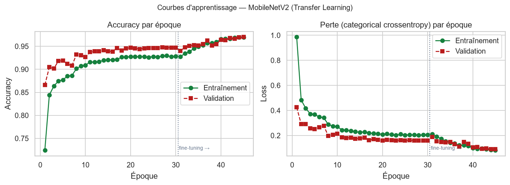
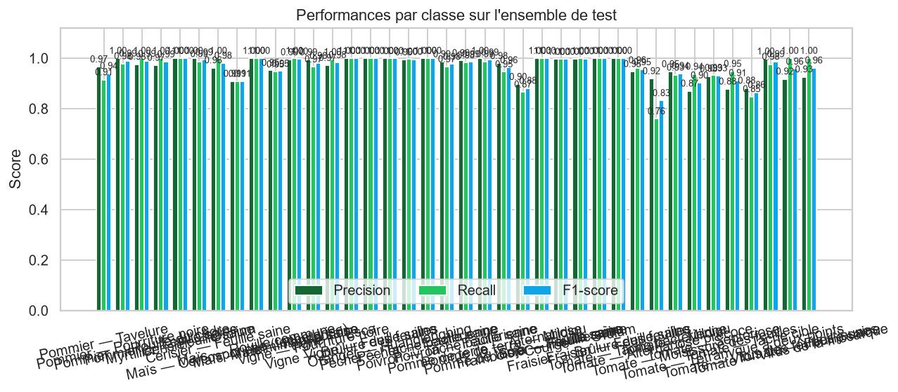
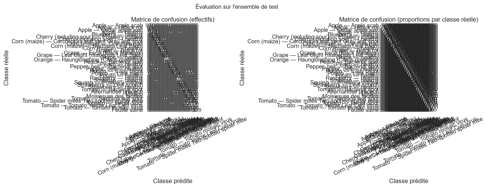
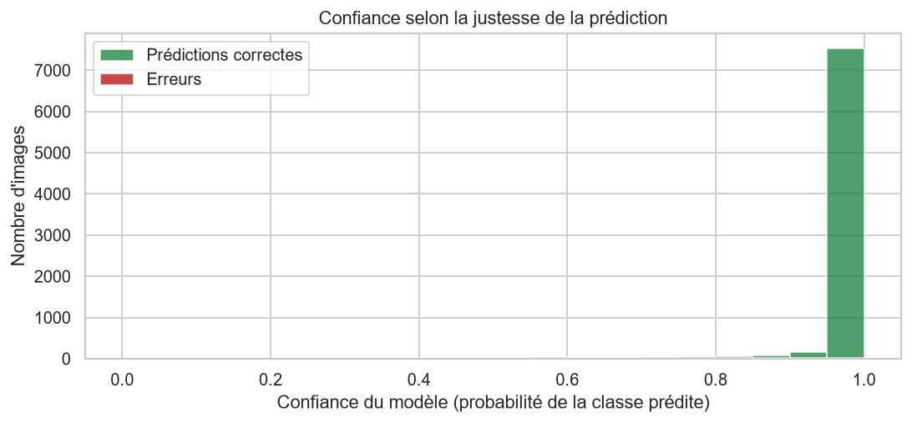
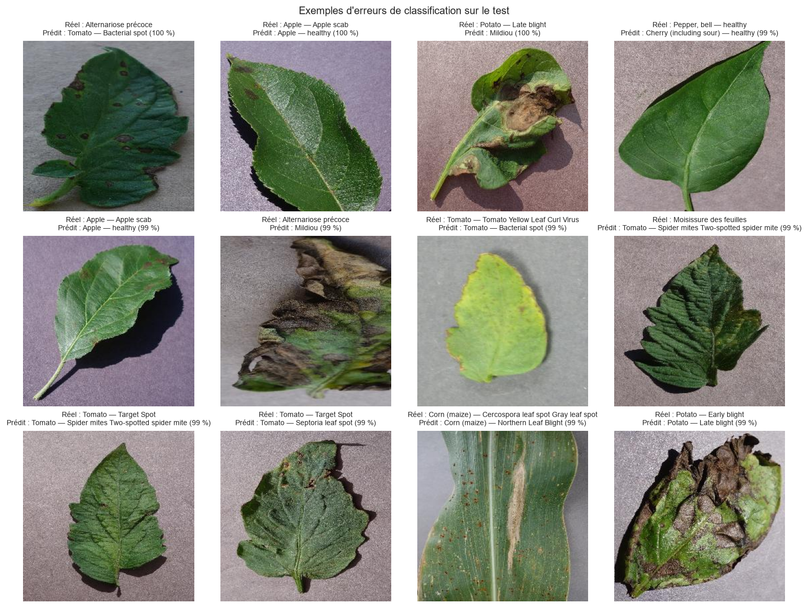

## 11. Développement de l'application Web

### 11.1 Objectif et principe

L'application Web constitue la couche de restitution du projet : elle rend le modèle
utilisable par une personne qui ne connaît rien à l'apprentissage automatique. Son
périmètre a été volontairement limité à **une seule fonction** : recevoir une image de
feuille et afficher la prédiction du modèle parmi les 38 classes.

Deux routes suffisent :

| Route | Méthode | Rôle |
| --- | --- | --- |
| `/` | GET | affiche le formulaire de téléversement |
| `/analyser` | POST | valide l'image, lance la prédiction, réaffiche la page avec le résultat |

Le modèle Keras est chargé **une seule fois** au démarrage (singleton protégé par un
verrou) : chaque analyse évite ainsi plusieurs secondes de chargement. L'application ne
maintient ni session, ni compte, ni base de données.

### 11.2 Architecture

Le code reste organisé par responsabilité, comme le reste du projet :

| Module | Responsabilité |
| --- | --- |
| `config.py` | chemins, hyperparamètres, libellés des 38 classes |
| `app.py` | les deux routes, la validation, le rendu de la page |
| `utils/preprocessing.py` | pipeline d'image partagé entraînement / inférence |
| `utils/predictor.py` | chargement unique du modèle et prédiction |
| `utils/helpers.py` | validation du fichier téléversé, libellés, formatage |

*Tableau 12 — Modules de l'application et responsabilités.*

Cette séparation est ce qui garantit la cohérence scientifique du système : le
prétraitement appliqué à la prédiction est **le même code** que celui utilisé pendant
l'entraînement, ce qui élimine la principale source d'écart entre validation et usage réel.

### 11.3 Parcours utilisateur

1. l'utilisateur ouvre <http://127.0.0.1:5000> ; la page affiche un formulaire et rappelle
   que 38 classes sont reconnues ;
2. il choisit un fichier JPG ou PNG de 8 Mo maximum ;
3. le serveur vérifie l'extension, le type MIME, décode réellement l'image avec Pillow et
   contrôle ses dimensions ;
4. l'image est convertie en RGB, redimensionnée à 224 × 224 puis normalisée dans
   l'intervalle [-1, 1] avant d'être passée au modèle ;
5. la page réaffiche le résultat : image analysée, classe prédite, confiance en
   pourcentage, durée de l'inférence, les **cinq probabilités les plus élevées**, et un
   message adapté — « feuille saine » ou « maladie détectée, faites confirmer par un
   agronome ».

Avec 38 classes, afficher l'intégralité des probabilités rendrait la page illisible : le
classement est donc tronqué aux cinq premières classes, ce qui suffit à montrer
l'incertitude du modèle (voir par exemple 62 % / 27 % entre deux classes proches).

Aucune image n'est écrite sur le disque : le fichier est traité en mémoire, puis oublié.
Il n'y a donc ni historique, ni fichier téléversé à nettoyer, ni donnée personnelle
conservée.

### 11.4 Choix de simplicité

Trois simplifications ont été assumées par rapport à une application « complète » :

- **pas de base de données ni d'historique** : le besoin exprimé est une inférence, pas un
  suivi d'activité ; supprimer la persistance supprime aussi le stockage d'images ;
- **pas d'API JSON ni de JavaScript** : un formulaire HTML classique et un rendu côté
  serveur suffisent, la page fonctionne même si les scripts sont désactivés ;
- **pas de framework CSS** : une feuille de style unique remplace Bootstrap et Chart.js,
  ce qui allège le dépôt de plusieurs mégaoctets et supprime toute dépendance externe.

Il en résulte une application d'environ 130 lignes, deux gabarits HTML et une feuille de
style : le comportement complet se lit d'un coup d'œil, ce qui facilite la relecture, les
tests et la démonstration. Pour un usage par lot, le script `training/predict.py` reste
disponible en ligne de commande.

### 11.5 Sécurité et robustesse

Les contrôles appliqués au fichier téléversé sont les suivants :

- **extension** en liste blanche (`.jpg`, `.jpeg`, `.png`) ;
- **type MIME** déclaré par le navigateur ;
- **décodage réel** par Pillow : un fichier renommé ou corrompu est rejeté, l'extension
  seule ne suffit pas ;
- **taille maximale** de 8 Mo, appliquée par Flask (`MAX_CONTENT_LENGTH`) ;
- **dimensions** comprises entre 32 et 4 000 pixels ;
- **traitement en mémoire** : aucun nom fourni par l'utilisateur ne participe à la
  construction d'un chemin, ce qui exclut toute traversée de répertoire ;
- **aucun chemin interne** renvoyé au navigateur ; les erreurs techniques sont
  journalisées côté serveur et remplacées par un message générique ;
- **codes HTTP explicites** : 400 (fichier refusé), 404 (page inconnue), 413 (image trop
  volumineuse), 500 (échec de prédiction) et 503 lorsque le modèle est absent.

Si le fichier `models/best_model.keras` est manquant, l'application démarre quand même et
affiche un message clair au lieu de planter. Si le fichier `data/class_names.json` ne
correspond pas au nombre de sorties du modèle, une erreur explicite est levée plutôt
qu'une prédiction silencieusement fausse.

### 11.6 Tests

Trente-trois tests automatisés (pytest) couvrent le prétraitement, les utilitaires et
l'application. Le parcours réel est testé de bout en bout : envoi d'une image, prédiction
par le vrai modèle à 38 sorties, affichage de la classe, de la confiance et des
probabilités. Les cas de rejet sont également vérifiés : absence de fichier, extension
interdite, faux type MIME, contenu qui n'est pas une image, image trop petite ou trop
grande, page inconnue (404).

## 12. Résultats expérimentaux

### 12.1 Protocole

L'évaluation est réalisée par `training/evaluate.py` sur les **8 156 images de l'ensemble
de test**, jamais utilisées pendant l'entraînement ni pendant la sélection du modèle. Le
script charge `models/best_model.keras`, applique exactement le prétraitement décrit en
section 8, calcule les prédictions par lots, puis dérive l'ensemble des métriques avec
scikit-learn. Les figures et les fichiers CSV sont générés automatiquement.

Rappel du protocole : 38 classes, 45 époques (30 + 15), meilleure accuracy de validation
**97,01 %** à l'époque 45. Le jeu de test n'a été ouvert qu'à la fin, une seule fois.

### 12.2 Courbes d'apprentissage

*Figure 5 — Courbes d'apprentissage : accuracy et perte, entraînement et validation,
avec la séparation entre phase 1 et fine-tuning (ligne pointillée).*

L'accuracy d'entraînement progresse de 72,4 % à 97,0 %, et celle de validation de 86,6 %
à 97,0 %. La perte de validation descend de 0,426 à 0,090. Sur les dernières époques,
l'écart entre entraînement (96,98 %) et validation (97,01 %) est **quasiment nul** : le
modèle n'est pas en situation de sur-apprentissage, malgré 2,4 millions de paramètres.
La Data Augmentation, les deux couches de Dropout et les poids de classes expliquent
cette absence de mémorisation.

### 12.3 Métriques globales sur le test

| Métrique | Valeur |
| --- | --- |
| Accuracy | **97,06 %** |
| Precision (macro) | 95,98 % |
| Recall (macro) | 96,66 % |
| F1-score (macro) | **96,17 %** |
| Precision (pondérée) | 97,19 % |
| Recall (pondéré) | 97,06 % |
| F1-score (pondéré) | 97,05 % |
| Images de test | 8 156 |
| Images mal classées | 240 (2,94 %) |

*Tableau 13 — Métriques globales du modèle sur l'ensemble de test (38 classes).*

L'accuracy de 97,06 % signifie que 7 916 images sur 8 156 ont été correctement classées.
Sur un problème à **38 classes**, ce résultat est nettement plus difficile à obtenir qu'un
problème à 4 classes : un classifieur aléatoire obtiendrait 2,6 %, et un modèle prédisant
toujours la classe majoritaire (orange, 826 images de test) obtiendrait 10,1 %.

La différence entre la moyenne macro (96,17 %) et la moyenne pondérée (97,05 %) est
faible mais réelle : elle signale que les classes peu représentées sont légèrement moins
bien traitées, ce que confirme l'analyse par classe.

### 12.4 Performances par classe

| Classe | Precision | Recall | F1-score | Support | Bien classées |
| --- | --- | --- | --- | --- | --- |
| Alternariose précoce | 93,81 % | 70,67 % | 80,61 % | 150 | 106 |
| Corn (maize) — Cercospora leaf spot Gray leaf spot | 70,87 % | 94,81 % | 81,11 % | 77 | 73 |
| Corn (maize) — Northern Leaf Blight | 98,32 % | 79,05 % | 87,64 % | 148 | 117 |
| Tomato — Target Spot | 85,91 % | 89,57 % | 87,70 % | 211 | 189 |
| Potato — healthy | 82,86 % | 96,67 % | 89,23 % | 30 | 29 |
| Moisissure des feuilles | 88,89 % | 95,10 % | 91,89 % | 143 | 136 |
| Tomato — Spider mites Two-spotted spider mite | 90,53 % | 95,22 % | 92,82 % | 251 | 239 |
| Tomato — Septoria leaf spot | 92,57 % | 93,61 % | 93,08 % | 266 | 249 |
| Potato — Late blight | 95,17 % | 92,00 % | 93,56 % | 150 | 138 |
| Tomato — Bacterial spot | 93,56 % | 95,61 % | 94,57 % | 319 | 305 |
| Tomato — Tomato mosaic virus | 93,22 % | 98,21 % | 95,65 % | 56 | 55 |
| Mildiou | 94,88 % | 96,86 % | 95,86 % | 287 | 278 |
| Feuille saine | 94,09 % | 99,58 % | 96,76 % | 240 | 239 |
| Potato — Early blight | 97,96 % | 96,00 % | 96,97 % | 150 | 144 |
| Pepper, bell — Bacterial spot | 97,32 % | 96,67 % | 96,99 % | 150 | 145 |
| Peach — healthy | 96,36 % | 98,15 % | 97,25 % | 54 | 53 |
| Apple — Apple scab | 96,84 % | 97,87 % | 97,35 % | 94 | 92 |
| Pepper, bell — healthy | 97,76 % | 98,20 % | 97,98 % | 222 | 218 |
| Tomato — Tomato Yellow Leaf Curl Virus | 100,00 % | 96,27 % | 98,10 % | 804 | 774 |
| Apple — healthy | 98,78 % | 97,58 % | 98,17 % | 248 | 242 |
| Cherry (including sour) — healthy | 97,69 % | 99,22 % | 98,45 % | 128 | 127 |
| Grape — Esca (Black Measles) | 98,56 % | 99,03 % | 98,80 % | 207 | 205 |
| Grape — Black rot | 98,87 % | 98,87 % | 98,87 % | 177 | 175 |
| Apple — Black rot | 97,89 % | 100,00 % | 98,94 % | 93 | 93 |
| Grape — Leaf blight (Isariopsis Leaf Spot) | 98,77 % | 99,38 % | 99,07 % | 161 | 160 |
| Grape — healthy | 98,44 % | 100,00 % | 99,21 % | 63 | 63 |
| Corn (maize) — Common rust | 98,90 % | 100,00 % | 99,44 % | 179 | 179 |
| Peach — Bacterial spot | 99,71 % | 99,42 % | 99,56 % | 345 | 343 |
| Strawberry — Leaf scorch | 99,40 % | 100,00 % | 99,70 % | 166 | 166 |
| Corn (maize) — healthy | 99,43 % | 100,00 % | 99,71 % | 174 | 174 |
| Soybean — healthy | 99,74 % | 99,74 % | 99,74 % | 764 | 762 |
| Blueberry — healthy | 100,00 % | 99,56 % | 99,78 % | 225 | 224 |
| Apple — Cedar apple rust | 100,00 % | 100,00 % | 100,00 % | 41 | 41 |
| Cherry (including sour) — Powdery mildew | 100,00 % | 100,00 % | 100,00 % | 158 | 158 |
| Orange — Haunglongbing (Citrus greening) | 100,00 % | 100,00 % | 100,00 % | 826 | 826 |
| Raspberry — healthy | 100,00 % | 100,00 % | 100,00 % | 56 | 56 |
| Squash — Powdery mildew | 100,00 % | 100,00 % | 100,00 % | 275 | 275 |
| Strawberry — healthy | 100,00 % | 100,00 % | 100,00 % | 68 | 68 |

*Tableau 14 — Métriques détaillées par classe, triées par F1-score croissant.*

*Figure 6 — Precision, recall et F1-score pour chacune des 38 classes.*

Trois observations se dégagent :

1. **Quatorze classes atteignent un F1-score supérieur à 99 %**, dont six à 100 %
   (orange, courge, framboise, fraise saine, cerise oïdium, pommier rouille). Les
   signatures visuelles de ces maladies sont très marquées.
2. **L'alternariose précoce est la classe la plus difficile** (F1 = 80,61 %, rappel de
   70,67 %) : 44 feuilles sur 150 lui échappent, principalement vers la tache cible
   (Target Spot, 14 cas). Ces deux maladies de la tomate produisent des taches brunes
   concentriques et leur ressemblance visuelle est bien connue en agronomie.
3. **Les confusions du maïs sont structurelles** : la tache grise (Cercospora) a une
   précision de seulement 70,87 % alors que son rappel est de 94,81 %, et la brûlure
   nordique (Northern Leaf Blight) l'inverse (98,32 % / 79,05 %). Les deux classes
   s'attirent mutuellement : 30 images de brûlure nordique sont prédites tache grise.

### 12.5 Matrice de confusion

La matrice complète (38 × 38) est produite en deux panneaux : effectifs à gauche,
proportions par classe réelle à droite.

*Figure 7 — Matrice de confusion en effectifs (à gauche) et en proportions par classe
réelle (à droite).*

La lecture par ligne est la plus instructive. La diagonale est très dominante : 34 des
38 classes conservent un rappel supérieur à 92 %. Les erreurs se concentrent sur quelques
paires :

| Confusion observée | Cas | Part des 240 erreurs |
| --- | --- | --- |
| Corn (maize) — Northern Leaf Blight → Cercospora leaf spot | 30 | 12,5 % |
| Tomato — Early blight → Target Spot | 14 | 5,8 % |
| Tomato — Yellow Leaf Curl Virus → Bacterial spot | 11 | 4,6 % |
| Tomato — Target Spot → Spider mites | 9 | 3,8 % |
| Tomato — Target Spot → healthy | 8 | 3,3 % |

*Tableau 15 — Confusions les plus fréquentes sur l'ensemble de test.*

Les cinq premières paires représentent **30 % des erreurs**. Autrement dit, 70 % des
240 erreurs sont des cas isolés, dispersés sur l'ensemble de la matrice.

### 12.6 Analyse des erreurs

| Indicateur | Valeur |
| --- | --- |
| Erreurs totales | 240 / 8 156 (2,94 %) |
| Confiance moyenne sur les prédictions correctes | 98,53 % |
| Confiance moyenne sur les erreurs | 74,44 % |
| Confiance médiane globale | 99,99 % |
| Classe la plus fragile | Alternariose précoce (rappel 70,67 %) |

*Tableau 16 — Statistiques de confiance et principales confusions.*

La confiance moyenne des erreurs (74,4 %) est très inférieure à celle des prédictions
correctes (98,5 %) : le modèle « sait » en partie qu'il hésite. C'est un signal utile pour
l'utilisateur et un argument en faveur de l'affichage des probabilités plutôt que d'une
classe unique.

*Figure 8 — Distribution de la confiance selon que la prédiction est correcte ou non.*

*Figure 9 — Exemples d'images mal classées : classe réelle, classe prédite et confiance.*

La planche d'erreurs montre que les images mal classées sont souvent des cas ambigus :
lésions peu contrastées, feuille partiellement floue, ou symptômes mélangés. Certaines
images annotées « alternariose précoce » présentent des taches sombres étendues qui
évoquent visuellement la tache cible. Ces erreurs ne relèvent donc pas uniquement d'une
faiblesse du modèle, mais aussi de la frontière floue entre deux pathologies.

### 12.7 Temps d'inférence

| Contexte | Durée observée |
| --- | --- |
| Chargement du modèle au démarrage | 1,6 s |
| Requêtes suivantes (modèle en mémoire) | 105 – 114 ms, moyenne **110 ms** |
| Sortie du modèle | vecteur de 38 probabilités |

*Tableau 17 — Temps d'inférence mesurés sur le processeur de test.*

Le chargement unique du modèle au démarrage permet de répondre en environ 110 ms par
image, ce qui rend l'expérience fluide dans le navigateur. Le passage de 4 à 38 classes
n'a pratiquement pas changé ce temps : le coût est dominé par les convolutions de
MobileNetV2, pas par la couche de sortie.

## 13. Évaluation et interprétation des métriques

### 13.1 Lecture critique de l'accuracy

Une accuracy de 97,06 % sur 38 classes et 8 156 images de test indépendantes est un
résultat solide pour un projet réalisé sans GPU et avec un seul run d'entraînement. Il
faut néanmoins rappeler qu'un tel chiffre n'a de sens que replacé dans son contexte :

- le test provient de la **même distribution** que l'entraînement (même dataset, même
  protocole de prise de vue), ce qui facilite la tâche ;
- la classe majoritaire représente 10,1 % du test, mais les trois classes les plus
  représentées (orange, virus YLCV, soja) en représentent 29,4 % ; un modèle naïf
  plafonnerait donc autour de 10 % ;
- avec 8 156 images, l'intervalle de confiance à 95 % sur l'accuracy est de l'ordre de
  ±0,37 point : la valeur réelle se situe très probablement entre 96,7 % et 97,4 %.

L'accuracy est donc un indicateur de faisabilité, pas une garantie de performance sur le
terrain.

### 13.2 Cohérence entre les métriques

Les moyennes macro (precision 95,98 %, recall 96,66 %, F1 96,17 %) sont légèrement
inférieures aux moyennes pondérées (97,05 % de F1) : l'écart d'environ 0,9 point mesure
le prix payé par les classes rares. C'est un écart modéré, très inférieur à ce qu'on
observe habituellement sur un dataset aussi déséquilibré, ce qui suggère que les poids de
classes ont rempli leur rôle.

Le recall macro (96,66 %) est supérieur à la precision macro (95,98 %) : le modèle
commet un peu plus de faux positifs que de faux négatifs. Dans un contexte de détection
de maladie, ce compromis est plutôt **favorable** : il vaut mieux signaler à tort une
feuille saine que manquer une maladie.

### 13.3 Interprétation des confusions

Les confusions observées sont **biologiquement cohérentes** :

- **brûlure nordique du maïs → tache grise (30 cas)** : les deux maladies forment des
  lésions allongées qui se chevauchent sur les feuilles âgées ; c'est la confusion la
  plus fréquente du modèle et elle est documentée dans la littérature agronomique ;
- **alternariose → tache cible (14 cas)** : les deux produisent des taches brunes
  concentriques ; la tache cible est d'ailleurs une maladie proche, du même genre
  *Alternaria* pour l'une de ses formes ;
- **virus YLCV → brûlure bactérienne (11 cas)** : les deux provoquent des jaunissements
  et des dessèchements de bord de feuille ;
- **tache cible → acariens (9 cas)** et **tache cible → feuille saine (8 cas)** : images
  à symptômes discrets, où quelques taches isolées ne suffisent pas au modèle.

Aucune confusion majeure n'implique une classe saine en entrée : les feuilles saines sont
reconnues avec un rappel de 99,58 % (239/240). C'est un point rassurant pour un usage
d'alerte : le modèle ne « voit » pas de maladie là où il n'y en a pas.

### 13.4 Calibration et sur-confiance

La confiance médiane (99,99 %) est très élevée, et de nombreuses prédictions correctes
sont annoncées à plus de 99,9 %. Les réseaux de neurones modernes sont connus pour être
**mal calibrés** : leurs probabilités softmax sont souvent trop tranchées, d'autant plus
que la couche de sortie compte ici 38 neurones. Un score de 100 % ne signifie donc pas
une certitude absolue, mais une forte activation du modèle.

L'écart de confiance entre prédictions correctes (98,5 %) et erreurs (74,4 %) montre que
la confiance reste informative. Une perspective d'amélioration serait d'appliquer une
**température scaling** ou une calibration de Platt sur l'ensemble de validation, afin de
produire des probabilités plus réalistes.

### 13.5 Positionnement par rapport à la littérature

Mohanty et al. (2016) rapportent des accuracies supérieures à 99 % sur PlantVillage avec
des architectures comme AlexNet et GoogLeNet, sur les 38 classes et avec un protocole
d'entraînement bien plus long. Notre résultat (**97,06 % sur les 38 classes**) est
désormais **directement comparable** : même dataset, même périmètre de classes, mais un
protocole plus léger (MobileNetV2, 45 époques, CPU, 4 threads) et un découpage différent
(70/15/15 au lieu 80/20).

L'écart de 2 à 3 points s'explique par la taille du modèle (2,4 M de paramètres contre
plusieurs dizaines de millions), le budget d'époques et l'absence de réglage fin des
hyperparamètres. Il confirme néanmoins la tendance de fond : sur PlantVillage, un CNN
pré-entraîné léger atteint une précision élevée avec un effort d'entraînement modéré.

## 14. Discussion des résultats

### 14.1 Apport du Transfer Learning

La progression observée valide l'intérêt du Transfer Learning :

| Étape | Accuracy de validation |
| --- | --- |
| Époque 1 (base gelée) | 86,59 % |
| Meilleure phase 1 (époque 27) | 94,75 % |
| Meilleure phase 2 (époque 45) | **97,01 %** |

*Tableau 18 — Progression de la validation au fil de l'expérience.*

Atteindre 86,6 % dès la première époque, avec seulement 168 870 paramètres entraînables,
aurait été impossible avec un réseau initialisé aléatoirement : c'est la qualité des
caractéristiques ImageNet qui rend ce démarrage possible. Le gain du fine-tuning
(+2,26 points) est plus marqué qu'avec le prototype à 4 classes (+1,46 point), ce qui
s'explique par la finesse des frontières à établir entre 38 classes.

### 14.2 Variabilité et sensibilité aux hyperparamètres

La courbe de validation reste irrégulière sur la phase 1 (oscillations de ±1 point entre
époques voisines), puis devient beaucoup plus stable pendant le fine-tuning. Trois
facteurs expliquent cette variabilité initiale :

1. la taille du jeu de validation (8 157 images, soit environ 255 lots de 32) ;
2. l'application aléatoire de la Data Augmentation, qui modifie la difficulté des lots ;
3. le déséquilibre des classes, partiellement compensé par les poids de classes.

Un usage plus stable serait obtenu avec une validation croisée à k plis, plus coûteuse en
temps de calcul (12 h 45 pour un seul pli) mais beaucoup plus robuste pour estimer la
performance réelle.

### 14.3 Coût de calcul et pertinence de MobileNetV2

Le modèle complet ne pèse que 2,43 millions de paramètres et environ 28 Mo sur disque.
Une époque d'entraînement dure environ 17 minutes sur 4 threads, et une prédiction
110 ms. Ces chiffres confirment que MobileNetV2 est un choix adapté à un déploiement
local, sur un ordinateur portable ou un mini-serveur, sans GPU ni service cloud. Un
modèle plus profond (ResNet-50, EfficientNet-B3) aurait probablement apporté les quelques
points qui manquent pour rejoindre les 99 % de la littérature, mais au prix d'un temps
d'entraînement multiplié par 5 à 10 dans notre environnement.

### 14.4 Qualité des données versus complexité du modèle

Le principal facteur limitant n'est pas la capacité du modèle mais la **nature des
données**. Les images PlantVillage sont prises en laboratoire, sur fond uniforme, avec une
feuille unique et un éclairage contrôlé. Sur des photographies de terrain (feuillage
dense, arrière-plan complexe, ombres, reflets, flou de bougé), les performances
chuteraient très probablement. Améliorer le dataset (images de terrain, plusieurs feuilles
par image, conditions variées) serait plus rentable que complexifier l'architecture.

### 14.5 Enseignements méthodologiques

Ce projet illustre plusieurs principes importants :

- **l'identité du prétraitement** entre entraînement et inférence est critique : elle est
  ici garantie par un module unique et vérifiée par un test ;
- **la prévention des fuites** (doublons, split) conditionne la validité des métriques ;
- **le suivi de la validation** (Early Stopping, checkpoint) évite de conserver un modèle
  dégradé : sans `initial_value_threshold`, un modèle de phase 1 moins bon aurait pu
  écraser le meilleur modèle de phase 2 ;
- **l'analyse des erreurs** apporte plus d'information que l'accuracy globale : elle
  révèle les frontières ambiguës entre maladies, ici le maïs et la tomate ;
- **la montée en classes** (4 → 38) coûte cher en temps de calcul mais très peu en
  paramètres : c'est un bon argument pour traiter le problème à l'échelle réelle du
  dataset plutôt que sur un sous-ensemble commode.

## 15. Limites et perspectives d'amélioration

### 15.1 Limites du système actuel

**Limites liées aux données**

- images de laboratoire, non représentatives des conditions de terrain ;
- déséquilibre extrême entre classes (de 152 à 5 507 images, rapport 36) : les classes
  rares (pomme de terre saine, pêche saine, cerise saine) reposent sur 30 à 54 images de
  test seulement, donc sur des estimations fragiles ;
- absence de regroupement par feuille (*leaf grouping*), qui peut laisser passer des
  quasi-doublons entre ensembles ;
- une seule culture par image : le modèle ne sait pas traiter une feuille portant deux
  maladies simultanées.

**Limites liées au modèle**

- une seule architecture et un seul protocole testés, faute de temps de calcul ;
- pas de validation croisée : la variabilité entre runs n'est pas estimée ;
- probabilités mal calibrées (sur-confiance) ;
- pas d'explicabilité intégrée : l'utilisateur ne voit pas quelles zones de la feuille ont
  motivé la décision ;
- pas de détection d'image hors domaine (une photo de fleur serait classée dans une des
  38 catégories) ;
- performance hétérogène : 80,6 % de F1 pour l'alternariose contre 100 % pour six classes.

**Limites liées à l'application**

- pas de déploiement en production : serveur de développement Flask, sans HTTPS ;
- une seule image analysée à la fois, sans traitement par lot dans l'interface ;
- pas d'historique ni de suivi des analyses : choix de simplicité, aucune donnée
  n'est conservée ;
- interface en français uniquement.

### 15.2 Perspectives techniques

1. **Explicabilité (Grad-CAM)** : produire une carte de chaleur des zones discriminantes,
   superposée à l'image, afin de renforcer la confiance de l'utilisateur et de détecter
   les décisions fondées sur des artefacts.
2. **Détection d'inconnu** : ajouter un seuil de rejet ou une classe « autre » entraînée
   sur des images hors domaine, pour éviter de classer n'importe quelle image.
3. **Calibration des probabilités** : température scaling sur l'ensemble de validation.
4. **Validation croisée** à 5 plis pour une estimation plus fiable des performances.
5. **Comparaison d'architectures** : MobileNetV3, EfficientNet-B0, ResNet-50, avec le même
   protocole, pour objectiver le compromis précision / coût.
6. **Quantification et export** : conversion du modèle en TensorFlow Lite (INT8) ou ONNX
   pour un déploiement mobile.
7. **Augmentation plus agressive et adaptée** : mélange d'images (*MixUp*, *CutMix*),
   simulation d'ombres et de fonds variés, pour préparer le passage au terrain.
8. **Suivi d'expériences** : intégration de MLflow ou de TensorBoard pour comparer
   systématiquement les runs.

### 15.3 Perspectives applicatives

- prise de photo directe depuis le smartphone (API `getUserMedia`) ;
- export PDF d'une fiche de résultat ;
- mode hors-ligne complet avec un modèle quantifié exécuté dans le navigateur
  (TensorFlow.js) ;
- filtrage par culture : n'afficher que les classes pertinentes pour la plante observée,
  ce qui réduirait mécaniquement le risque de confusion entre espèces ;
- interface multilingue.

## 16. Éthique et impacts du système

Un système de vision artificielle appliqué à l'agriculture ne soulève pas seulement des
questions techniques. Parce qu'il produit une recommandation qu'un utilisateur pourrait
suivre pour traiter une culture, il engage une responsabilité : celle de dire clairement
ce qu'il fait, ce qu'il ne fait pas, et avec quelles données il a été construit. Cette
section explicite le cadre d'usage, les risques identifiés et les mesures prises ou
recommandées pour les atténuer.

### 16.1 Usage prévu et limites de responsabilité

L'usage prévu est **pédagogique et expérimental** : illustrer une chaîne complète de Deep
Learning, de la donnée brute à l'application. Le système n'est ni un dispositif médical ni
un outil de diagnostic agricole certifié. Trois précautions sont appliquées :

- un avertissement explicite figure dans le README et dans l'interface ;
- l'application affiche **les cinq probabilités les plus élevées**, et non une classe
  unique, afin que l'utilisateur voie l'incertitude du modèle ;
- aucune prescription de traitement (dose, produit, fréquence) n'est proposée.

Toute décision de traitement doit rester celle d'un agronome ou d'un technicien, sur la
base d'une observation de terrain. Le modèle ne qualifie ni la gravité ni le stade de
l'infection, deux informations déterminantes pour décider d'une intervention. Il ne
distingue pas non plus une feuille d'une autre espèce : il **force** toute image dans
l'une des 38 classes.

### 16.2 Données : licence, représentativité et biais

**Licence et redistribution.** Le dépôt PlantVillage ne comporte pas de fichier de licence
explicite. Les images sont donc utilisées dans un cadre strictement académique, ne sont
**pas redistribuées** et ne sont pas versionnées dans le dépôt Git (`.gitignore`), ce qui
respecte la source et évite toute réutilisation non contrôlée.

**Biais de représentativité.** Le jeu de données est constitué de feuilles isolées,
photographiées en laboratoire sur fond uniforme, dans des conditions contrôlées et pour un
nombre limité de variétés. Il sous-représente les situations réelles : symptômes précoces
ou atypiques, attaques multiples, feuilles sales ou flétries, arrière-plans végétaux,
éclairages rasants, photos de smartphone compressées. Le modèle n'a jamais vu ces
conditions : **aucune mesure de performance hors domaine n'est disponible**, et rien ne
permet d'affirmer que les 97,06 % obtenus se transposeraient au champ. Ce biais est le
plus important du projet et il est explicité dans les limites (§15.1).

**Biais hérité du pré-entraînement.** Les poids ImageNet proviennent d'images web, avec
leurs propres déséquilibres géographiques et culturels. Le transfer learning accélère
l'apprentissage mais transmet une partie de ces biais, impossible à quantifier ici.

**Déséquilibre entre classes.** Les effectifs vont de 152 à 5 507 images. Les poids de
classes compensent partiellement ce déséquilibre à l'entraînement, mais la classe la plus
petite (pomme de terre saine, 30 images de test) reste celle dont l'estimation est la plus
fragile : un seul cas vaut 3,3 points de rappel.

**Couverture géographique et culturelle.** Les 14 cultures couvertes correspondent à
l'agriculture nord-américaine et européenne ; le manioc, le riz, le bananier ou le sorgho,
cultures majeures d'Afrique et d'Asie, sont absents. Un déploiement dans ces contextes
serait donc hors du domaine du modèle.

**Données personnelles dans le dataset.** Les images ne contiennent pas de données
personnelles identifiantes à notre connaissance, mais leurs métadonnées EXIF n'ont pas fait
l'objet d'un audit exhaustif ; ce point est signalé par prudence.

### 16.3 Vie privée des utilisateurs de l'application

Le principe appliqué est la **minimisation absolue** : l'image téléversée n'est **jamais
écrite sur le disque**. Elle est décodée en mémoire, convertie en tenseur, passée au
modèle, puis oubliée à la fin de la requête. L'application ne conserve donc ni image, ni
nom de fichier, ni résultat : aucune analyse n'est consultable après coup, aucune donnée
personnelle n'est stockée.

Mesures techniques concrètes :

- **traitement en mémoire** : le flux du fichier est lu directement par Pillow, sans
  écriture dans un répertoire temporaire ;
- **aucun chemin construit** à partir du nom fourni par le client : ce nom sert uniquement
  à vérifier l'extension, ce qui exclut toute traversée de répertoire ;
- **aucun envoi à un tiers** : l'inférence est exécutée par le serveur local, sans API
  externe ni service cloud ;
- **aucun cookie de suivi, aucun compte, aucune adresse IP enregistrée** : l'application
  ne tient pas de session et n'a pas de base de données.

Limites assumées : le serveur de développement Flask sert la page **en HTTP**, sans
chiffrement ; une image transite donc en clair sur le réseau si l'application est exposée
autre part qu'en local, et les journaux du serveur conservent l'heure et le code de
réponse des requêtes. Pour un déploiement réel, il faudrait ajouter HTTPS, une politique
de rétention des journaux et une information explicite des utilisateurs. Ces points sont
documentés comme limites et non masqués.

### 16.4 Risque d'un mauvais diagnostic

Sur 8 156 images, 240 erreurs (2,94 %) subsistent. Leur concentration est le point
sensible : les confusions entre **alternariose précoce** et **tache cible** (14 cas
documentés), et entre **brûlure nordique** et **tache grise** du maïs (30 cas), portent
sur des maladies dont la gestion diffère. Une erreur dans ces couples peut conduire à un
traitement inadapté, donc à une perte de récolte ou à un usage inutile de fongicides.

Deux risques symétriques doivent être nommés :

- **faux négatif** (maladie prédite saine) : risque de propagation silencieuse, le plus
  grave agronomiquement ; la classe saine est toutefois celle qui obtient un très bon
  rappel (99,58 %), ce qui limite ce risque dans le domaine étudié ;
- **faux positif** (sain prédit malade) : traitement inutile, coût économique et intrants
  supplémentaires.

La confiance moyenne des erreurs (74,44 %) est nettement inférieure à celle des prédictions
correctes (98,53 %), mais elle reste élevée pour certaines erreurs : l'affichage de la
confiance **ne suffit pas** à lui seul à alerter l'utilisateur. C'est pourquoi un seuil de
rejet et une carte d'attention (Grad-CAM) figurent parmi les perspectives prioritaires.

### 16.5 Équité et accessibilité

Le choix de MobileNetV2 (2,43 millions de paramètres, inférence d'environ 110 ms sur CPU)
relève aussi d'un souci d'équité d'accès : le système fonctionne sans GPU et sur un poste
modeste, condition indispensable pour un usage dans de petites exploitations. Le modèle est
en outre suffisamment compact pour envisager une exécution embarquée après quantification.

À l'inverse, trois barrières subsistent : l'interface est uniquement en français ; elle
suppose un smartphone ou un ordinateur et une instance accessible ; et **aucune mesure de
performance par sous-groupe** (type d'appareil, conditions d'éclairage, variété, stade de
la maladie) n'a été réalisée. Il n'est donc pas possible d'affirmer que le modèle est
équitable entre ces situations : c'est un audit à conduire avant tout usage réel.

### 16.6 Impact environnemental et coût de calcul

L'entraînement complet a duré **environ 765 minutes de CPU** (498 min pour la phase 1,
267 min pour le fine-tuning) sur un processeur à quatre threads, sans GPU, soit près de
13 heures. Le transfer learning reste ici le principal levier environnemental : il évite
d'entraîner un CNN from scratch, qui exigerait plusieurs jours de calcul pour un résultat
souvent inférieur. L'inférence (environ 110 ms par image) est négligeable à l'échelle d'un
usage interactif.

Le projet ne fournit pas d'estimation en kWh ni en équivalent CO₂ : une telle estimation
n'aurait de sens qu'avec la consommation réelle mesurée de la machine. Les recommandations
associées sont de réutiliser le modèle existant plutôt que de réentraîner sans nécessité,
et de privilégier la quantification pour l'inférence mobile.

### 16.7 Conduite scientifique

Toutes les valeurs du rapport proviennent d'un entraînement et d'une évaluation réellement
exécutés ; aucune métrique n'est simulée ni recopiée d'une publication. Les figures de
résultats sont générées par `training/evaluate.py` et les figures d'exploration par
`training/explore_data.py`, à partir des fichiers de résultats : le risque d'erreur de
recopie est donc limité. Le dataset n'est pas versionné, mais les scripts, les métriques,
les prédictions et le modèle le sont, ce qui rend l'expérience auditable.

Deux réserves d'honnêteté accompagneront la lecture des chiffres : l'expérience repose sur
**un seul run** (pas de validation croisée, donc pas d'estimation de la variabilité entre
initialisations), et l'entraînement a été volontairement limité à 4 threads sur 12 cœurs
logiques, ce qui a allongé la durée sans changer le résultat. Les 97,06 % ne doivent donc
pas être présentés comme une borne supérieure de performance.

### 16.8 Synthèse des risques et des mesures

| Risque | Gravité | Mesure en place | Mesure recommandée |
| --- | --- | --- | --- |
| Mauvais diagnostic suivi d'un traitement | Élevée | Avertissement explicite, 5 probabilités affichées, aucune prescription | Seuil de rejet, Grad-CAM, validation par un agronome |
| Écart entre laboratoire et terrain | Élevée | Limite documentée (§15.1), pas de promesse de performance terrain | Constituer un jeu de test de terrain et le publier |
| Atteinte à la vie privée | Faible | Aucune image ni résultat conservé, traitement en mémoire, aucun compte | HTTPS et politique de journaux en cas de déploiement |
| Biais de représentation et d'équité | Moyenne | Déséquilibre traité par poids de classes, biais explicités | Audit par sous-groupe, augmentation de données variées |
| Inégalité d'accès à l'outil | Moyenne | Modèle léger, exécution CPU, aucune API payante | Interface multilingue, mode hors-ligne quantifié |
| Coût de calcul | Faible | Transfer learning, ≈ 765 min de CPU, pas de GPU | Réutiliser le modèle, quantifier pour l'inférence |

*Tableau 19 — Synthèse des risques éthiques identifiés et des mesures d'atténuation.*

En résumé, le projet ne revendique pas la neutralité : il rend explicites ses données, ses
biais, ses erreurs et son domaine de validité, et il refuse de transformer une prédiction
probabiliste en prescription agricole. Cette transparence est la condition minimale d'un
usage responsable, et la première des améliorations à venir.

## 17. Conclusion générale

Ce projet avait pour objectif de concevoir un système complet de détection et de
classification des maladies des feuilles, depuis la donnée brute jusqu'à une application
Web utilisable. Cet objectif a été atteint à l'échelle du dataset complet : un modèle
MobileNetV2 adapté par Transfer Learning a été entraîné sur **37 992 images** couvrant
**38 classes et 14 cultures**, évalué sur **8 156 images indépendantes**, et intégré dans
une application Flask en français.

Les résultats expérimentaux sont les suivants :

- **accuracy de 97,06 %** sur l'ensemble de test à 38 classes ;
- **F1-score macro de 96,17 %**, avec 14 classes au-dessus de 99 % de F1 et un point
  faible identifié (alternariose précoce, 80,61 %) ;
- **240 erreurs sur 8 156 images** (2,94 %), dont 30 % concentrées sur cinq paires de
  classes visuellement proches ;
- **temps d'inférence d'environ 110 ms** par image, compatible avec une utilisation
  interactive ;
- un modèle compact de **2,43 millions de paramètres**, entraînable et exécutable sans GPU.

Au-delà des chiffres, le projet apporte plusieurs contributions méthodologiques : un
découpage rigoureux sans fuite de données, un prétraitement strictement identique entre
entraînement et inférence (vérifié par un test), une évaluation complète avec matrice de
confusion et analyse d'erreurs, une application sécurisée et testée, et une documentation
qui distingue clairement ce qui a été mesuré de ce qui reste hypothétique.

Le système ne constitue pas un diagnostic agricole. Il s'agit d'un outil expérimental
d'aide à la reconnaissance visuelle, dont les limites sont explicites : images de
laboratoire, déséquilibre entre classes, absence d'explicabilité et de détection
d'inconnu. Les perspectives identifiées — Grad-CAM, calibration, validation croisée,
données de terrain, quantification — tracent un chemin réaliste vers un outil plus
robuste et réellement utilisable sur le terrain.

Sur le plan pédagogique, ce projet a permis de mettre en pratique l'ensemble de la chaîne
d'un projet de Deep Learning : préparation et audit des données, choix d'architecture,
Transfer Learning, régularisation, évaluation critique, intégration applicative, tests et
documentation. Il illustre une idée essentielle : la performance d'un modèle dépend moins
de sa complexité que de la qualité des données, de la rigueur du protocole et de
l'honnêteté de l'interprétation.

## 18. Références bibliographiques

1. Hughes, D. P., & Salathé, M. (2015). *An open access repository of images on plant
   health to enable the development of mobile disease diagnostics*. arXiv:1511.08060.
2. Mohanty, S. P., Hughes, D. P., & Salathé, M. (2016). Using deep learning for
   image-based plant disease detection. *Frontiers in Plant Science*, 7, 1419.
   https://doi.org/10.3389/fpls.2016.01419
3. Sandler, M., Howard, A., Zhu, M., Zhmoginov, A., & Chen, L.-C. (2018). MobileNetV2:
   Inverted residuals and linear bottlenecks. *Proceedings of the IEEE Conference on
   Computer Vision and Pattern Recognition (CVPR)*, 4510–4520.
4. Howard, A. G., Zhu, M., Chen, B., Kalenichenko, D., Wang, W., Weyand, T., Andreetto,
   M., & Adam, H. (2017). *MobileNets: Efficient convolutional neural networks for mobile
   vision applications*. arXiv:1704.04861.
5. LeCun, Y., Bengio, Y., & Hinton, G. (2015). Deep learning. *Nature*, 521(7553),
   436–444.
6. LeCun, Y., Bottou, L., Bengio, Y., & Haffner, P. (1998). Gradient-based learning
   applied to document recognition. *Proceedings of the IEEE*, 86(11), 2278–2324.
7. Krizhevsky, A., Sutskever, I., & Hinton, G. E. (2012). ImageNet classification with
   deep convolutional neural networks. *Advances in Neural Information Processing
   Systems (NeurIPS)*, 25, 1097–1105.
8. He, K., Zhang, X., Ren, S., & Sun, J. (2016). Deep residual learning for image
   recognition. *Proceedings of the IEEE Conference on Computer Vision and Pattern
   Recognition (CVPR)*, 770–778.
9. Simonyan, K., & Zisserman, A. (2015). *Very deep convolutional networks for
   large-scale image recognition*. arXiv:1409.1556.
10. Szegedy, C., Liu, W., Jia, Y., Sermanet, P., Reed, S., Anguelov, D., Erhan, D.,
    Vanhoucke, V., & Rabinovich, A. (2015). Going deeper with convolutions.
    *Proceedings of the IEEE Conference on Computer Vision and Pattern Recognition
    (CVPR)*, 1–9.
11. Pan, S. J., & Yang, Q. (2010). A survey on transfer learning. *IEEE Transactions on
    Knowledge and Data Engineering*, 22(10), 1345–1359.
12. Shorten, C., & Khoshgoftaar, T. M. (2019). A survey on image data augmentation for
    deep learning. *Journal of Big Data*, 6(1), 60.
13. Kingma, D. P., & Ba, J. (2015). *Adam: A method for stochastic optimization*.
    arXiv:1412.6980.
14. Rumelhart, D. E., Hinton, G. E., & Williams, R. J. (1986). Learning representations
    by back-propagating errors. *Nature*, 323(6088), 533–536.
15. Srivastava, N., Hinton, G., Krizhevsky, A., Sutskever, I., & Salakhutdinov, R. (2014).
    Dropout: A simple way to prevent neural networks from overfitting. *Journal of
    Machine Learning Research*, 15(1), 1929–1958.
16. Selvaraju, R. R., Cogswell, M., Das, A., Vedantam, R., Parikh, D., & Batra, D. (2017).
    Grad-CAM: Visual explanations from deep networks via gradient-based localization.
    *Proceedings of the IEEE International Conference on Computer Vision (ICCV)*,
    618–626.
17. Chollet, F. (2021). *Deep Learning with Python* (2ᵉ édition). Manning Publications.
18. Abadi, M. et al. (2016). TensorFlow: A system for large-scale machine learning.
    *12th USENIX Symposium on Operating Systems Design and Implementation (OSDI)*,
    265–283.

[[PAGEBREAK]]

## Annexe — Ressources du projet

| Ressource | Emplacement |
| --- | --- |
| Code source complet | dépôt Git du projet |
| Notebook d'expérimentation | `notebooks/plant_disease_training.ipynb` |
| Script de téléchargement du dataset | `training/download_dataset.py` |
| Préparation et découpage | `training/prepare_data.py` |
| Exploration et figures du dataset | `training/explore_data.py` |
| Entraînement | `training/train.py` |
| Évaluation et figures | `training/evaluate.py` |
| Prédiction en ligne de commande | `training/predict.py` |
| Modèle entraîné | `models/best_model.keras` |
| Configuration et comptages | `models/training_config.json` |
| Métriques détaillées | `results/metrics/evaluation.json` |
| Rapport de classification | `results/metrics/classification_report.txt` |
| Figures | `results/figures/` |
| Prédictions et erreurs | `results/predictions/` |
| Tests automatisés | `tests/` |
