# Détection et classification des maladies des plantes à partir d'images de feuilles à l'aide des réseaux de neurones convolutifs (CNN) et du Transfer Learning

**Application au cas de la feuille de tomate — MobileNetV2, TensorFlow/Keras et Flask**

Projet universitaire de fin d'études — Génie informatique

Réalisé par : **[Prénom NOM]**

Encadré par : **[Nom de l'encadrant]**

Établissement : **[Nom de l'université / de l'école]**

Année universitaire : **2025 – 2026**

[[PAGEBREAK]]

## Sommaire

1. Introduction générale
2. Contexte et problématique
3. Objectifs du projet
4. État de l'art : Deep Learning et réseaux de neurones convolutifs
5. Présentation de MobileNetV2
6. Présentation du Transfer Learning
7. Présentation et exploration du dataset
8. Prétraitement et Data Augmentation
9. Architecture du modèle proposé
10. Configuration et processus d'entraînement
11. Développement de l'application Web
12. Résultats expérimentaux
13. Évaluation et interprétation des métriques
14. Discussion des résultats
15. Limites et perspectives d'amélioration
16. Conclusion générale
17. Références bibliographiques

> **Note sur l'honnêteté scientifique.** Toutes les valeurs numériques de ce rapport
> proviennent d'un entraînement et d'une évaluation réellement exécutés dans le cadre
> de ce projet, sur le dataset PlantVillage téléchargé depuis sa source publique. Les
> figures de résultats sont générées automatiquement par le script
> `training/evaluate.py` à partir des prédictions du modèle sur l'ensemble de test.
> Aucun résultat n'a été simulé, arrondi artificiellement ou recopié d'une publication.

[[PAGEBREAK]]

## 1. Introduction générale

L'agriculture constitue un secteur économique majeur, particulièrement vulnérable aux
maladies des cultures. Parmi les espèces les plus cultivées, la tomate occupe une place
de premier plan : elle est produite sur tous les continents et représente une source de
revenus importante pour de nombreux exploitants. Or, les maladies foliaires de la tomate
— alternariose précoce, mildiou, moisissure des feuilles, entre autres — peuvent réduire
considérablement les rendements et compromettre une récolte entière en quelques jours.

Le diagnostic de ces maladies repose traditionnellement sur l'expertise humaine :
l'agriculteur, le technicien ou l'agronome observe les feuilles, identifie des motifs
visuels (taches, halos, duvets, nécroses) et en déduit une pathologie probable. Cette
démarche se heurte à plusieurs difficultés : elle exige une formation spécifique, elle
est chronophage, elle dépend de la disponibilité d'un expert et elle reste subjective
lorsque les symptômes sont discrets ou se ressemblent. De plus, un diagnostic tardif
réduit fortement l'efficacité des mesures de protection.

Les progrès récents de l'apprentissage profond (*Deep Learning*) et, en particulier, des
réseaux de neurones convolutifs (*Convolutional Neural Networks*, CNN) offrent une
alternative prometteuse. Ces modèles sont capables d'apprendre automatiquement des
représentations visuelles discriminantes à partir d'exemples étiquetés, sans que l'on
ait à définir manuellement les caractéristiques pertinentes. Appliqués à des
photographies de feuilles, ils peuvent distinguer une feuille saine d'une feuille
malade, et identifier la maladie en cause avec une précision souvent élevée sur des jeux
de données de référence.

Le présent projet s'inscrit dans cette dynamique. Il propose un système complet,
**de la donnée brute à l'application Web**, permettant à un utilisateur de téléverser
une photographie de feuille de tomate et d'obtenir une prédiction parmi quatre classes,
accompagnée d'un score de confiance et de la distribution des probabilités. La démarche
s'appuie sur un modèle **MobileNetV2** pré-entraîné sur ImageNet, adapté par
**Transfer Learning** à notre problème à quatre classes, puis intégré dans une
application **Flask** dotée d'une interface en français, d'un historique des analyses et
de fiches descriptives des maladies.

Le rapport est organisé de la manière suivante. Les sections 2 et 3 exposent le contexte,
la problématique et les objectifs. Les sections 4 à 6 présentent le cadre théorique :
CNN, architecture MobileNetV2 et Transfer Learning. La section 7 décrit le dataset et
son exploration, la section 8 le prétraitement et la Data Augmentation. Les sections 9
et 10 détaillent l'architecture du modèle et le protocole d'entraînement. La section 11
est consacrée à l'application Web. Les sections 12 à 14 présentent et discutent les
résultats expérimentaux. Les sections 15 et 16 dressent les limites, les perspectives et
la conclusion. La section 17 rassemble les références.

## 2. Contexte et problématique

### 2.1 Contexte agricole et scientifique

La tomate (*Solanum lycopersicum*) est sensible à de nombreuses maladies foliaires
d'origine fongique, oomycète, bactérienne ou virale. Trois d'entre elles dominent
largement les préoccupations des producteurs :

- l'**alternariose précoce**, causée par *Alternaria solani*, qui se manifeste par des
  taches brunes concentriques sur les feuilles âgées ;
- le **mildiou**, causé par *Phytophthora infestans*, dont la progression rapide en
  conditions humides peut détruire une parcelle en quelques jours ;
- la **moisissure des feuilles**, causée par *Passalora fulva*, fréquente sous serre et
  caractérisée par un duvet olive sur la face inférieure des feuilles.

À ces trois pathologies s'ajoute la classe « feuille saine », indispensable pour que le
système apprenne à ne pas signaler de maladie en l'absence de symptôme.

Sur le plan scientifique, la reconnaissance automatique de maladies des plantes à partir
d'images est un domaine actif. Le jeu de données **PlantVillage**, publié par Hughes et
Salathé (2015) puis exploité par Mohanty, Hughes et Salathé (2016), a servi de référence
à de nombreux travaux. Ces études ont montré que des CNN entraînés sur des images de
feuilles peuvent atteindre des précisions supérieures à 99 % sur ce jeu de données, tout
en soulignant une limite essentielle : les performances chutent lorsque les images
proviennent de conditions réelles, différentes de celles du laboratoire.

### 2.2 Problématique

La problématique du projet peut être formulée ainsi :

> **Peut-on concevoir un système accessible, fonctionnant localement et sans service
> payant, capable de classer automatiquement une photographie de feuille de tomate parmi
> quatre catégories (saine, alternariose précoce, mildiou, moisissure des feuilles), avec
> une précision utile, un temps de réponse de l'ordre de la seconde et une interface
> compréhensible par un utilisateur non spécialiste ?**

Cette problématique soulève plusieurs sous-questions techniques :

1. Comment préparer un jeu de données fiable, équilibré et sans fuite entre entraînement
   et évaluation ?
2. Quel modèle offre le meilleur compromis entre précision et coût de calcul, sachant
   que l'application doit fonctionner sur un ordinateur sans GPU ?
3. Comment garantir que le prétraitement appliqué lors de la prédiction soit identique à
   celui utilisé pendant l'entraînement ?
4. Comment présenter le résultat de manière honnête, en affichant la distribution des
   probabilités plutôt qu'une classe unique présentée comme une certitude ?
5. Comment intégrer le modèle dans une application Web robuste, sécurisée et maintenable ?

### 2.3 Enjeu et portée

L'enjeu n'est pas de remplacer l'expertise agronomique, mais de fournir un **outil d'aide
à la reconnaissance visuelle**, utilisable sur le terrain comme en formation. Le système
doit donc être rapide, compréhensible et explicitement présenté comme expérimental. Cette
posture est essentielle : un modèle entraîné sur des images de laboratoire ne peut pas
prétendre à un diagnostic fiable sur des photographies de terrain.

## 3. Objectifs du projet

### 3.1 Objectif général

Concevoir, entraîner, évaluer et déployer localement une application Web de détection et
de classification des maladies de la feuille de tomate, fondée sur un CNN et le Transfer
Learning.

### 3.2 Objectifs spécifiques

**Sur le plan des données**

- télécharger et organiser le sous-ensemble tomate du dataset PlantVillage ;
- vérifier l'intégrité des images et détecter les doublons ;
- construire un découpage stratifié entraînement / validation / test (70 / 15 / 15)
  reproductible et sans fuite de données ;
- documenter précisément la provenance, les effectifs et les limites du dataset.

**Sur le plan de la modélisation**

- construire un modèle MobileNetV2 pré-entraîné sur ImageNet, adapté à quatre classes ;
- entraîner la tête de classification en base gelée, puis réaliser un fine-tuning partiel ;
- mettre en place les mécanismes de régularisation et de suivi (Early Stopping, Model
  Checkpoint, réduction du learning rate, journalisation) ;
- sauvegarder le meilleur modèle et l'ensemble de ses hyperparamètres.

**Sur le plan de l'évaluation**

- calculer accuracy, precision, recall et F1-score sur un ensemble de test indépendant ;
- produire la matrice de confusion, le rapport de classification et les courbes
  d'apprentissage ;
- analyser les erreurs et les confusions entre classes ;
- discuter les limites du modèle.

**Sur le plan applicatif**

- développer une application Flask en français, responsive et moderne ;
- proposer cinq pages : tableau de bord, analyse, historique, fiches maladies, à propos ;
- stocker les analyses dans une base SQLite et permettre leur consultation et leur
  suppression ;
- garantir la sécurité des téléversements et éviter de recharger le modèle à chaque
  requête ;
- fournir des tests automatisés et une documentation d'installation.

### 3.3 Contraintes

Le projet doit rester réalisable par un étudiant en génie informatique, avec des moyens
limités : pas de GPU dédié, pas de service cloud payant, pas d'API externe. Toutes les
étapes doivent pouvoir être rejouées localement à partir du code fourni.

## 4. État de l'art : Deep Learning et réseaux de neurones convolutifs

### 4.1 Du perceptron aux réseaux profonds

Un réseau de neurones artificiel est composé de couches de neurones interconnectés.
Chaque neurone calcule une combinaison linéaire de ses entrées, à laquelle il applique
une fonction d'activation non linéaire. L'empilement de plusieurs couches permet
d'apprendre des fonctions de plus en plus abstraites. L'apprentissage consiste à ajuster
les poids du réseau afin de minimiser une fonction de perte mesurant l'écart entre les
prédictions et les étiquettes réelles, généralement par **descente de gradient** et
**rétropropagation du gradient** (Rumelhart, Hinton et Williams, 1986).

Les réseaux entièrement connectés appliqués directement à des images se heurteraient à
un problème de dimension : une image de 224 × 224 × 3 contient plus de 150 000 valeurs,
et une première couche de 1 000 neurones nécessiterait plus de 150 millions de poids.
Les réseaux convolutifs résolvent ce problème en exploitant la structure spatiale des
images.

### 4.2 Principes des réseaux convolutifs

**La convolution.** Une couche de convolution applique un ensemble de filtres (noyaux) de
petite taille sur l'image d'entrée. Chaque filtre produit une carte d'activation qui
répond à un motif local : contour, texture, couleur. Un filtre de 3 × 3 partagé sur toute
l'image ne possède que 27 poids, ce qui réduit considérablement le nombre de paramètres
tout en introduisant deux propriétés fondamentales :

- le **partage des poids** : le même détecteur est appliqué partout dans l'image ;
- l'**invariance par translation** : un motif reconnu reste reconnu s'il se déplace.

**Le pooling.** Les couches de *max pooling* réduisent la résolution spatiale en
conservant la réponse la plus forte de chaque région. Elles diminuent le coût de calcul
et rendent la représentation plus robuste aux petites translations.

**Les fonctions d'activation.** La fonction ReLU (`max(0, x)`) est la plus utilisée : elle
introduit la non-linéarité nécessaire tout en limitant le problème de disparition du
gradient. La couche de sortie utilise une fonction **softmax**, qui transforme un vecteur
de scores en une distribution de probabilités dont la somme vaut 1 :

p_i = exp(z_i) / somme_j exp(z_j), pour i = 1 à 4.

**La perte et l'optimisation.** Pour une classification multi-classes, la perte usuelle
est l'**entropie croisée catégorielle**. L'optimiseur Adam (Kingma et Ba, 2015) adapte le
pas d'apprentissage de chaque paramètre à partir des moments du gradient, ce qui le rend
robuste et rapide à converger, avec peu de réglage manuel.

### 4.3 Architectures marquantes

| Architecture | Année | Apport principal |
| --- | --- | --- |
| LeNet-5 | 1998 | Premiers succès de la convolution sur les chiffres manuscrits |
| AlexNet | 2012 | Victoire d'ImageNet ; popularisation de ReLU, dropout et GPU |
| VGG-16/19 | 2014 | Empilement régulier de convolutions 3 × 3 ; simplicité conceptuelle |
| ResNet | 2015 | Connexions résiduelles permettant d'entraîner des réseaux très profonds |
| Inception | 2014 | Convolutions multi-échelles parallèles |
| MobileNet (V1/V2) | 2017-2018 | Convolutions séparables en profondeur, pour les appareils à faibles ressources |

*Tableau 1 — Architectures convolutives marquantes.*

Notre choix s'est porté sur MobileNetV2, pour des raisons de coût de calcul et de
pertinence pratique : l'application doit fonctionner sur un ordinateur portable sans GPU
et produire une prédiction en moins d'une seconde.

### 4.4 Régularisation et prévention du sur-apprentissage

Le sur-apprentissage (*overfitting*) désigne la situation où le modèle mémorise les
exemples d'entraînement sans généraliser. Plusieurs techniques sont utilisées dans ce
projet :

- **Data Augmentation** : création de variantes artificielles des images d'entraînement ;
- **Dropout** : désactivation aléatoire de neurones pendant l'entraînement ;
- **Early Stopping** : arrêt de l'entraînement lorsque la perte de validation cesse de
  s'améliorer ;
- **réduction du learning rate** : diminution du pas lorsque la validation stagne ;
- **poids de classes** : compensation du déséquilibre entre classes ;
- **gel des couches pré-entraînées** : limite le nombre de paramètres à apprendre.

### 4.5 Métriques d'évaluation

Soit TP, FP, FN et TN les nombres de vrais positifs, faux positifs, faux négatifs et vrais
négatifs pour une classe donnée :

- **Accuracy** : proportion de prédictions correctes, toutes classes confondues ;
- **Precision** : TP / (TP + FP), capacité à ne pas signaler une classe à tort ;
- **Recall** : TP / (TP + FN), capacité à retrouver tous les cas de la classe ;
- **F1-score** : moyenne harmonique de la precision et du recall.

L'accuracy seule est insuffisante en cas de déséquilibre : un modèle qui prédirait
toujours la classe majoritaire obtiendrait une accuracy trompeuse. C'est pourquoi la
matrice de confusion et les métriques par classe sont systématiquement analysées.

## 5. Présentation de MobileNetV2

### 5.1 Motivation : l'efficacité computationnelle

MobileNetV2, proposé par Sandler et al. (2018), est une évolution de MobileNet (Howard
et al., 2017). Son objectif est de fournir un réseau convolutif performant avec un coût
de calcul et un nombre de paramètres très inférieurs à ceux de VGG ou ResNet, afin de
permettre une exécution sur téléphone ou micro-ordinateur. Notre modèle complet ne
compte ainsi que **2 422 468 paramètres**, dont seulement **164 484** sont entraînés lors
de la première phase.

### 5.2 Convolutions séparables en profondeur

Une convolution standard de `Dk × Dk` noyaux appliquée à `M` canaux d'entrée pour
produire `N` canaux coûte `Dk² × M × N` multiplications par position. MobileNet la
remplace par deux opérations :

1. une **convolution en profondeur** (*depthwise*) : un filtre par canal d'entrée, coût
   `Dk² × M` ;
2. une **convolution ponctuelle** (*pointwise*) 1 × 1 qui recombine les canaux, coût
   `M × N`.

Le rapport de coût est approximativement `1/N + 1/Dk²`, soit une réduction d'environ 8 à
9 fois pour des noyaux 3 × 3. C'est cette économie qui rend le modèle compatible avec une
exécution sur processeur.

### 5.3 Blocs résiduels inversés et goulot linéaire

MobileNetV2 introduit deux idées structurelles :

- le **bloc résiduel inversé** (*inverted residual*) : contrairement à ResNet, la
  connexion résiduelle relie des représentations de faible dimension, tandis que la
  couche intermédiaire est élargie (facteur d'expansion 6) ;
- le **goulot linéaire** (*linear bottleneck*) : la dernière convolution 1 × 1 de chaque
  bloc n'applique pas de ReLU, car une activation non linéaire détruirait l'information
  dans un espace de faible dimension.

Le réseau alterne ainsi des blocs d'expansion, de convolution en profondeur et de
projection, pour un total de 53 couches convolutives dans la version 1.0 de largeur 224.

### 5.4 Sortie et adaptation à notre problème

La version utilisée est `MobileNetV2(weights="imagenet", include_top=False)`, avec une
entrée de 224 × 224 × 3. La couche de classification d'origine (1 000 classes ImageNet)
est supprimée. La sortie de la base est un tenseur de forme 7 × 7 × 1 280, que nous
agrégeons par un *Global Average Pooling* pour obtenir un vecteur de 1 280
caractéristiques. Ce vecteur alimente ensuite notre propre tête de classification.

### 5.5 Pourquoi ce choix pour notre projet

- **coût maîtrisé** : entraînement et inférence possibles sur CPU ;
- **taille raisonnable** : un fichier modèle de quelques dizaines de mégaoctets ;
- **qualité des caractéristiques ImageNet** : textures, contours et couleurs déjà
  apprises, très utiles pour analyser des feuilles ;
- **latence faible** : environ 70 ms par image mesurés sur notre environnement de test.

## 6. Présentation du Transfer Learning

### 6.1 Principe

Le Transfer Learning consiste à réutiliser un modèle entraîné sur une tâche source
(généralement ImageNet, 1,2 million d'images et 1 000 classes) pour résoudre une tâche
cible disposant de moins de données. Les premières couches d'un CNN apprennent des
motifs génériques (contours, couleurs, textures) qui restent pertinents pour de
nombreuses tâches visuelles. Seules les couches les plus profondes, spécialisées dans les
classes d'origine, doivent être remplacées.

Cette approche est particulièrement adaptée ici : notre dataset ne contient que
5 452 images, un volume insuffisant pour entraîner un CNN profond from scratch sans
sur-apprentissage sévère.

### 6.2 Deux stratégies complémentaires

**Extraction de caractéristiques (feature extraction).** La base pré-entraînée est
gelée (`trainable = False`). Seule la nouvelle tête de classification est entraînée. Le
nombre de paramètres apprenables est faible (164 484 dans notre cas), l'entraînement est
rapide et le risque de sur-apprentissage limité.

**Fine-Tuning.** Les dernières couches de la base sont dégelées et ré-entraînées avec un
learning rate très faible (1e-5 dans notre cas), afin d'adapter les filtres les plus
spécifiques aux textures et couleurs de nos feuilles. Un learning rate élevé détruirait
les poids pré-entraînés : c'est pourquoi il doit rester au moins dix fois plus petit que
celui de la phase 1.

Dans notre projet, les couches **BatchNormalization** restent gelées pendant le
fine-tuning. Leur mise à jour avec de petits lots (batch de 32) déstabilise
l'apprentissage, car les statistiques de normalisation sont estimées sur trop peu
d'exemples.

### 6.3 Avantages et limites

| Avantages | Limites |
| --- | --- |
| Apprentissage rapide avec peu de données | Dépend de la similarité entre domaine source et cible |
| Meilleure généralisation qu'un modèle from scratch | Risque de biais hérité d'ImageNet |
| Coût de calcul réduit | Fine-tuning délicat (learning rate, couches à dégeler) |
| Base solide pour un projet étudiant | Ne compense pas un dataset trop pauvre ou mal étiqueté |

*Tableau 2 — Avantages et limites du Transfer Learning.*

Le Transfer Learning est donc un levier méthodologique, pas une garantie de performance :
la qualité des données et la rigueur de l'évaluation restent déterminantes.

## 7. Présentation et exploration du dataset

### 7.1 Origine des données

Le dataset utilisé est **PlantVillage**, un dépôt public d'images de feuilles de plantes
saines et malades. Il a été introduit par Hughes et Salathé (2015) et constitue la
référence de nombreux travaux en vision par ordinateur appliquée à l'agriculture.

- **Source** : dépôt GitHub officiel `spMohanty/PlantVillage-Dataset`, dossier
  `raw/color` (images couleur d'origine, 256 × 256 pixels) ;
- **Article associé** : Mohanty, Hughes et Salathé (2016), *Using Deep Learning for
  Image-Based Plant Disease Detection*, Frontiers in Plant Science, 7:1419 ;
- **Périmètre retenu** : 4 classes de tomate, soit **5 452 images**.

Le dépôt officiel ne comporte pas de fichier de licence explicite. Les images sont
diffusées à des fins de recherche ; elles ont donc été utilisées dans un cadre
strictement académique et **ne sont pas redistribuées** dans le dépôt du projet. Le
script `training/download_dataset.py` permet à quiconque de les récupérer depuis la
source d'origine.

### 7.2 Classes et effectifs

| Code de classe | Nom français | Agent pathogène | Images |
| --- | --- | --- | --- |
| `Tomato___Early_blight` | Alternariose précoce | *Alternaria solani* (champignon) | 1 000 |
| `Tomato___Late_blight` | Mildiou de la tomate | *Phytophthora infestans* (oomycète) | 1 909 |
| `Tomato___Leaf_Mold` | Moisissure des feuilles | *Passalora fulva* (champignon) | 952 |
| `Tomato___healthy` | Feuille saine | — | 1 591 |
| **Total** | | | **5 452** |

*Tableau 3 — Classes retenues et effectifs du dataset.*

Le dataset est **déséquilibré** : la classe la plus représentée (mildiou, 1 909 images)
contient deux fois plus d'images que la classe la moins représentée (moisissure,
952 images). Ce déséquilibre doit être pris en compte, sous peine d'obtenir un modèle
qui prédit plus volontiers les classes majoritaires.

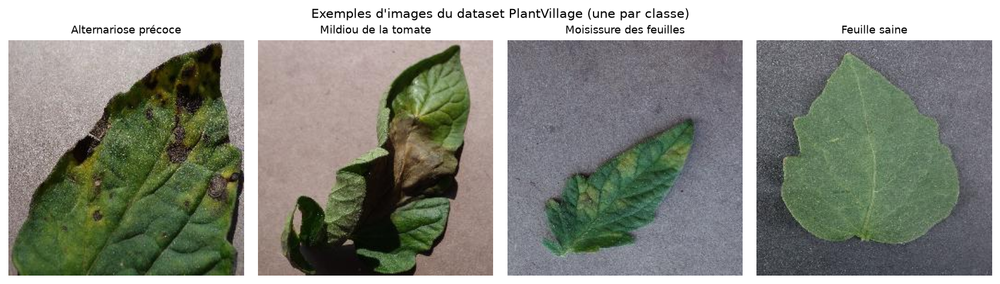

*Figure 1 — Exemples d'images du dataset (une par classe).*

### 7.3 Contrôle qualité

Avant toute utilisation, chaque fichier a été vérifié :

- ouverture et décodage complet par Pillow : **0 image illisible** sur 5 452 ;
- vérification des dimensions : toutes les images sont en 256 × 256 pixels, en RGB ;
- calcul d'une empreinte **MD5** pour chaque fichier : **14 doublons exacts** ont été
  détectés (même image présente plusieurs fois dans le dataset).

Les doublons détectés ne sont pas supprimés, car ils correspondent à des images
légitimement présentes dans leur classe. En revanche, ils sont **regroupés** lors du
découpage afin qu'une même image ne puisse jamais se retrouver simultanément dans
l'ensemble d'entraînement et dans l'ensemble de test.

### 7.4 Découpage des données

Le découpage est réalisé par classe (stratifié), avec la graine aléatoire **42** pour
garantir la reproductibilité, selon les proportions 70 % / 15 % / 15 % :

| Ensemble | Rôle | Images |
| --- | --- | --- |
| Entraînement | Apprentissage des poids | 3 811 |
| Validation | Suivi, Early Stopping, sélection du modèle | 821 |
| Test | Évaluation finale, jamais utilisé pendant l'entraînement | 820 |

*Tableau 4 — Rôle et taille des trois ensembles.*

La répartition détaillée par classe est la suivante :

| Classe | Entraînement | Validation | Test |
| --- | --- | --- | --- |
| Alternariose précoce | 700 | 150 | 150 |
| Mildiou de la tomate | 1 334 | 288 | 287 |
| Moisissure des feuilles | 666 | 143 | 143 |
| Feuille saine | 1 111 | 240 | 240 |
| **Total** | **3 811** | **821** | **820** |

*Tableau 5 — Découpage stratifié détaillé par classe.*

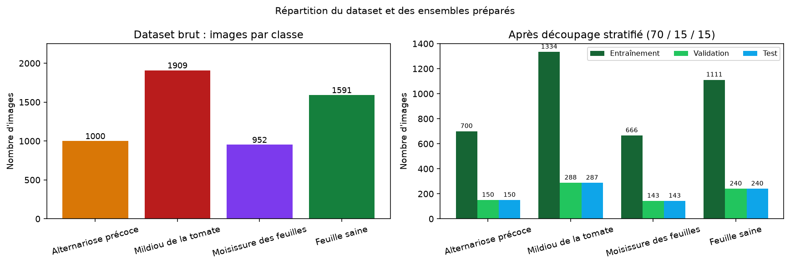

*Figure 2 — Répartition des images par classe, avant et après découpage.*

### 7.5 Garanties contre la fuite de données

La fuite de données (*data leakage*) est l'une des erreurs les plus fréquentes en
apprentissage automatique : si des images très similaires se trouvent à la fois dans
l'entraînement et dans le test, les performances mesurées sont artificiellement
optimistes. Trois mesures ont été prises :

1. **découpage au niveau des fichiers, avant tout calcul de statistiques** ;
2. **regroupement des doublons exacts** dans un même ensemble ;
3. **absence totale d'utilisation du test** pendant l'entraînement et la sélection du
   modèle (le test n'est chargé que par `training/evaluate.py`).

### 7.6 Limites du dataset

- **Images de laboratoire** : les feuilles sont photographiées sur un fond uniforme,
  souvent gris, avec un éclairage contrôlé. Les performances mesurées ne peuvent pas être
  transposées directement à des photos prises au champ.
- **Une seule culture** : le modèle ne connaît que la tomate.
- **Pas de niveau de gravité** : seules les classes sont étiquetées, pas le stade de la
  maladie.
- **Regroupement par feuille** : le dépôt fournit des métadonnées de regroupement par
  feuille (*leaf grouping*) que nous n'avons pas exploitées ; des images d'une même
  feuille sous des angles légèrement différents peuvent donc se retrouver dans deux
  ensembles. C'est une limite reconnue, qui plaide pour une évaluation future plus
  stricte.
- **Quatre classes sur trente-huit** : les autres maladies de la tomate (septoriose,
  brûlure bactérienne, virus de l'enroulement jaune, tache cible, etc.) sont hors
  périmètre et seront de toute façon classées dans l'une des quatre catégories.

## 8. Prétraitement et Data Augmentation

### 8.1 Pipeline de prétraitement

Le prétraitement est **strictement identique** pendant l'entraînement et pendant la
prédiction. Il est centralisé dans `utils/preprocessing.py`, utilisé à la fois par les
scripts d'entraînement et par l'application Flask.

| Étape | Opération | Justification |
| --- | --- | --- |
| 1 | Ouverture et conversion en RGB | Uniformise les images (PNG avec transparence, niveaux de gris, etc.) |
| 2 | Application de l'orientation EXIF | Corrige les photos de smartphone |
| 3 | Redimensionnement en 224 × 224 | Taille d'entrée attendue par MobileNetV2 |
| 4 | Conversion en tableau `float32` | Format numérique attendu par Keras |
| 5 | Normalisation `x / 127.5 - 1` | Ramène les valeurs dans [-1, 1], convention MobileNetV2 |

*Tableau 6 — Pipeline de prétraitement des images.*

La normalisation utilisée reproduit exactement
`tensorflow.keras.applications.mobilenet_v2.preprocess_input`. Un test automatisé
(`tests/test_preprocessing.py`) vérifie cette équivalence numériquement, ce qui garantit
l'absence de décalage de distribution entre l'entraînement et l'inférence : c'est un
point où de nombreux projets échouent silencieusement.

### 8.2 Data Augmentation

La Data Augmentation génère des variantes des images d'entraînement afin d'augmenter la
diversité apparente du dataset et de réduire le sur-apprentissage. Les transformations
retenues sont volontairement modérées, car les images PlantVillage sont déjà cadrées et
centrées :

| Transformation | Paramètre | Effet recherché |
| --- | --- | --- |
| Rotation | ±5 % (≈ ±18°) | Robustesse à l'orientation de la feuille |
| Zoom | ±10 % | Robustesse à la distance de prise de vue |
| Retournement horizontal | aléatoire | Invariance gauche/droite |
| Luminosité | ±15 % | Robustesse aux conditions d'éclairage |
| Translation | ±5 % | Robustesse au cadrage |

*Tableau 7 — Transformations de Data Augmentation.*

Ces couches sont appliquées **uniquement** au jeu d'entraînement et sont inactives à
l'inférence. Elles ne font pas partie du modèle sauvegardé : le prétraitement de
prédiction reste donc simplement « redimensionnement + normalisation ».

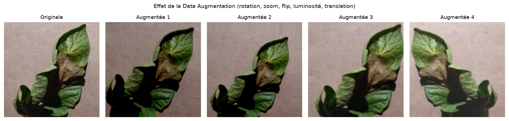

*Figure 3 — Exemples de variantes générées par la Data Augmentation sur une même image.*

### 8.3 Gestion du déséquilibre des classes

Deux mécanismes complémentaires ont été mis en place :

1. **poids de classes** lors de la phase 1 : chaque classe reçoit un poids inversement
   proportionnel à son effectif (mildiou ≈ 0,72 ; alternariose ≈ 1,36 ; moisissure
   ≈ 1,43 ; feuille saine ≈ 0,86) ;
2. **métriques par classe** dans l'évaluation, afin de ne pas masquer une classe
   défavorisée par une bonne accuracy globale.

## 9. Architecture du modèle proposé

### 9.1 Vue d'ensemble

Le modèle est construit en Keras selon l'enchaînement suivant :

1. entrée de forme 224 × 224 × 3 ;
2. base **MobileNetV2** pré-entraînée sur ImageNet, sans couche de classification
   (`include_top=False`) ;
3. **GlobalAveragePooling2D** : agrège les 7 × 7 × 1 280 cartes en un vecteur de 1 280 ;
4. **Dropout (0,2)** ;
5. **Dense(128, activation ReLU)** : couche de caractéristiques spécifiques au problème ;
6. **Dropout (0,3)** ;
7. **Dense(4, activation Softmax)** : distribution de probabilités sur les quatre classes.

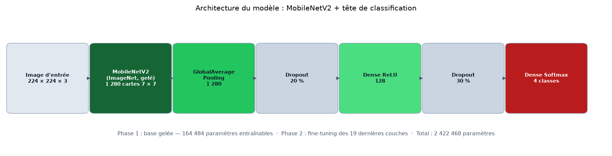

*Figure 4 — Architecture du modèle : base MobileNetV2 et tête de classification.*

### 9.2 Détail des couches et des paramètres

| Bloc | Type | Sortie | Paramètres |
| --- | --- | --- | --- |
| Entrée | InputLayer | 224 × 224 × 3 | 0 |
| Base | MobileNetV2 (ImageNet) | 7 × 7 × 1 280 | 2 257 984 |
| Agrégation | GlobalAveragePooling2D | 1 280 | 0 |
| Régularisation | Dropout (0,2) | 1 280 | 0 |
| Classification | Dense (ReLU) | 128 | 163 968 |
| Régularisation | Dropout (0,3) | 128 | 0 |
| Sortie | Dense (Softmax) | 4 | 516 |
| **Total** | | | **2 422 468** |

*Tableau 8 — Détail des couches et du nombre de paramètres.*

Les 2 257 984 paramètres de la base sont **gelés** en phase 1 : seuls 164 484 paramètres
sont alors entraînables, soit moins de 7 % du total. Cette réduction drastique explique
la rapidité de convergence observée.

### 9.3 Choix de la fonction de perte et de l'optimiseur

- **Perte** : `categorical_crossentropy`, adaptée à un encodage one-hot des étiquettes
  (les images sont chargées avec `label_mode="categorical"`).
- **Optimiseur** : Adam, avec un learning rate de 1e-3 en phase 1 puis 1e-5 en phase 2.
- **Métrique suivie** : accuracy, complétée par la perte de validation pour l'Early
  Stopping et la réduction du learning rate.

Le choix d'Adam se justifie par sa robustesse et sa convergence rapide sans réglage fin
du pas, ce qui est adapté à un projet où le nombre d'expériences possibles est limité par
le temps de calcul.

## 10. Configuration et processus d'entraînement

### 10.1 Hyperparamètres

| Paramètre | Valeur |
| --- | --- |
| Taille d'image | 224 × 224 × 3 |
| Batch size | 32 |
| Époques maximales (phase 1) | 15 (configuration : 30) |
| Époques maximales (phase 2) | 8 (configuration : 15) |
| Learning rate phase 1 | 1e-3 |
| Learning rate phase 2 | 1e-5 |
| Couches dégelées | 19 (30 dernières couches, BatchNormalization exclues) |
| Perte | Categorical crossentropy |
| Optimiseur | Adam |
| Graine aléatoire | 42 |
| Early Stopping | patience 5 sur `val_loss`, restauration des meilleurs poids |
| Model Checkpoint | sauvegarde si `val_accuracy` s'améliore |
| ReduceLROnPlateau | facteur 0,5, patience 2, learning rate minimal 1e-6 |

*Tableau 9 — Hyperparamètres d'entraînement.*

> **Remarque sur le budget d'époques.** Le nombre maximal d'époques prévu par la
> configuration est de 30 (phase 1) et 15 (phase 2). L'expérience présentée ici a été
> exécutée avec un budget réduit (15 + 8 époques) car elle a été réalisée sur un
> processeur à deux cœurs, sans GPU : chaque époque dure environ 90 secondes. Ce budget
> reste suffisant pour observer la convergence, comme le montrent les courbes.

### 10.2 Environnement d'exécution

| Élément | Valeur |
| --- | --- |
| Processeur | 2 cœurs (x86-64, AVX2) |
| Mémoire | 16 Go |
| GPU | aucun |
| Système | Linux (Ubuntu 24.04) |
| Python | 3.12 |
| TensorFlow | 2.21 (version CPU) |
| Durée phase 1 | 23,4 minutes (15 époques) |
| Durée phase 2 | 14,3 minutes (8 époques) |
| Durée totale | ≈ 38 minutes |

*Tableau 10 — Environnement d'exécution de l'expérience.*

### 10.3 Déroulement de la phase 1

La base MobileNetV2 est gelée et seules les couches de classification apprennent. Dès la
première époque, l'accuracy de validation atteint **86,2 %**, ce qui illustre la qualité
des caractéristiques ImageNet. La progression est rapide : 89,40 % à l'époque 2, 91,84 %
à l'époque 3, puis un maximum de **94,52 % dès l'époque 4**. La validation oscille ensuite
entre 91 % et 94,5 % jusqu'à la fin de la phase.
Le learning rate est réduit automatiquement à 5e-4 puis 2,5e-4 et 1,25e-4, sans gain
supplémentaire sur la validation : le modèle commence à plafonner.

### 10.4 Déroulement de la phase 2 (fine-tuning)

Les 19 dernières couches de la base sont dégelées et ré-entraînées avec un learning rate
de 1e-5. Après une légère dégradation initiale (92,8 % à l'époque 16), la validation
remonte progressivement. Les époques 21 et 22 apportent les meilleurs résultats :

- époque 18 : 92,81 % ;
- époque 20 : 94,76 % ;
- époque 21 : 94,52 % ;
- **époque 22 : 95,98 %** (meilleur modèle retenu) ;
- époque 23 : 94,52 % (légère baisse, non conservée).

Le fine-tuning apporte donc un gain réel de **+1,46 point** d'accuracy de validation par
rapport au meilleur modèle de la phase 1 (94,52 % → 95,98 %). Le meilleur modèle est
sauvegardé automatiquement dans `models/best_model.keras`, avec la contrainte de ne
jamais remplacer un modèle de phase 1 par un modèle de phase 2 moins bon
(`initial_value_threshold`).

### 10.5 Suivi et reproductibilité

Tous les paramètres, comptages, durées et versions de bibliothèques sont enregistrés dans
`models/training_config.json`. L'historique complet des époques est conservé dans
`results/metrics/training_history.json` et `results/metrics/training_log.csv`. La graine
42 est fixée pour Python, NumPy et TensorFlow. Le découpage des données est lui aussi
déterministe. Ces précautions permettent de rejouer l'expérience dans des conditions
comparables.

## 11. Développement de l'application Web

### 11.1 Objectifs et architecture générale

L'application Web constitue la couche de restitution du projet : elle doit rendre le
modèle utilisable par une personne qui ne connaît rien à l'apprentissage automatique.
Elle a été conçue selon une architecture en trois couches :

1. **couche de présentation** : templates Jinja2, HTML5, CSS3, Bootstrap 5, JavaScript
   natif et Chart.js ;
2. **couche applicative** : Flask, validation des entrées, routage, API JSON, gestion des
   erreurs ;
3. **couche métier** : prédicteur Keras (chargé une seule fois), base SQLite pour
   l'historique, utilitaires de prétraitement.

Chaque responsabilité est isolée dans un module distinct, ce qui facilite la maintenance
et les tests :

| Module | Responsabilité |
| --- | --- |
| `config.py` | chemins, hyperparamètres, paramètres de sécurité |
| `app.py` | routes, API, gestion des erreurs, rendu des templates |
| `utils/preprocessing.py` | pipeline d'image partagé entraînement / inférence |
| `utils/predictor.py` | chargement unique du modèle et prédiction |
| `utils/database.py` | accès SQLite (une seule couche qui parle SQL) |
| `utils/helpers.py` | validation des fichiers, métadonnées, formatage |

*Tableau 11 — Modules du projet et responsabilités.*

### 11.2 Pages et fonctionnalités

| Page | Route | Contenu principal |
| --- | --- | --- |
| Tableau de bord | `/` | compteurs, état du modèle, classes, répartition, dernières analyses |
| Analyse | `/analyse` | dépôt d'image, aperçu, prédiction, probabilités, description |
| Détail d'analyse | `/analyse/<id>` | image, classe, confiance, probabilités, symptômes |
| Historique | `/historique` | tableau des analyses, suppression, accès aux détails |
| Maladies | `/maladies` | fiches des quatre classes avec exemples et prévention |
| À propos | `/a-propos` | contexte, méthodologie, architecture, limites, références |

*Tableau 12 — Pages de l'application et routes associées.*

**Tableau de bord.** Il affiche le nombre total d'analyses, la confiance moyenne, les
analyses de la semaine, le nombre de classes, l'état de chargement du modèle, la
répartition des prédictions sous forme de graphique en anneau et les cinq dernières
analyses. C'est la page d'accueil : elle doit donner en un coup d'œil une idée du
fonctionnement et de l'activité du système.

*Figure 5 — Tableau de bord : présentation du projet et état du système (affichage mobile).*

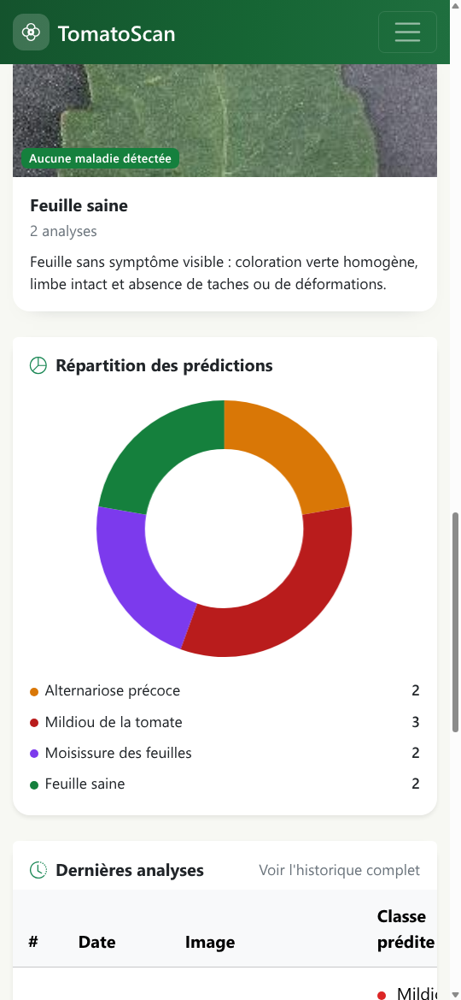

*Figure 6 — Tableau de bord : répartition des classes prédites sous forme de graphique.*

**Page d'analyse.** L'utilisateur dépose une image par glisser-déposer ou par sélection
de fichier. Un aperçu s'affiche immédiatement, avant toute analyse, accompagné du nom et
de la taille du fichier. Le bouton « Lancer l'analyse » déclenche un appel asynchrone
(`fetch`) vers `/api/analyser`, sans rechargement de page, avec un indicateur de
chargement (spinner) pendant l'inférence.

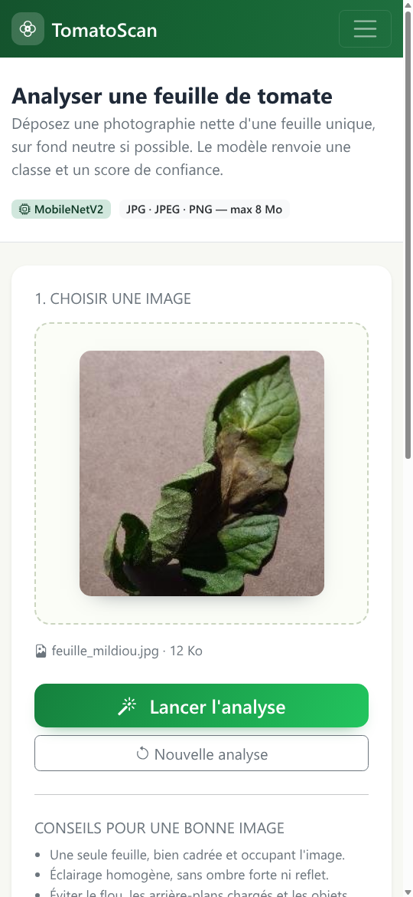

*Figure 7 — Page d'analyse : aperçu de l'image avant lancement de la prédiction.*

Le résultat présente la classe prédite, un résumé de la maladie, le pourcentage de
confiance, la durée de l'inférence, un graphique en barres des quatre probabilités, la
liste détaillée des scores, la description de la maladie et ses symptômes
caractéristiques. L'utilisateur peut relancer une analyse ou consulter la fiche
complète de l'analyse enregistrée.

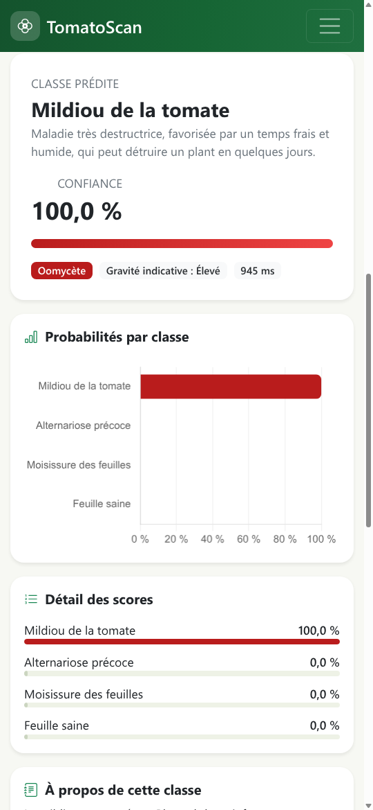

*Figure 8 — Résultat d'une analyse : classe prédite, confiance et distribution des
probabilités.*

**Historique.** Les analyses sont conservées dans une base SQLite et affichées dans un
tableau trié par date décroissante : identifiant, date et heure, nom de l'image, maladie
prédite, score de confiance, accès au détail et suppression. La suppression est protégée
par une fenêtre de confirmation et efface également le fichier image associé.

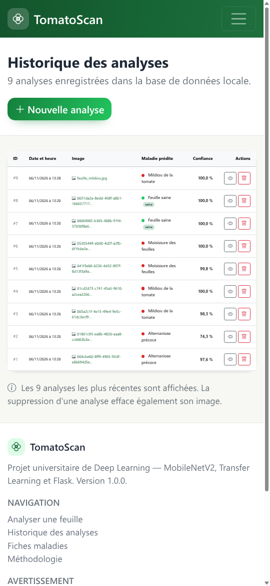

*Figure 9 — Historique des analyses enregistrées dans la base SQLite.*

**Fiches maladies.** Chaque classe est présentée avec trois images d'exemple issues du
dataset, une description, les symptômes visuels caractéristiques, des conseils de
prévention et une mention des confusions possibles. Cette page rappelle explicitement que
le périmètre est limité à quatre catégories.

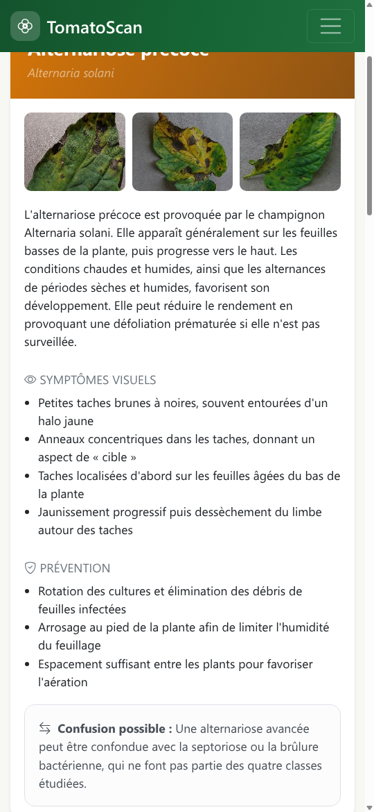

*Figure 10 — Fiche maladie : description, symptômes et prévention.*

**À propos.** Cette page documente le contexte scientifique, la problématique, les
objectifs, l'architecture, les technologies, la configuration réelle du modèle et ses
limites. Elle contribue à la posture honnête du projet.

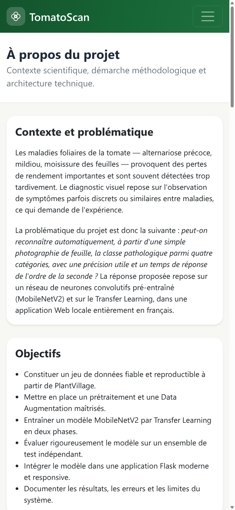

*Figure 11 — Page « À propos » : contexte, objectifs et méthodologie.*

### 11.3 API JSON

L'application expose une API simple, utilisée par le frontend et exploitable par un
script :

| Méthode | Route | Rôle |
| --- | --- | --- |
| POST | `/api/analyser` | téléversement + prédiction + enregistrement |
| GET | `/api/historique` | liste des analyses au format JSON |
| DELETE | `/api/historique/<id>` | suppression d'une analyse et de son image |
| GET | `/api/statistiques` | statistiques agrégées |
| GET | `/sante` | sonde de disponibilité (modèle chargé, nombre de classes) |

*Tableau 13 — Points d'entrée de l'API JSON.*

La réponse de `/api/analyser` contient la classe, le nom français, la confiance, les
quatre probabilités triées, la durée d'inférence, l'URL de l'image et le lien vers la
fiche détaillée. En cas d'erreur, un code HTTP approprié (400, 404, 413, 500, 503) est
renvoyé avec un message compréhensible en français.

### 11.4 Base de données

L'historique est stocké dans une base SQLite unique, créée automatiquement au premier
lancement. Le schéma est volontairement minimal :

| Colonne | Type | Rôle |
| --- | --- | --- |
| `id` | INTEGER (PK) | identifiant de l'analyse |
| `nom_stocke` | TEXT | nom aléatoire du fichier sur le serveur (UUID) |
| `nom_original` | TEXT | nom d'origine assaini, pour l'affichage |
| `classe_predite` | TEXT | classe retournée par le modèle |
| `confiance` | REAL | probabilité de la classe prédite (0 à 1) |
| `probabilites` | TEXT | distribution complète au format JSON |
| `modele` | TEXT | nom du fichier modèle utilisé |
| `duree_ms` | INTEGER | durée de l'inférence en millisecondes |
| `created_at` | TEXT | horodatage ISO 8601 |

*Tableau 14 — Schéma de la table `analyses`.*

Toutes les requêtes utilisent des paramètres liés (`?`), ce qui élimine les risques
d'injection SQL. Aucune donnée personnelle n'est stockée : ni adresse IP, ni identifiant
utilisateur.

### 11.5 Sécurité et robustesse

Les mesures suivantes ont été mises en œuvre :

- **validation des extensions** contre une liste blanche (`.jpg`, `.jpeg`, `.png`) ;
- **vérification du type MIME** déclaré par le navigateur ;
- **décodage réel du fichier** par Pillow : une image corrompue ou un fichier renommé
  est rejeté, l'extension seule ne suffit pas ;
- **taille maximale** de 8 Mo, appliquée par Flask (`MAX_CONTENT_LENGTH`) et par le
  frontend ;
- **dimensions maximales** de 4 000 pixels et taille minimale de 32 pixels ;
- **renommage systématique** par UUID : aucun nom fourni par l'utilisateur n'est utilisé
  pour construire un chemin ;
- **ré-encodage en JPEG RGB** : neutralise les métadonnées et les charges utiles cachées ;
- **service des images** via une route validant un motif strict
  (`^[0-9a-f]{32}\.jpg$`), ce qui empêche toute traversée de répertoire ;
- **aucun chemin interne** renvoyé par l'API ; les erreurs techniques sont journalisées
  côté serveur et remplacées par un message générique ;
- **chargement unique du modèle** au démarrage (singleton protégé par un verrou), et non
  à chaque requête ;
- **gestion explicite** des erreurs 404, 413, 500 et du cas « modèle absent » (503).

### 11.6 Choix d'interface et accessibilité

L'interface utilise une palette verte et rouge évoquant le végétal et la tomate, des
cartes arrondies, des transitions discrètes et une typographie lisible. Les éléments
interactifs possèdent un état de focus visible, la zone de dépôt est utilisable au clavier
(`tabindex` et gestion des touches Entrée/Espace), les images ont un texte alternatif et
les graphiques portent un label ARIA. Bootstrap 5 assure la responsivité : sur mobile, la
navigation se replie et les cartes passent sur une colonne.

Bootstrap, Bootstrap Icons et Chart.js sont **embarqués localement** dans
`static/vendor/`, ce qui permet une démonstration hors ligne, sans dépendance à un CDN.

### 11.7 Tests de l'application

Quarante-quatre tests automatisés (pytest) couvrent le prétraitement, les utilitaires, la
base de données et l'application. Ils incluent un parcours complet réel :
téléversement d'une image du jeu de test → prédiction par le vrai modèle → enregistrement
→ consultation de l'historique et du détail → suppression → vérification de la
disparition en base et sur le disque. Les tests vérifient également le refus d'un fichier
non-image, d'une extension interdite, d'un dépassement de taille et d'un nom de fichier
malveillant.

## 12. Résultats expérimentaux

### 12.1 Protocole

L'évaluation est réalisée par `training/evaluate.py` sur les **820 images de l'ensemble
de test**, jamais utilisées pendant l'entraînement ni pendant la sélection du modèle. Le
script charge `models/best_model.keras`, applique exactement le prétraitement décrit en
section 8, calcule les prédictions par lots, puis dérive l'ensemble des métriques avec
scikit-learn. Les figures et les fichiers CSV sont générés automatiquement.

### 12.2 Courbes d'apprentissage

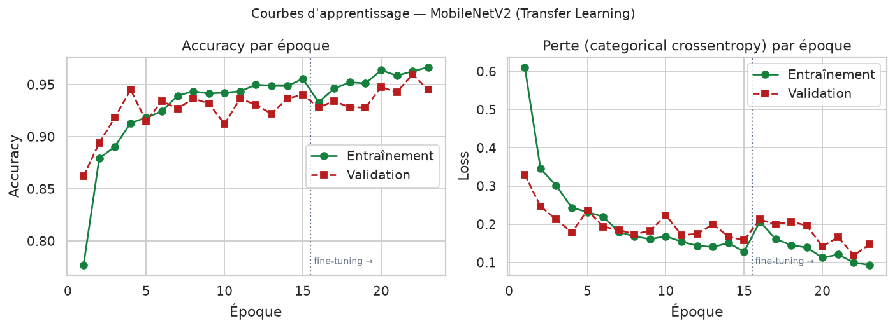

*Figure 12 — Courbes d'apprentissage : accuracy et perte, entraînement et validation,
avec la séparation entre phase 1 et fine-tuning (ligne pointillée).*

L'accuracy d'entraînement progresse régulièrement de 77,7 % à 96,7 %. L'accuracy de
validation atteint rapidement 94,5 %, puis le fine-tuning permet de franchir la barre des
95 % à l'époque 22 (**95,98 %**). La perte de validation descend de 0,33 à 0,12. L'écart
final entre entraînement (96,7 %) et validation (95,98 %) reste modéré, ce qui indique
un sur-apprentissage limité.

### 12.3 Métriques globales sur le test

| Métrique | Valeur |
| --- | --- |
| Accuracy | **95,85 %** |
| Precision (macro) | 95,47 % |
| Recall (macro) | 95,25 % |
| F1-score (macro) | **95,34 %** |
| Precision (pondérée) | 95,83 % |
| Recall (pondéré) | 95,85 % |
| F1-score (pondéré) | 95,82 % |
| Images de test | 820 |
| Images mal classées | 34 (4,15 %) |

*Tableau 15 — Métriques globales du modèle sur l'ensemble de test.*

L'accuracy de 95,85 % signifie que 786 images sur 820 ont été correctement classées. La
faible différence entre les moyennes macro (95,34 %) et pondérée (95,82 %) indique que
les performances sont relativement homogènes entre classes : le modèle n'a pas sacrifié
les classes minoritaires au profit des classes majoritaires.

### 12.4 Performances par classe

| Classe | Precision | Recall | F1-score | Support | Bien classées |
| --- | --- | --- | --- | --- | --- |
| Alternariose précoce | 93,66 % | 88,67 % | 91,10 % | 150 | 133 |
| Mildiou de la tomate | 96,15 % | 95,82 % | 95,99 % | 287 | 275 |
| Moisissure des feuilles | 94,52 % | 96,50 % | 95,50 % | 143 | 138 |
| Feuille saine | 97,56 % | 100,00 % | 98,77 % | 240 | 240 |
| **Macro** | **95,47 %** | **95,25 %** | **95,34 %** | 820 | 786 |

*Tableau 16 — Métriques détaillées par classe.*

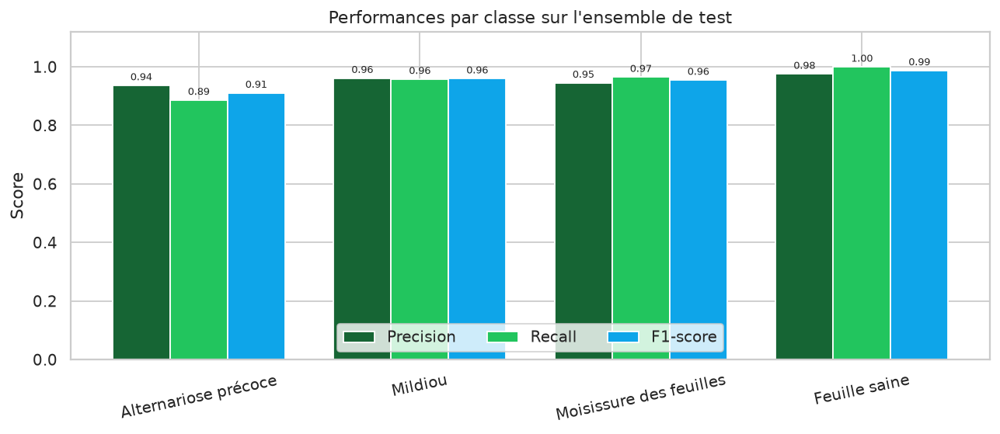

*Figure 13 — Precision, recall et F1-score pour chacune des quatre classes.*

Trois observations se dégagent :

1. **La classe « feuille saine » est parfaitement détectée** (rappel de 100 %). Aucune
   feuille saine n'a été classée comme malade, ce qui est le comportement souhaité pour un
   outil d'alerte : pas de fausse alerte sur un feuillage sain.
2. **L'alternariose précoce est la classe la plus difficile** (F1 = 91,10 %, rappel de
   88,67 %) : 17 feuilles sur 150 lui échappent, dont 9 classées comme mildiou. Ces deux
   maladies produisent des taches brunes et leur ressemblance visuelle est bien connue en
   agronomie.
3. **Le mildiou et la moisissure** obtiennent des scores élevés (F1 ≈ 96 %), cohérents
   avec leurs signatures visuelles plus marquées (lésions humides, duvet olive).

### 12.5 Matrice de confusion

| Réel \\ Prédit | Alternariose | Mildiou | Moisissure | Saine |
| --- | --- | --- | --- | --- |
| **Alternariose** | **133** | 9 | 4 | 4 |
| **Mildiou** | 6 | **275** | 4 | 2 |
| **Moisissure** | 3 | 2 | **138** | 0 |
| **Saine** | 0 | 0 | 0 | **240** |

*Tableau 17 — Matrice de confusion (effectifs) sur les 820 images de test.*

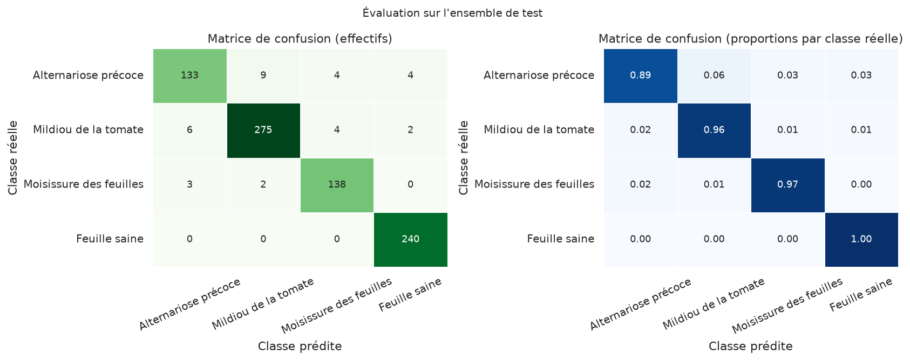

*Figure 14 — Matrice de confusion en effectifs (à gauche) et en proportions par classe
réelle (à droite).*

La lecture par ligne est la plus instructive : 88,7 % des alternarioses sont correctement
identifiées, 95,8 % des mildious, 96,5 % des moisissures et 100 % des feuilles saines. La
diagonale est nettement dominante, ce qui traduit un modèle globalement fiable. Les
erreurs se concentrent sur la frontière alternariose / mildiou, avec 15 confusions croisées
(9 + 6), soit près de la moitié des 34 erreurs totales.

### 12.6 Analyse des erreurs

| Indicateur | Valeur |
| --- | --- |
| Erreurs totales | 34 / 820 (4,15 %) |
| Confiance moyenne sur les prédictions correctes | 97,52 % |
| Confiance moyenne sur les erreurs | 70,23 % |
| Confiance médiane globale | 99,95 % |
| Confusion la plus fréquente | Alternariose → Mildiou (9 cas) |

*Tableau 18 — Statistiques de confiance et principales confusions.*

La confiance moyenne des erreurs (70,2 %) est très inférieure à celle des prédictions
correctes (97,5 %) : le modèle « sait » en partie qu'il hésite. C'est un signal utile pour
l'utilisateur et un argument en faveur de l'affichage de la distribution complète des
probabilités plutôt que d'une classe unique.

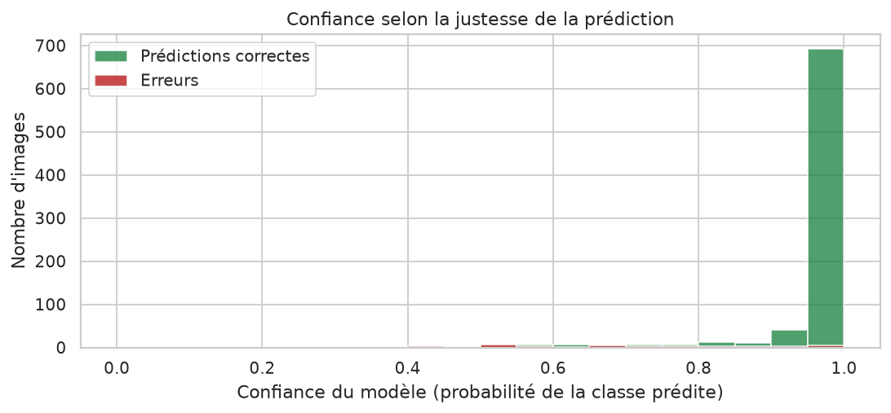

*Figure 15 — Distribution de la confiance selon que la prédiction est correcte ou non.*

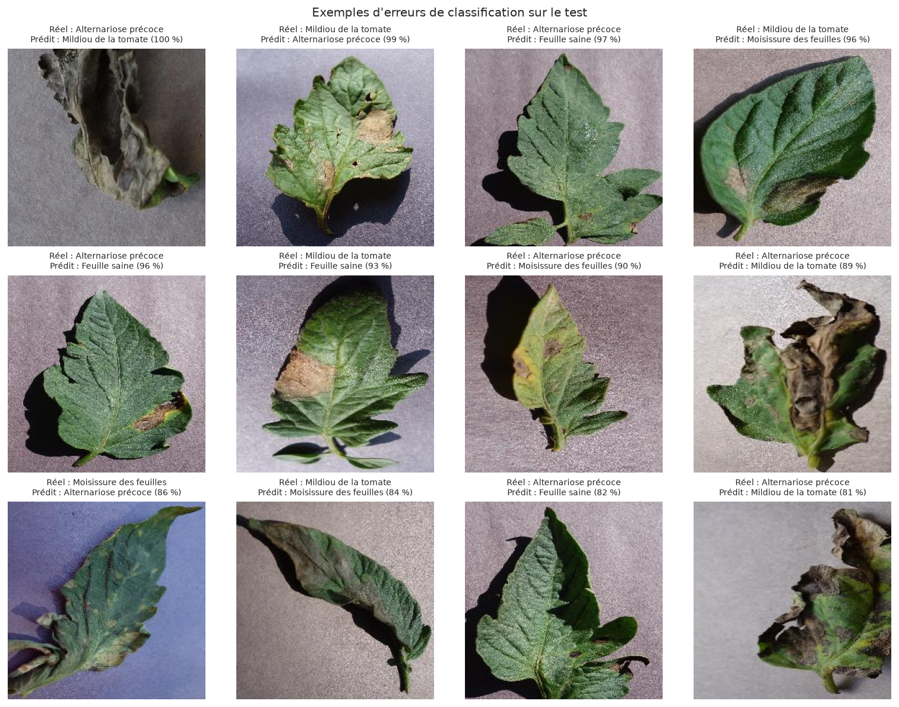

*Figure 16 — Exemples d'images mal classées : classe réelle, classe prédite et confiance.*

La planche d'erreurs montre que les images mal classées sont souvent des cas ambigus :
lésions peu contrastées, feuille partiellement floue, ou symptômes mélangés. Certaines
images annotées « alternariose précoce » présentent des taches sombres étendues qui
évoquent visuellement le mildiou. Ces erreurs ne relèvent donc pas uniquement d'une
faiblesse du modèle, mais aussi de la frontière floue entre deux pathologies.

### 12.7 Temps d'inférence

| Contexte | Durée observée |
| --- | --- |
| Première requête (chargement + échauffement) | ≈ 880 ms |
| Requêtes suivantes (modèle en mémoire) | 68 – 80 ms |
| Batch d'évaluation (16 images) | ≈ 1,2 s, soit ≈ 75 ms par image |

*Tableau 19 — Temps d'inférence mesurés sur le processeur de test.*

Le chargement unique du modèle au démarrage permet de répondre en moins de 100 ms par
image, ce qui rend l'expérience fluide dans le navigateur. La première requête est plus
lente en raison de l'initialisation des graphes TensorFlow.

## 13. Évaluation et interprétation des métriques

### 13.1 Lecture critique de l'accuracy

Une accuracy de 95,85 % sur un jeu de test indépendant est un résultat solide pour un
projet réalisé sans GPU et avec un budget d'époques réduit. Il faut néanmoins rappeler
qu'un tel chiffre n'a de sens que replacé dans son contexte :

- le test provient de la **même distribution** que l'entraînement (même dataset, même
  protocole de prise de vue), ce qui facilite la tâche ;
- la classe majoritaire représente 35 % du test ; un classifieur naïf atteindrait déjà
  environ 35 % d'accuracy, et un modèle prédisant toujours « mildiou » obtiendrait 35 % ;
- les 820 images de test sont peu nombreuses à l'échelle des variations possibles d'une
  feuille de tomate malade.

L'accuracy est donc un indicateur de faisabilité, pas une garantie de performance sur le
terrain.

### 13.2 Cohérence entre les métriques

Les quatre métriques macro sont comprises entre 95,25 % et 95,47 %, avec un F1 de
95,34 %. Cette homogénéité signifie que le modèle n'est pas seulement bon sur les classes
majoritaires : il conserve un bon rappel sur la moisissure (143 images seulement) et sur
l'alternariose (150 images). Les poids de classes et la Data Augmentation ont
probablement contribué à cet équilibre.

La precision (95,47 %) est légèrement supérieure au recall (95,25 %) : le modèle commet
un peu plus de faux négatifs que de faux positifs. Dans un contexte de détection de
maladie, ce compromis est discutable : manquer une feuille malade (faux négatif) peut
être plus coûteux que signaler à tort une feuille saine. Un ajustement du seuil de
décision, ou une pondération plus forte des classes malades, pourrait être envisagé.

### 13.3 Interprétation des confusions

Les confusions observées sont **biologiquement cohérentes** :

- **alternariose → mildiou (9 cas)** : les deux maladies produisent des taches brunes
  irrégulières ; à un stade avancé, l'alternariose perd ses anneaux concentriques et
  ressemble au mildiou ;
- **mildiou → alternariose (6 cas)** : symétrique du cas précédent, souvent sur des
  lésions jeunes ou des images peu contrastées ;
- **alternariose → feuille saine (4 cas)** : taches rares ou très petites, insuffisantes
  pour déclencher la classe malade ;
- **mildiou → moisissure (4 cas)** et **alternariose → moisissure (4 cas)** : images
  présentant des plages jaunies communes aux deux pathologies.

Aucune confusion n'implique la classe « feuille saine » en sortie : le modèle ne prend
jamais une feuille malade pour une feuille saine de manière significative (2 cas de
mildiou classés sains au maximum). C'est un point rassurant pour un usage d'alerte.

### 13.4 Calibration et sur-confiance

La confiance médiane (99,95 %) est très élevée, et 100 % des feuilles saines du test sont
prédites avec une confiance proche de 1. Les réseaux de neurones modernes sont connus pour
être **mal calibrés** : leurs probabilités softmax sont souvent trop tranchées. Un score
de 100 % ne signifie donc pas une certitude absolue, mais une forte activation du modèle.

L'écart de confiance entre prédictions correctes (97,5 %) et erreurs (70,2 %) montre que
la confiance reste informative. Une perspective d'amélioration serait d'appliquer une
**température scaling** ou une calibration de Platt sur l'ensemble de validation, afin de
produire des probabilités plus réalistes.

### 13.5 Positionnement par rapport à la littérature

Mohanty et al. (2016) rapportent des accuracies supérieures à 99 % sur PlantVillage avec
des architectures comme AlexNet et GoogLeNet, sur l'ensemble des 38 classes et avec un
protocole d'entraînement bien plus long. Nos 95,85 % sur 4 classes ne sont pas directement
comparables : le périmètre est plus restreint, le budget d'entraînement beaucoup plus
faible (23 époques, CPU) et le découpage différent. Le résultat confirme néanmoins la
tendance de fond de la littérature : sur PlantVillage, les CNN pré-entraînés atteignent
une précision élevée avec un effort d'entraînement modéré.

## 14. Discussion des résultats

### 14.1 Apport du Transfer Learning

La progression observée valide l'intérêt du Transfer Learning :

| Étape | Accuracy de validation |
| --- | --- |
| Époque 1 (base gelée) | 86,24 % |
| Meilleure phase 1 (époque 4) | 94,52 % |
| Meilleure phase 2 (époque 22) | **95,98 %** |

*Tableau 20 — Progression de la validation au fil de l'expérience.*

Atteindre 86 % dès la première époque, avec seulement 164 484 paramètres entraînables,
aurait été impossible avec un réseau initialisé aléatoirement. Le gain du fine-tuning
(+1,46 point) est plus modeste mais réel : il montre que les filtres profonds de
MobileNetV2, initialement spécialisés sur ImageNet, bénéficient d'un ajustement aux
textures de feuilles.

### 14.2 Variabilité et sensibilité aux hyperparamètres

La courbe de validation est irrégulière (oscillations de ±2 points entre époques
voisines). Trois facteurs expliquent cette variabilité :

1. la taille limitée du jeu de validation (821 images, soit environ 26 lots de 32) ;
2. l'application aléatoire de la Data Augmentation, qui modifie la difficulté des lots ;
3. le déséquilibre des classes, partiellement compensé par les poids de classes.

Un usage plus stable serait obtenu avec une validation croisée à k plis, plus coûteuse en
temps de calcul mais beaucoup plus robuste pour estimer la performance réelle.

### 14.3 Coût de calcul et pertinence de MobileNetV2

Le modèle complet ne pèse que 2,4 millions de paramètres et environ 24 Mo sur disque. Une
époque d'entraînement dure 90 secondes sur deux cœurs, et une prédiction 70 ms. Ces
chiffres confirment que MobileNetV2 est un choix adapté à un déploiement local, sur un
ordinateur portable ou un mini-serveur, sans GPU ni service cloud. Un modèle plus profond
(ResNet-50, EfficientNet-B3) aurait probablement apporté quelques points supplémentaires
mais au prix d'un temps d'entraînement multiplié par 5 à 10 dans notre environnement.

### 14.4 Qualité des données versus complexité du modèle

Le principal facteur limitant n'est pas la capacité du modèle mais la **nature des
données**. Les images PlantVillage sont prises en laboratoire, sur fond uniforme, avec une
feuille unique et un éclairage contrôlé. Sur des photographies de terrain (feuillage
dense, arrière-plan complexe, ombres, reflets, flou de bougé), les performances chuteraient
très probablement. Améliorer le dataset (images de terrain, plusieurs feuilles par image,
conditions variées) serait plus rentable que complexifier l'architecture.

### 14.5 Enseignements méthodologiques

Ce projet illustre plusieurs principes importants :

- **l'identité du prétraitement** entre entraînement et inférence est critique : elle est
  ici garantie par un module unique et vérifiée par un test ;
- **la prévention des fuites** (doublons, split) conditionne la validité des métriques ;
- **le suivi de la validation** (Early Stopping, checkpoint) évite de conserver un modèle
  dégradé : sans `initial_value_threshold`, le modèle final aurait été moins bon que
  celui de la phase 1 ;
- **l'analyse des erreurs** apporte plus d'information que l'accuracy globale : elle
  révèle les frontières ambiguës entre maladies.

## 15. Limites et perspectives d'amélioration

### 15.1 Limites du système actuel

**Limites liées aux données**

- quatre classes seulement, alors que PlantVillage en compte 38 et que la tomate connaît
  une dizaine de maladies foliaires courantes ;
- images de laboratoire, non représentatives des conditions de terrain ;
- déséquilibre entre classes (952 à 1 909 images) ;
- absence de regroupement par feuille (*leaf grouping*), qui peut laisser passer des
  quasi-doublons entre ensembles ;
- jeu de test de 820 images, insuffisant pour une estimation à ±0,5 point près.

**Limites liées au modèle**

- une seule architecture et un seul protocole testés, faute de temps de calcul ;
- pas de validation croisée ;
- probabilités mal calibrées (sur-confiance) ;
- pas d'explicabilité intégrée : l'utilisateur ne voit pas quelles zones de la feuille ont
  motivé la décision ;
- pas de détection d'image hors domaine (une photo de fleur serait classée dans une des
  quatre catégories).

**Limites liées à l'application**

- pas d'authentification ni de comptes utilisateurs : l'historique est partagé ;
- pas de déploiement en production (serveur de développement Flask) ;
- base SQLite adaptée à un usage local, non à un usage multi-utilisateurs intensif ;
- interface en français uniquement.

### 15.2 Perspectives techniques

1. **Explicabilité (Grad-CAM)** : produire une carte de chaleur des zones discriminantes,
   superposée à l'image, afin de renforcer la confiance de l'utilisateur et de détecter
   les décisions fondées sur des artefacts.
2. **Détection d'inconnu** : ajouter un seuil de rejet ou une classe « autre » entraînée
   sur des images hors domaine, pour éviter de classer n'importe quelle image.
3. **Calibration des probabilités** : température scaling sur l'ensemble de validation.
4. **Validation croisée** à 5 plis pour une estimation plus fiable des performances.
5. **Comparaison d'architectures** : MobileNetV3, EfficientNet-B0, ResNet-50, avec le même
   protocole, pour objectiver le compromis précision / coût.
6. **Quantification et export** : conversion du modèle en TensorFlow Lite (INT8) ou ONNX
   pour un déploiement mobile.
7. **Augmentation plus agressive et adaptée** : mélange d'images (*MixUp*, *CutMix*),
   simulation d'ombres et de fonds variés, pour préparer le passage au terrain.
8. **Suivi d'expériences** : intégration de MLflow ou de TensorBoard pour comparer
   systématiquement les runs.

### 15.3 Perspectives applicatives

- ajout d'un compte utilisateur et d'un historique personnel ;
- export PDF d'un rapport d'analyse ;
- prise de photo directe depuis le smartphone (API `getUserMedia`) ;
- mode hors-ligne complet avec un modèle quantifié exécuté dans le navigateur
  (TensorFlow.js) ;
- extension à d'autres cultures (pomme de terre, vigne, pommier) ;
- interface multilingue.

## 16. Conclusion générale

Ce projet avait pour objectif de concevoir un système complet de détection et de
classification des maladies de la feuille de tomate, depuis la donnée brute jusqu'à une
application Web utilisable. Cet objectif a été atteint : un modèle MobileNetV2 adapté par
Transfer Learning a été entraîné sur 3 811 images, évalué sur 820 images indépendantes, et
intégré dans une application Flask en français.

Les résultats expérimentaux sont les suivants :

- **accuracy de 95,85 %** sur l'ensemble de test ;
- **F1-score macro de 95,34 %**, avec des performances homogènes entre les quatre classes
  (de 91,10 % à 98,77 %) ;
- **34 erreurs sur 820 images**, concentrées sur la frontière entre alternariose précoce
  et mildiou, deux maladies visuellement proches ;
- **temps d'inférence d'environ 70 ms** par image, compatible avec une utilisation
  interactive ;
- un modèle compact de **2,4 millions de paramètres**, entraînable et exécutable sans GPU.

Au-delà des chiffres, le projet apporte plusieurs contributions méthodologiques : un
découpage rigoureux sans fuite de données, un prétraitement strictement identique entre
entraînement et inférence (vérifié par un test), une évaluation complète avec matrice de
confusion et analyse d'erreurs, une application sécurisée et testée, et une documentation
qui distingue clairement ce qui a été mesuré de ce qui reste hypothétique.

Le système ne constitue pas un diagnostic agricole. Il s'agit d'un outil expérimental
d'aide à la reconnaissance visuelle, dont les limites sont explicites : quatre classes,
images de laboratoire, absence d'explicabilité et de détection d'inconnu. Les perspectives
identifiées — Grad-CAM, calibration, validation croisée, données de terrain, quantification
— tracent un chemin réaliste vers un outil plus robuste et réellement utilisable sur le
terrain.

Sur le plan pédagogique, ce projet a permis de mettre en pratique l'ensemble de la chaîne
d'un projet de Deep Learning : préparation et audit des données, choix d'architecture,
Transfer Learning, régularisation, évaluation critique, intégration applicative, tests et
documentation. Il illustre une idée essentielle : la performance d'un modèle dépend moins
de sa complexité que de la qualité des données, de la rigueur du protocole et de
l'honnêteté de l'interprétation.

## 17. Références bibliographiques

1. Hughes, D. P., & Salathé, M. (2015). *An open access repository of images on plant
   health to enable the development of mobile disease diagnostics*. arXiv:1511.08060.
2. Mohanty, S. P., Hughes, D. P., & Salathé, M. (2016). Using deep learning for
   image-based plant disease detection. *Frontiers in Plant Science*, 7, 1419.
   https://doi.org/10.3389/fpls.2016.01419
3. Sandler, M., Howard, A., Zhu, M., Zhmoginov, A., & Chen, L.-C. (2018). MobileNetV2:
   Inverted residuals and linear bottlenecks. *Proceedings of the IEEE Conference on
   Computer Vision and Pattern Recognition (CVPR)*, 4510–4520.
4. Howard, A. G., Zhu, M., Chen, B., Kalenichenko, D., Wang, W., Weyand, T., Andreetto,
   M., & Adam, H. (2017). *MobileNets: Efficient convolutional neural networks for mobile
   vision applications*. arXiv:1704.04861.
5. LeCun, Y., Bengio, Y., & Hinton, G. (2015). Deep learning. *Nature*, 521(7553),
   436–444.
6. LeCun, Y., Bottou, L., Bengio, Y., & Haffner, P. (1998). Gradient-based learning
   applied to document recognition. *Proceedings of the IEEE*, 86(11), 2278–2324.
7. Krizhevsky, A., Sutskever, I., & Hinton, G. E. (2012). ImageNet classification with
   deep convolutional neural networks. *Advances in Neural Information Processing
   Systems (NeurIPS)*, 25, 1097–1105.
8. He, K., Zhang, X., Ren, S., & Sun, J. (2016). Deep residual learning for image
   recognition. *Proceedings of the IEEE Conference on Computer Vision and Pattern
   Recognition (CVPR)*, 770–778.
9. Simonyan, K., & Zisserman, A. (2015). *Very deep convolutional networks for
   large-scale image recognition*. arXiv:1409.1556.
10. Szegedy, C., Liu, W., Jia, Y., Sermanet, P., Reed, S., Anguelov, D., Erhan, D.,
    Vanhoucke, V., & Rabinovich, A. (2015). Going deeper with convolutions.
    *Proceedings of the IEEE Conference on Computer Vision and Pattern Recognition
    (CVPR)*, 1–9.
11. Pan, S. J., & Yang, Q. (2010). A survey on transfer learning. *IEEE Transactions on
    Knowledge and Data Engineering*, 22(10), 1345–1359.
12. Shorten, C., & Khoshgoftaar, T. M. (2019). A survey on image data augmentation for
    deep learning. *Journal of Big Data*, 6(1), 60.
13. Kingma, D. P., & Ba, J. (2015). *Adam: A method for stochastic optimization*.
    arXiv:1412.6980.
14. Rumelhart, D. E., Hinton, G. E., & Williams, R. J. (1986). Learning representations
    by back-propagating errors. *Nature*, 323(6088), 533–536.
15. Srivastava, N., Hinton, G., Krizhevsky, A., Sutskever, I., & Salakhutdinov, R. (2014).
    Dropout: A simple way to prevent neural networks from overfitting. *Journal of
    Machine Learning Research*, 15(1), 1929–1958.
16. Selvaraju, R. R., Cogswell, M., Das, A., Vedantam, R., Parikh, D., & Batra, D. (2017).
    Grad-CAM: Visual explanations from deep networks via gradient-based localization.
    *Proceedings of the IEEE International Conference on Computer Vision (ICCV)*,
    618–626.
17. Chollet, F. (2021). *Deep Learning with Python* (2ᵉ édition). Manning Publications.
18. Abadi, M. et al. (2016). TensorFlow: A system for large-scale machine learning.
    *12th USENIX Symposium on Operating Systems Design and Implementation (OSDI)*,
    265–283.

[[PAGEBREAK]]

## Annexe — Ressources du projet

| Ressource | Emplacement |
| --- | --- |
| Code source complet | dépôt Git du projet |
| Notebook d'expérimentation | `notebooks/plant_disease_training.ipynb` |
| Script de téléchargement du dataset | `training/download_dataset.py` |
| Préparation et découpage | `training/prepare_data.py` |
| Entraînement | `training/train.py` |
| Évaluation et figures | `training/evaluate.py` |
| Prédiction en ligne de commande | `training/predict.py` |
| Modèle entraîné | `models/best_model.keras` |
| Configuration et comptages | `models/training_config.json` |
| Métriques détaillées | `results/metrics/evaluation.json` |
| Rapport de classification | `results/metrics/classification_report.txt` |
| Figures | `results/figures/` |
| Prédictions et erreurs | `results/predictions/` |
| Tests automatisés | `tests/` |
